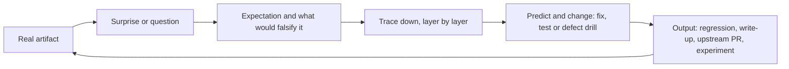

# Start from the running system

Huy's workflow since [D046](context/decision-log.md#d046-production-backward-learning-replaces-mastery-gates): **real artifact → surprise → trace down the layers → predict and change it → ship an output**. A trace starts from something that runs (a live call, an incident, a cost, a verifier verdict, or production code read as the source of truth) and stops at the layer where Huy can predict the behavior and change it on purpose. There are no mastery gates; the [trace log](docs/05-mastery-tracker.md) records what was traced and what it produced.

**VI:** Không học hết nền tảng rồi mới làm. Bắt đầu từ thứ đang chạy, thấy chỗ lạ thì đào xuống từng tầng: code của mình, thư viện, giao thức, serving, model, kernel, phần cứng, toán. Dừng khi em tự đoán trước và tự sửa được, rồi tạo ra một thứ dùng được.

The [October 11 research and mentoring audit](research/mentoring-operating-model-2026-10-11.md) and the [mentoring skill — local-only](docs/github-snapshot.md#omitted-local-evidence) remain useful for bilingual explanations from first principles. [H0 foundations through production](study/packets/H0-first-principles-to-production.md) is background on state, authority, partial failure and finite capacity, to open when a trace reaches those ideas.

1. Read [current state](context/current-state.md) and [implementation coverage](capstone/08-implementation-coverage.md).
2. Follow the [build-ordered route](docs/02-mastery-learning-plan.md#build-ordered-route-2026-10-14) for what ships next and which decision Huy owns. The next artifact is the G1 live call. Before it, the S0 [prediction file](study/sessions/2026-10-14-H0-live-G1-prediction.md) stays as Huy's own pre-registration; Huy can drop it by saying so.
3. When a trace reaches our code, use the [code-reading guide](docs/06-reference-code-reading-guide.md) as the concept/source/test map.
4. When a trace reaches a concept, open its H-module in the [concept reference](docs/02-mastery-learning-plan.md) or a [packet](study/packets).
5. Run the reference using the commands in [README](README.md) when a local reproduction helps.
6. Write one [trace note](study/templates/session-note.md) in `study/sessions/` and one row in the [trace log](docs/05-mastery-tracker.md).

**VI:** Phần nào AI làm thì ghi là AI làm; phần em tự hiểu và tự viết thì ghi là của em. Hai thứ này không trộn vào nhau.

One trace, as a shape rather than a quota:

Start with one ownership token, one dispatch, one edit and one verifier receipt. Later follow one token through Q/K/V, the offset causal mask, probabilities, output and cache state. GPU code has CPU references; CUDA performance needs the actual accelerator. [Compute guide](compute/README.md).

**VI:** “Under the hood” phải có boundary rõ: database transaction không bao gồm network; tool intent không đồng nghĩa effect đã xảy ra; tensor shape không chứng minh kernel nào đã chạy. Mỗi lớp cần đúng phép quan sát của nó.

Use [AGENTS.md](AGENTS.md) for ongoing preferences, [the learning plan](docs/02-mastery-learning-plan.md) for the build-ordered route and the H0–H15 concept reference, and [the decision log](context/decision-log.md) for why the implementation sequence changed.

For an engineering request, follow [the current dependency slices](capstone/07-reference-implementation-spec.md#ordered-implementation-slices) and [coverage](capstone/08-implementation-coverage.md). The first NVIDIA slice is a CPU RMSNorm correctness reference; later GPU, profiler and data work have separate gates. A request to continue learning resumes the current trace. NVIDIA work does not displace required hackathon delivery.

The current engineering map is [the readiness dependency plan](research/system-readiness-plan-2026-10-11.md). The skills chain is capture → broker receipt → accepted-request disclosure → typed post-turn checkpoint → fresh-owner continuation. Follow [the exact recovery trace](docs/06-reference-code-reading-guide.md#skills-recovery-pre-request-state-post-turn-state-and-a-fresh-owner). The source request's membership, post-turn loaded membership and the next owner's capability are different objects.

For operations, use the [offline service](ops/runbooks/offline-service.md), [journal reconciliation](ops/runbooks/environment-reconciliation.md) and [trusted GPU probe](ops/runbooks/trusted-gpu-probe.md) runbooks. A trusted GPU probe is prepared for later authorized hardware qualification; generated GPU code and production serving require additional implementation and measurements. [The release index](releases/README.md) records installed evidence separately. The first production trace starts from the G1 live call ([build-ordered route](docs/02-mastery-learning-plan.md#build-ordered-route-2026-10-14)). Live calls are enabled for the hackathon path within a frozen ceiling ([D042](context/decision-log.md#d042-live-execution-enabled-for-the-hackathon-path)).

**VI:** Bắt đầu học bằng một load receipt và hai request: request trước chưa có body, checkpoint sau đã có, owner mới phải chứng minh lại quyền. Đừng nhảy sang GPU chỉ vì code probe đã có; trace hiện tại bắt đầu từ call live G1.

The next delivered hackathon preparation seam is [offline provider qualification](ops/runbooks/provider-qualification.md): prepare → once-only native mock probe → validated report → exact prepared-repair handoff. [Current verification](research/provider-qualification-verification-2026-10-11.json) and [installed rc4](releases/README.md) bind this evidence. Study its [identity and liability trace](docs/06-reference-code-reading-guide.md#provider-qualification-manifest-receipt-and-authority) within H0/H4/H9/H12/H15. Actual G1/G2 and public G5 remain open; the handoff cannot authorize execution.
