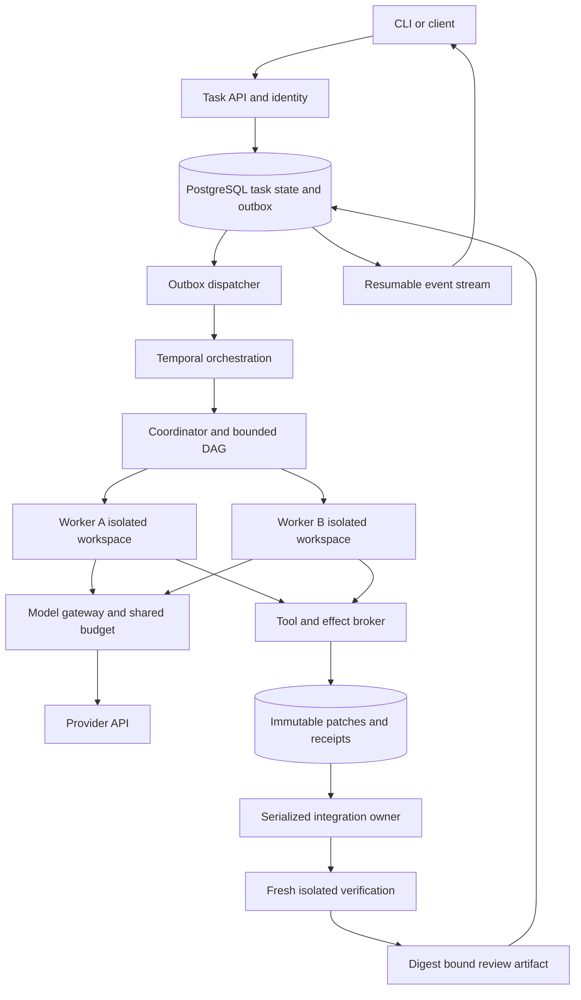
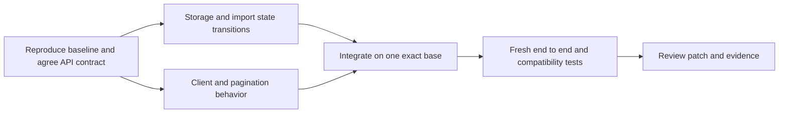
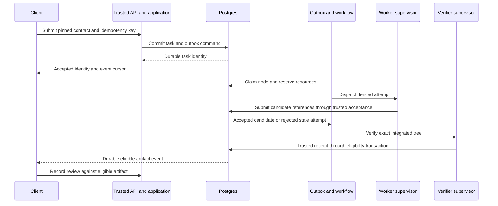

# System specification for a durable coding agent service

Design date: **8 October 2026**. This specification chooses a concrete capstone architecture from the broader learning curriculum. It is an implementation proposal informed by public systems, not a claim to reproduce a frontier company's private stack. API inference is the default; no production deployment is established by this plan.

**Design status:** proposed architecture with explicit unresolved configuration decisions. `MUST` below defines a capstone acceptance requirement, not an achieved property. This document owns product boundaries, component interfaces and trust. [02](02-runtime-contracts-and-recovery.md) owns transactional runtime semantics; [03](03-evaluation-serving-and-efficiency.md) owns research and operations measurements; [04](04-build-sequence-and-mastery-gates.md) owns learning/design/build gates; [06](06-target-role-and-research-contract.md) owns the job-to-evidence mapping. Resolve conflicts in the owning document and update its consumers before implementation.

**VI:** Ta học cách giải cùng loại bài toán mà các công ty frontier gặp: model không chắc chắn, tool có side effect, network có retry, task kéo dài và code phải được kiểm chứng. Không cần sao chép mọi thành phần nội bộ để nghiên cứu đúng cơ chế.

## Product contract and scope

The [NVIDIA specialization](07-reference-implementation-spec.md#ordered-implementation-slices) is a bounded workload extension of this product. Its initial NV-S0 CPU numerical reference runs outside task execution and cannot create acceptance evidence. Later CUDA recipes must explicitly satisfy the existing isolation, identity, budget and independent-verifier requirements; the hackathon Python recipe/default remains unchanged.

The first supported workload is a scoped bug fix, refactor, or feature in a Python repository with a reproducible Linux build and automated tests. Input is a repository identity and immutable base revision, task requirements, acceptance contract, allowed capabilities, deadline, and aggregate resource budget. Output is a candidate patch against that base, resulting tree digest, verification receipts, limitations, and a trace. Return a review artifact; merge and deployment are separate operations with separate authority.

The initial operating scope is one developer team with explicit repository access. Exercise two synthetic tenants to test access separation before calling the system suitable for broader use. Begin with one active task; then test four active tasks with at most two patch workers per task. These are proposed workload limits for the first capacity experiment, not achieved capacity or permanent architecture constants. A provider concurrency limit can reduce runnable model calls below the worker count.

**VI:** Một task dài cần giới hạn rõ hơn một chat ngắn: được sửa repo nào, “đúng” nghĩa gì, tiêu tối đa bao nhiêu, và khi nào phải dừng. Khả năng tổng quát sẽ đến từ thay workload có kiểm chứng, không phải bỏ hết ràng buộc ngay từ đầu.

## First principles and the six boundaries

The [selected career/research target](06-target-role-and-research-contract.md) adds one bounded research profile for 1/2/4 patch workers. The service default remains two workers. The higher profile is available only after isolation/recovery evidence, declared physical capacity and total budgets permit it; it is not demonstrated production capacity. The same state, authority and verification boundaries apply.

**VI:** Ta dùng cùng hệ thống để nghiên cứu scaling. Không tạo swarm hay stack thứ hai; chỉ đổi một biến trong run manifest đã khóa và đo tác động trong phạm vi thực nghiệm.

The environment can change without the model seeing it; the model can produce a valid-looking but incorrect action; a process can die between an effect and its receipt. Therefore, completion must be a relation between **requirements, exact artifact, environment, and evidence**, while authority and ownership must be enforced outside generated text. The agent is a feedback controller: observe evidence, propose action, admit action under policy, execute, observe again. Its memory is distributed across durable records and immutable artifacts; a prompt is only one working view.

| Boundary | Input → output | Owner and invariant | First defect to plant |
|---|---|---|---|
| Intent → durable task | Authenticated request → task generation | API/database: same tenant/key/input identifies one submission | Retry submission with changed body |
| Task → authorized attempt | Ready DAG node → lease, epoch, budget reservation | Scheduler: one accepted owner per node epoch | Old worker returns after reassignment |
| Model → effect | Completed typed call → broker receipt | Broker: policy/schema/authority checked at execution | Partial JSON or repo instruction asks for secret |
| History → next context | Durable evidence → bounded model request | Harness: constraints and unresolved effects survive projection | Summary loses a required compatibility condition |
| Workers → integrated candidate | Base-bound patches → exact resulting tree | Integrator: serialize accepted integration and invalidate stale evidence | Two cleanly applying patches disagree on an API |
| Candidate → review artifact | Exact tree + immutable grader → receipt | Verifier/release gate: candidate cannot author its own pass record | Passing old tree reused after another edit |

**VI:** Mỗi hàng là một chỗ phải hỏi “ai được quyền ghi sự thật?”. Agent có thể đề xuất task đã xong, nhưng không được tự sửa receipt của verifier. Worker có thể tiếp tục chạy sau khi mất lease, nhưng output của nó không còn quyền trở thành kết quả chính thức.

## Architecture and storage ownership



PostgreSQL owns task status, authority, generation, node ownership, budget liability and accepted artifact references. Temporal owns orchestration history, timers and activity scheduling. Neither storage system creates an atomic transaction with the other: an outbox plus idempotent handlers reconciles the boundary. Workers may upload immutable evidence into their authorized namespace, but only a fenced application transaction accepts it as current. Large tool output belongs in artifact storage; database and workflow histories carry references and hashes.

The execution environment has a different lifetime from the conversation. Recovering a task may mean provisioning a fresh environment from a pinned image and applying a checkpoint, rather than reviving the old machine. This separation follows the public design direction described by [Anthropic Managed Agents](https://www.anthropic.com/engineering/managed-agents) and [Cursor's cloud-agent lessons](https://cursor.com/blog/cloud-agent-lessons); the exact storage and authority choices here are ours.

**VI:** Temporal không thay thế domain database, và Postgres không tự điều phối một workflow dài. Hai hệ có trách nhiệm khác nhau. Thiết kế cần chứng minh được trường hợp “DB đã commit, workflow chưa nhận” mà không mất task hoặc chạy effect hai lần.

## Agent roles and communication

| Role | Allowed output | Limits |
|---|---|---|
| Coordinator/planner | Versioned DAG, node contracts, bounded replanning decisions | Cannot expand user scope or mark final verification passed |
| Repository investigator | Revision-bound files, symbols, constraints and reproduction evidence | Start read-only; include provenance and uncertainty |
| Patch worker A/B | Candidate patch, local test receipts, handoff manifest | Own isolated workspace; no production/publishing credentials |
| Integrator | One coherent tree assembled from eligible candidates | Single accepted owner; changed tree requires new verification |
| Verifier | Structured results for exact tree/grader/environment identity | Protected tests and result channel; separate from candidate write authority |
| Review/release gate | Review artifact and eligibility decision | Does not grant authority to merge or deploy |

Investigator and integrator may be phases of the coordinator process. The verifier primarily runs deterministic checks; an LLM review is supplemental and separately labeled. Do not build a peer-to-peer chat swarm first. Messages are bounded records: requirement IDs, base revision, relevant evidence references, output schema, budget, deadline, unresolved assumptions, and dependency completion criteria. Schema validation checks structure; test/review checks truth.

Replan on evidence: failed prerequisite, newly discovered interface dependency, repeated no-progress attempts, or exhausted allowance. Version the DAG and invalidate descendants whose inputs changed. Count model/tool calls, unresolved failures, accepted tests, conflicts and spend; a growing message count is not progress. Use bounded attempts and an explicit unresolved outcome when the remaining task is infeasible under the current contract.

**VI:** Worker B không nên nhận “A nói đã xong”. Nó nên nhận “artifact digest X đáp ứng contract Y, nhưng giả định Z chưa được kiểm”. Graph có thể thay đổi, nhưng thay đổi phải tạo version mới để biết kết quả cũ còn hợp lệ với input mới hay không.

## A concrete hard task and its dependency graph

Reference task to provision at milestone M0: add resumable CSV imports to a small Python issue-tracking service, including duplicate-safe submission, cancellation, cursor pagination of progress, and compatibility with existing synchronous clients. The target repository and immutable baseline must be selected and locked at M0; this document does not invent a commit or claim the fixture already exists. Task requirements are bounded to the test service and use synthetic data.



Worker A changes storage/state transitions; worker B changes client/pagination using the same versioned interface contract. If B needs an interface that A has not yet fixed, B waits or works against an explicit stub whose integration is later verified. Both independently passing tests do not establish the integrated system's correctness. Interrupt A after a local edit, force context rollover, and attempt to return an old-epoch result after a replacement starts. The completed demonstration must recover without accepting stale evidence or declaring partial work complete.

This task exercises real software mechanisms and cross-component reasoning. Duration alone does not establish difficulty. The evaluation plan adds distinct repositories/tasks and keeps calibration, development and held-out evaluation separate. A staged 24-hour recovery exercise may include idle time; report active work, waiting time and context boundaries separately.

**VI:** Cái khó đến từ dependency và ràng buộc đồng thời: retry không tạo import trùng, cancel không phá state, API cũ vẫn dùng được. Chia file khác nhau chưa chắc độc lập vì cả hai có thể cùng dựa vào một contract sai.

## Technology decisions and deferred complexity

| Layer | Default choice for this capstone | Reason and reconsideration trigger |
|---|---|---|
| Harness/model adapter | Python, typed schemas, own small loop; SDK comparison adapter | Inspect context/tool semantics; compare SDK at matched task budget |
| API | FastAPI, streaming events backed by durable sequence IDs | Fast experiments; API process loss must not lose tasks |
| State | PostgreSQL with migrations and explicit transactions | Concurrent ownership, budget and artifact acceptance |
| Workflow | Temporal Python workflows and activities | Timers/replay/retries; keep model/network/tool calls in activities |
| Artifacts | S3-compatible object storage, content digests | Large immutable evidence; tenant-scoped access and retention |
| Execution | Dedicated disposable Linux environment per task/worker scope | Real process/network/resource boundaries; threat-model-driven hardening |
| Source integration | Git bases and candidate patches; serialized integration | Familiar inspectable semantics; optimize only measured bottlenecks |
| Telemetry | OpenTelemetry plus structured task/evaluation records | Trace the critical path and correlate costs/failures |
| Inference | One pinned provider/model first | Remove GPU-fleet complexity from initial product experiment |
| Optional serving study | One pinned vLLM or SGLang deployment | Requires trace replay and a cost/quality/latency hypothesis |

These are project choices, not a vendor-stack inventory. Pin dependencies, image digests, provider model identifiers and configuration in a run manifest; avoid floating `latest` in reproducible experiments. A Git worktree is change isolation, not an OS security boundary. Linux containment experiments on this Mac need a Linux VM environment. Multi-tenant exposure requires demonstrated isolation and operations gates, not just a container label.

**VI:** API-backed service vẫn là production serving: phải xử lý queue, quota, timeout, backpressure và chi phí. Self-host GPU là một bài toán khác phía dưới model gateway. Tách hai bài toán giúp định vị bottleneck trước khi chọn học kernel hay thêm GPU.

## Proposed implementation map and ownership

The following tree is a **future repository layout**, not existing executable code. Create it only as milestones require; keep the working teaching lab separate.

```text
service/
  api/             submission, auth, event stream, cancellation
  domain/          task, DAG, action, candidate, verification contracts
  storage/         transactions, migrations, outbox, budget ledger
  workflows/       deterministic orchestration, timers, continuation
  harness/         context projection, adapter, stream assembly, control loop
  execution/       sandbox lifecycle, policy broker, bounded tool I/O
  integration/     base checks, patch application, candidate acceptance
  verification/    protected grader dispatcher and structured receipts
  telemetry/       trace propagation, cost and latency accounting
evals/
  manifests/       pinned tasks and workload definitions
  runners/         fresh environments, fault injection, paired trials
  reports/         run-derived results and confidence intervals
ops/
  runbooks/        provider outage, worker loss, backlog, restore, rollback
```

Keep authoritative state changes narrow and testable. The current lab's [action intent and result journal](../lab/harness.py#L35) provides a small reference for the crash problem; it does not implement distributed leases, a persistent model conversation, protected verification, or hostile-code isolation. Read the [runtime design](02-runtime-contracts-and-recovery.md) before promoting any lab mechanism into a service guarantee.

**VI:** Dòng code trong lab là điểm bắt đầu để nhìn invariant. Bản production phải thêm concurrency, authority và recovery đúng theo contract; đổi SQLite thành Postgres mà giữ nguyên mọi giả định single-process là chưa đủ.

## Engineering requirements and acceptance boundaries

The system transforms an authenticated request into an independently checkable software artifact. Four constraints determine its design: model proposals are uncertain; messages can repeat or arrive late; execution consumes finite resources; evidence describes a particular artifact at a particular time. Each requirement below has a single primary implementation boundary and a failure that can invalidate it. Passing a demonstration establishes only its tested scope.

| ID | The service MUST | Primary boundary | Distinguishing acceptance case |
|---|---|---|---|
| SYS-01 | Bind an authorized submission to immutable scope, repository base, acceptance contract and resource envelope | Task API and registry | Same tenant/key/body returns the same task; changed body conflicts; an unauthorized repository never dispatches |
| SYS-02 | Accept model actions only after a complete protocol event, schema validation and current policy admission | Harness and broker | Fragmented arguments, duplicate completion and prompt-injected tool names cannot create extra effects |
| SYS-03 | Run candidate code within an enforced Linux resource and access boundary | Execution supervisor | Candidate cannot read service credentials, write protected grader assets or exceed declared process/output limits |
| SYS-04 | Persist intent, effect uncertainty and fenced acceptance across every enumerated crash window | Domain storage and workflow bridge | A late old owner cannot make a new accepted candidate; an ambiguous remote action remains unresolved |
| SYS-05 | Preserve authoritative constraints and evidence provenance across context and machine replacement | Checkpoint and context projection | A fresh worker reconstructs the next permitted action; stale file evidence must be refreshed |
| SYS-06 | Schedule a versioned, bounded dependency graph with isolated patch workspaces | Coordinator and scheduler | A dependency change invalidates affected descendants; an unconfirmed old sandbox retains its physical slot |
| SYS-07 | Verify the exact integrated candidate in a fresh environment through a protected result channel | Integrator and verifier | Branch tests or a passing receipt for another tree cannot authorize eligibility |
| SYS-08 | Enforce task/tenant/service resource admission and preserve uncertain liabilities | Budget and capacity services | Concurrent claims cannot overspend; a timeout cannot free potentially billed capacity or money without evidence |
| SYS-09 | Produce reconstructible task, action, cost and decision records | Event and artifact stores | The final artifact can be traced to requirements, inputs, ownership, receipts and all incurred work |
| SYS-10 | Run experiments under a frozen protocol that includes failures and exposes resource differences | Evaluation runner | Bare baseline, candidate N=1 and candidate N=2/4 remain distinguishable in results |
| SYS-11 | Operate within a demonstrated load envelope with explicit overload, cancellation, restore and rollback behavior | Service operations | Rejected work is visible; accepted work survives API loss; restore retains evidence relationships |
| SYS-12 | Support independent reproduction and an intelligible research decision | Manifest, report and review interfaces | Another person can rerun a frozen experiment and challenge a conclusion from raw evidence |

**VI:** Requirement mạnh phải có tình huống cụ thể làm nó sai. Ví dụ “reliable” quá mơ hồ; “worker cũ không thể accept artifact sau khi epoch đổi” chỉ rõ state, authority và phép thử. SYS là hợp đồng sản phẩm; RT, EV và OP trong tài liệu tiếp theo mô tả cách kiểm nó ở từng tầng.

## Component interfaces and the critical data path

Logical interfaces are defined before process placement. Start with a small control-plane deployment and separate trusted supervisors from candidate execution; split services only when load, isolation or fault evidence requires it. A worker is an execution role, not permission to access the database. Typed domain commands pass through trusted application code, which owns transactions.

| Producer → consumer | Required input | Durable output and admission condition |
|---|---|---|
| Client → task API | Identity, repository grant, idempotency key, task contract | Task ID, generation and request digest committed together with outbox intent |
| Workflow → coordinator | Task generation, graph version, accepted dependency references, remaining envelope | Proposed DAG update; application validates acyclicity, bounds and current generation before acceptance |
| Scheduler → worker supervisor | Node contract, attempt/epoch, input artifacts, expiring capability, resource reservation | Sandbox handle and attempt record; resource admission precedes provisioning |
| Harness → model gateway | Provider-compatible context, tool schema version, model config, request/dispatch IDs, output cap | Response/protocol artifacts and usage receipt; reserve each potentially billable dispatch first |
| Harness → tool broker | Complete typed action, input digest, ownership tuple, scoped capability | Intent and bounded observation references; recheck authority at the effect boundary |
| Worker → candidate acceptance | Patch and manifest references, base/tree identities, node/attempt/epoch | Accepted immutable candidate reference or explicit stale/invalid rejection |
| Integrator → verifier supervisor | Reconstructed tree, integration manifest, protected grader/environment IDs | Trusted verification receipt bound to all identities and measured limits |
| Verifier → eligibility transaction | Passing receipt and exact current candidate, generation, authority | Eligibility record using the database decision-time rule in 02; caller timestamp cannot backdate it |
| Review gate → artifact API | Eligible artifact ID, fixed rubric, reviewer identity and review decision | Accepted/rejected review record with its own deadline; no new execution authorization |
| Evaluator → researcher | Frozen protocol and raw run references | Outcomes, uncertainty, resource accounting and decision memo with provenance |

Large model messages and tool output are blobs referenced from records. The context builder fetches only allowed, budgeted evidence; durable storage retains what reconstruction and declared retention require. No protocol assumes a prompt summary contains the entire task state. Provider-specific continuation artifacts stay in the adapter layer and are used only under that provider's supported compatibility rules.

**VI:** Một lần tool call đi qua hai loại kiểm tra: dữ liệu có đúng schema và actor hiện tại có quyền thực hiện không. JSON hợp lệ chỉ trả lời câu đầu. Hash của artifact xác định nội dung, nhưng bản thân hash không chứng minh ai đã tạo hay ai được quyền đọc.



Every arrow crossing a process boundary can be retried, delayed or lost. The runtime contract supplies the identity and reconciliation rule for each arrow. The diagram omits blob transport and model/tool substeps for readability; it grants no direct candidate access to PostgreSQL or the protected verifier channel.

**VI:** Đi từ trái sang phải không có nghĩa toàn bộ sequence là một transaction. Nếu API trả lời bị mất sau commit, client phải tìm lại task cũ; nếu candidate chưa được accept, blob đã upload vẫn chỉ là bằng chứng chưa được công nhận.

## External API behavior

The initial interface is a task API plus a small CLI. Version the API and schemas together. Authentication and tenant/repository authorization precede resource admission. Every read checks current artifact/task access; opaque IDs and content digests are identifiers, not bearer authorization. Log policy decisions without credential values.

| Endpoint | Request and normal result | Required exceptional behavior |
|---|---|---|
| `POST /v1/tasks` | Valid frozen contract and tenant-scoped `Idempotency-Key`; `202` with task ID, state, generation and event cursor after commit | `409` for same key with different canonical body; `422` unsupported profile/invalid contract; `429` tenant admission limit; `503` service unable to accept durably. Return retry guidance where meaningful |
| `GET /v1/tasks/{id}` | Current execution state, generation, eligible artifact, review state, resource exposure, last event cursor | Tenant-scoped absence/denial policy; never return another tenant's existence or payload |
| `GET /v1/tasks/{id}/events` | Resume from committed cursor containing service incarnation, task identity and sequence; replayable events with immutable event IDs and schema versions | Duplicates tolerated by clients; retention-expired or pre-restore-incarnation cursor returns `410` with an explicit reason and authorized snapshot route, never silently reuses a sequence for different events |
| `POST /v1/tasks/{id}/cancel` | Idempotent request ID; durable revocation acknowledgement with generation and cleanup status | Acknowledgement means new admission is fenced; it does not claim every process or external effect has stopped |
| `GET /v1/tasks/{id}/artifacts/{artifact_id}` | Authorized manifest/patch/receipt access with content digest | Verify task/tenant membership even for known digest; expired authorization cannot obtain a new download grant |
| `POST /v1/tasks/{id}/reviews` | Authorized reviewer, immutable eligible artifact, rubric/version, decision, idempotency key | Reject stale or withdrawn eligibility for release acceptance; allow labeled audit records under separate authority without restarting work |

Idempotent submission retries return the existing task, including terminal tasks, without reapplying current capacity admission as if it were a new submission. Authorization still applies. Concurrent creation with the same key is resolved by a unique database constraint and payload digest comparison. Reject oversized payloads before expensive parsing using a configured ingress bound. Secrets are resolved server-side from granted capabilities; they are never task-body fields. A task update that changes requirements, base, model treatment or resource ceiling creates a new immutable run identity and explicit lineage rather than mutating the treatment of an ongoing experiment.

**VI:** API “accepted” là lời hứa đã lưu được công việc, chưa phải lời hứa giải được bài. `cancel` cũng có hai thời điểm khác nhau: chặn quyền làm tiếp và xác nhận process đã dừng. User phải quan sát được cả hai để hiểu trạng thái thật.

## Schemas and revision identities

These are required semantic fields, not generated implementation classes. The runtime document owns SQL keys and state transitions. Use schema versions, UTC timestamps for audit, local monotonic durations for interval measurements, integer accounting units, and explicitly named digest algorithms. Define canonical byte encoding before hashing; do not rely on language-specific dictionary serialization.

| Record | Minimum content | Validity rule |
|---|---|---|
| `TaskContract` | tenant/repository/base IDs; task and requirement IDs; acceptance contract; capability policy; execution/review deadlines; model/harness/environment/config revisions; total resource envelope; profile; lineage | All execution-defining fields frozen before admission; optional fields have explicit defaults recorded in the manifest |
| `NodeContract` | graph version; node ID/type; requirement IDs; dependencies and accepted input digests; output schema; allowed paths; allowance; deadline; completion predicate | Graph acyclic and bounded; executable only when required inputs and authority remain current |
| `EvidenceRef` | tenant/task scope; artifact ID/digest; source repository revision and file/span digests where applicable; producing action/receipt; uncertainty/freshness metadata | New source revision requires validation before a claim is reused; untrusted prose cannot become an authoritative receipt |
| `CandidateManifest` | base; ordered patch chain; resulting tree ID; added-file manifest; requirements; input evidence; producing attempt/epoch; integration lineage | Trusted reconstruction must yield the declared tree; reject unsupported file types, path escapes and policy-violating changes |
| `VerificationReceipt` | supervisor identity; run/candidate/tree; grader/environment/contract digests; check results; trusted completion status; resource usage; observation times | Result arrives through protected authority; exit code or candidate-authored stdout alone cannot establish pass |
| `RestartManifest` | generation/graph; checkpoint artifact; accepted event offset; environment recipe; authority references; pending actions; unresolved liabilities; context projection version; next safe node | Commit only after referenced artifacts are durable; restore validates every reference and reacquires authority |
| `RunManifest` | task/sample split; treatment and policy; seeds where supported; all role configurations; envelope; admission/load context; protocol/analysis version | Evaluation validates required fields before dispatch; after-start deviations retained with the run |

For the initial text-code workload, pin one repository Git object format, reject submodules and policy-disallowed symlink changes, and identify the source tree by its Git tree object plus repository object format. Separately hash exported patch/archive bytes with SHA-256 and pin the reconstruction rules. A tree ID does not cover the execution image, untracked files or dependency resolution; those have their own manifest identities. The verifier reconstructs an allowlisted, normalized workspace and validates the candidate manifest before running tests. Broader file types need a deliberate contract extension and tests.

**VI:** `tree_hash` không đồng nghĩa “mọi thứ ảnh hưởng kết quả đã giống nhau”. Cùng source nhưng khác dependency hoặc environment vẫn có thể cho kết quả khác. Mỗi identity trả lời một câu riêng: code gì, được tạo từ đâu, chạy bằng môi trường nào và ai xác nhận.

## Threat model and operational authority

The initial adversary can control repository text, generated patches, tool stdout/stderr and processes inside a worker. Network loss, duplicate delivery, faulty models and compromised candidate code are in scope. Control-plane administrators and the selected provider are trusted dependencies; an administrator or provider compromise is outside the first capstone's assurance claim. Document that boundary when reporting isolation results.

| Surface | Enforced boundary | Required probe |
|---|---|---|
| Repository instructions and tool output | Data cannot grant capabilities, change the system policy or authorize new external effects | A file requesting credential access or tenant switching is denied at the broker |
| Candidate process | Dedicated constrained Linux environment; no host home, control sockets or provider/database/workflow credentials mounted | Try denied reads, process creation, excess output, disk exhaustion and disallowed egress |
| Candidate versus grader | Protected assets and receipt channel owned by trusted verifier supervisor | Modify tests, fake a success marker, exit early and forge a receipt payload |
| Tenant and artifact access | Application authorization plus scoped object access and short-lived grants | Reuse known artifact IDs across two synthetic tenants and after grant revocation |
| Control-plane outage | Admission fails closed; accepted work reconstructed through database/outbox and artifacts | Kill API/dispatcher/workflow worker independently and reconcile each accepted task |
| Telemetry and retention | Redaction at collection; separate access to model content; bounded artifact lifetime; protected audit references | Inject test secret markers and verify forbidden exposure in user-visible reports and logs |

Select the concrete Linux isolation mechanism during M2 after evaluating its threat boundary on the available host/cloud. Until that decision and enforcement probes pass, the service is limited to trusted disposable fixtures. A canary is a real operated service for an allowlisted team within a measured envelope; it does not imply unrestricted hostile multi-tenant hosting. Model and platform credentials terminate in trusted gateways. User-visible publishing remains a separately scoped broker operation if later added.

**VI:** Độ mạnh của isolation đến từ kernel/VM boundary, mount, identity và network policy thực tế. Label “sandbox” hay một prompt cấm đọc secret không tạo ra boundary. Phải đặt đúng attacker rồi thử đúng quyền mà attacker có.

## Design freeze and unresolved decisions

These decisions must close at the specified milestone. A value is required before its dependent execution, not before learning the mechanism. Do not fill unknowns with convenient invented production settings.

| Decision | Already fixed | Must be selected and justified before execution |
|---|---|---|
| CFG-01 Workload and oracle — M0 | Python/Linux repository tasks; immutable requirements; independent checks | Repository/base, license/access, six calibration cases, acceptance rubric and protected grader |
| CFG-02 Model and protocol — M1/M2 | One pinned provider/model per controlled comparison | Supported model identifier, adapter/SDK versions, retry/continuation behavior, rate snapshot and enforceable bounds |
| CFG-03 Execution boundary — M2 | Isolated workspace, trusted supervisor, resource/egress enforcement | VM/container mechanism, image digest, mounts, network policy, CPU/RAM/disk/process/output limits |
| CFG-04 Recovery authority — M3 | PostgreSQL domain authority, outbox, deterministic workflow scheduling, fencing | Schema/migrations, workflow version policy, lease/heartbeat intervals, reconciliation and retention settings |
| CFG-05 Scheduling and capacity — M4 | Production patch limit 2; validated research 1/2/4; physical stale execution still counts | Node/attempt/replan limits, service/tenant slots, provider concurrency, overload/fairness policy |
| CFG-06 Long-horizon evidence — M5 | Checkpoints plus provenance, context distinct from durable state | Context budget/projection algorithm, compaction trigger, constraint probes and restore recipe |
| CFG-07 Experiment — M6 | Same runner and full accounting; scaling before fixed-N allocation | Task split, spend envelope, sample/stop plan, primary estimand, practical effect threshold and analysis lock |
| CFG-08 Operating release — M7 | Restricted canary, explicit unsupported scope | Workload envelope, SLO windows, recovery objectives, backup/retention, canary duration and rollback triggers |

Freeze each decision as a short design record: problem; considered alternatives; chosen rule; invariant; failure case; experiment that could change the decision; configuration/version; evidence owner. Every open item must identify its blocking milestone. If an experiment refutes a decision, revise the design and version the affected manifests before further comparison.

**VI:** Design first không có nghĩa đoán sẵn mọi tham số. Phần cần chốt sớm là semantics và cách ra quyết định; timeout, capacity hay sample size phải có dữ liệu và workload để chọn. Spec tốt chỉ rõ cái gì đã quyết, cái gì còn mở và khi nào buộc phải giải quyết.


## Current bounded readiness delivery — 2026-10-11

The [current dependency/evidence plan](../research/system-readiness-plan-2026-10-11.md) adds typed skills post-turn recovery (M5/RT-09), persisted atomic pending-task caps and configured loopback fixture serving (M7/SYS-08/OP admission), durable per-instance local-Docker cleanup (M3/RT physical-slot ownership), and trusted RMSNorm qualification preparation (H12/NV-S1 partial). The [coverage register](08-implementation-coverage.md) owns implementation status and open gates; these additions do not replace the broader requirements above.

A restored checkpoint supplies data, a fresh claim supplies authority, a terminal container observation permits physical-slot release, and a verification receipt permits candidate evaluation. None substitutes for the others. The service currently runs fixed authored fixtures; a real live repair service still needs the separately frozen workload/provider/operation envelope. GPU preparation runs no generated code and defaults to no execution. Paid execution and human mastery remain unchanged.

**VI:** Ta hoàn thành các boundary nhỏ có thể kiểm chứng và giữ nguyên production contract. Đừng suy “cleanup xong” thành “task được retry”, hoặc “HTTP trả200” thành “service đạt SLO”.
