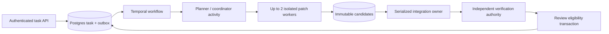

# Durable runtime contracts and recovery

**Contract specification, originally 2026-10-08.** This document specifies a long-horizon coding service. Python contracts, SQL and workflow code below are illustrative specifications, not runnable migrations. The delivered reference implements a bounded subset; [implementation coverage](08-implementation-coverage.md) owns current source and measured evidence. The [production architecture](../docs/03-production-architecture-and-stack.md) provides the wider stack. Neither the initial fixture lab nor the current reference establishes every specified production guarantee.

The [NVIDIA numerical slice](07-reference-implementation-spec.md#nv-s0-frozen-cpu-numerical-contract) produces advisory CPU observations. A passing observation cannot create an execution receipt, release resources or authorize review eligibility. Later GPU execution must preserve the ownership, effects, accounting and independent verification contracts below.

**VI:** Đích là giữ task đúng qua crash và retry, không chỉ giữ agent “chạy liên tục”. Mọi guarantee bên dưới cần fault-injection test trước khi coi là đã có.

## 1. Ownership and six invariants

The system accepts a task, stores intent in PostgreSQL, starts Temporal orchestration through a transactional outbox, runs bounded patch workers in isolated workspaces, integrates immutable candidates, verifies the integrated result independently, and returns a review artifact. PostgreSQL owns business authority: permissions, current generations, budget, accepted candidates and review eligibility. Temporal owns orchestration history and timers. Object storage owns immutable bytes. Git identifies repository content. None is silently substituted for another.

The planner/coordinator creates a validated dependency graph. At most two authorized patch workers operate per task, each in its own worktree and execution sandbox. One integrator owns the integration head. A separately authorized verifier grades an immutable integration candidate. These are logical roles, not a requirement for five simultaneously live model processes. The coordinator may wait durably while workers run; integration and verification normally follow them.

This is the `production` default. For the [target-role scaling study](06-target-role-and-research-contract.md), a frozen `research` manifest may select `patch_slot_limit` in {1, 2, 4} after isolation/recovery gates and physical capacity checks. Store the validated limit with the task/run generation; workers and model output cannot raise it. A changed limit creates a new run/generation. Every admission path uses that limit and the global service/tenant capacity, with the same fencing, budgets and physical-slot accounting. The diagrams and two-branch example describe the default profile.

**VI:** Parameter hóa limit để làm experiment không làm yếu invariant. Capacity thật, quyền và budget vẫn được kiểm ngoài model; N=4 không cho phép mỗi worker nhận một budget riêng đầy đủ.

| Invariant | Enforcement and counterexample |
|---|---|
| **I1 — Stable intent and identity** | Tenant-scoped submission key binds immutable request digest. Same key/different body is rejected. A network retry cannot create a second task. |
| **I2 — Current ownership controls execution acceptance** | Execution acceptance checks service incarnation, task generation and resource-specific epoch under database locks. Review and settlement use their separate restricted authorities. Lease loss prevents acceptance even if an old process continues. |
| **I3 — Effects have explicit outcomes** | Persist intent before dispatch; record succeeded, known failure or unknown. Retry does not imply the first attempt had no effect. |
| **I4 — Admission respects shared limits** | Atomically reserve global budget, authorize work and consume a worker slot. Cancellation/deadline revokes admission; delayed accounting cannot free unknown liabilities. |
| **I5 — Content and evidence are inseparable** | Candidate binds exact base, patch, resulting tree and provenance. Verification binds that exact candidate and grader/environment versions. Any transformation requires new verification. |
| **I6 — Independent authority decides review readiness** | Workers cannot modify integration head, verification verdict or review records. Integrator cannot certify its own correctness. Only the publication transaction can mark a review artifact eligible. |

**VI:** Lease chỉ nói ai đang được phép làm việc; fencing quyết định kết quả nào còn được chấp nhận. Một worker cũ có thể vẫn sống, nhưng không được biến output cũ thành sự thật authoritative.



## 2. Identities are recovery contracts

A **session** groups human interactions; a **task** binds one requested outcome, repository and budget. A **generation** increments when task intent/base/policy is superseded or execution is revoked. A **node** is one DAG work unit. An **attempt** is a worker incarnation for a node; replacement allocates a new attempt and node epoch. An **action** is one durable logical model/tool operation inside that attempt. Each potentially billed or effectful external **dispatch** has its own receipt and reservation. A **candidate** is immutable produced content. A **verification** is one independent grading run against that content.

Use UUIDs for identity and cryptographic digests for content. Include tenant identity in foreign keys and authorization queries; never trust tool-provided tenant fields. Temporal Workflow ID is stable, such as `coding/{tenant}/{task}`; its Run ID may change across continuation and is recorded for diagnostics, not used as the business idempotency key. [Temporal workflow identities](https://docs.temporal.io/workflow-execution/workflowid-runid).

**VI:** Hai file giống nhau có thể đến từ hai attempt khác nhau: digest nói “nội dung nào”, ID nói “lần thực thi nào”. Cần cả hai để phân biệt tái sử dụng kết quả với ghi đè lịch sử.

```python
# Proposed contracts; constructor validation and authorization omitted here.
from dataclasses import dataclass
from typing import Literal
from uuid import UUID

@dataclass(frozen=True)
class Ownership:
    service_incarnation: UUID
    tenant_id: UUID
    task_id: UUID
    generation: int
    node_id: UUID
    node_epoch: int
    attempt_id: UUID

@dataclass(frozen=True)
class ActionIntent:
    action_id: UUID
    owner: Ownership
    kind: Literal["model", "read", "edit", "test", "external"]
    input_digest: str
    input_blob: str
    policy_digest: str
    effect_class: Literal["read", "isolated_mutation", "remote_mutation"]

@dataclass(frozen=True)
class Candidate:
    candidate_id: UUID
    owner: Ownership
    base_commit: str
    patch_digest: str
    result_tree_digest: str
    manifest_digest: str

@dataclass(frozen=True)
class Verification:
    verification_id: UUID
    candidate_id: UUID
    candidate_manifest_digest: str
    grader_digest: str
    environment_digest: str
    outcome: Literal["pass", "fail", "infra_error", "cancelled"]
    evidence_digest: str
```

All execution ownership also carries a trusted `service_incarnation`; a control-plane restore must install a new noncolliding incarnation before resume as specified in section 11. Use independent epochs for patch nodes and the integration resource. A global epoch incremented whenever any worker starts would wrongly fence its sibling. A task-generation change intentionally fences all nodes. Lease timestamps use the database clock; neither worker wall clocks nor heartbeats supplied by a model decide authority.

**VI:** Epoch của worker A không phải epoch của worker B. Chỉ thay mục tiêu toàn task mới cần invalidation toàn bộ; thay một worker chỉ đổi owner của nhánh đó.

## 3. Acceptance, outbox and fenced claims

`POST /v1/tasks` authenticates repository scope and validates limits. In one short transaction it inserts task, initial event and `StartTask` outbox command. Enforce `UNIQUE(tenant_id, submission_key)`. On conflict, return the existing task only if canonical request digest matches; otherwise return a conflict. Respond with the committed task ID. Model calls and Temporal RPCs never run inside this transaction.

The outbox relay claims queue rows, sends commands and marks delivery only after acknowledgement. A crash between send and marking causes duplicate delivery. Use stable command IDs and Workflow IDs, explicit workflow reuse/conflict policy, and a retained database tombstone so an old `StartTask` cannot restart a completed task after Temporal retention expires. “Already exists” is acceptable only after identity and intended execution state are reconciled. Signals carry command IDs and generation; handlers deduplicate, and activities recheck PostgreSQL. Periodic reconciliation repairs missed wakeups and compares accepted tasks with workflow state.

**VI:** Outbox giải quyết khoảng hở “DB đã commit nhưng chưa gửi queue”. Nó không tạo transaction chung giữa Postgres và Temporal; duplicate vẫn tồn tại và phải được thiết kế sẵn.

```sql
-- Proposed claim transaction; section 11 defines the global lock order.
BEGIN;
-- Read-lock the current service authority guard; reject a stale incarnation.
-- Then lock service/tenant account and capacity rows when admission uses them.
SELECT generation, status, deadline_at
  FROM task WHERE tenant_id = :tenant AND task_id = :task
  FOR UPDATE;
-- Reject if generation changed, cancellation requested, or deadline passed.
SELECT patch_slot_limit FROM run_manifest
 WHERE tenant_id = :tenant AND task_id = :task AND generation = :generation;
-- Immutable manifest must exist and match the current execution generation.
SELECT node_epoch, state, lease_until
  FROM node WHERE tenant_id = :tenant AND task_id = :task
    AND generation = :generation AND node_id = :node
  FOR UPDATE;
-- Validate dependency success and unused/reclaimed slot under these locks.
-- Replacement requires reconciliation and retirement of the prior sandbox.
UPDATE node
   SET node_epoch = node_epoch + 1, attempt_id = :new_attempt,
       state = 'running', lease_until = clock_timestamp() + :lease_duration
 WHERE tenant_id = :tenant AND task_id = :task
   AND generation = :generation AND node_id = :node
 RETURNING node_epoch;
INSERT INTO attempt (...) VALUES (...);
INSERT INTO event (...) VALUES (...); -- unique task sequence allocated under lock
COMMIT;
```

The claim sketch omits the account, capacity and reservation statements for readability; RT-03 below requires their reservations and the attempt claim to commit together. It cannot be implemented as a node update followed by best-effort resource booking.

The broker permits renewals only for the current generation/epoch/attempt and an unexpired lease. An expired attempt cannot resurrect itself. Before accepting a candidate, checkpoint or integration update, the trusted service locks task then resource, checks the same ownership tuple, verifies deadline/cancellation and commits acceptance atomically. Uploading a blob is not acceptance: stale blobs may be retained for audit or garbage-collected, but cannot acquire an authoritative pointer.

Use `FOR UPDATE SKIP LOCKED` for outbox/ready-queue selection, not for correctness checks requiring a complete view; PostgreSQL explicitly describes its queue-oriented, inconsistent-view tradeoff. Within task scope, keep task→resource→budget lock ordering consistent; section 11 specifies earlier locks when service/tenant resources are also involved. Serialization/deadlock failures retry the entire short transaction; never include external effects in that retried unit. [PostgreSQL SELECT](https://www.postgresql.org/docs/current/sql-select.html), [transaction isolation](https://www.postgresql.org/docs/current/transaction-iso.html).

**VI:** Kiểm tra epoch rồi ghi ở transaction khác vẫn có race. Check và acceptance phải nằm trong cùng critical section, dùng cùng thứ tự lock với cancellation.

## 4. Deterministic orchestration and a bounded DAG

The planner returns a proposed graph as activity output. A deterministic validator rejects cycles, missing inputs, unknown tools, unbounded recursion and excessive nodes. Start with a fixed graph: inspect/plan → two independent patch branches → integrate → verify → review. Dependencies refer to immutable candidate/evidence IDs, never mutable “latest” files. A failed mandatory parent blocks descendants; optional branches require explicit policy. The coordinator can revise the graph only through a versioned transition with recorded reasons and budgets.

Temporal workflow replay reconstructs decisions from recorded events. Model sampling, file reads, clock-sensitive database checks and network/tool execution belong in activities. Activity retries can repeat code; they must consult the action ledger and reconcile uncertain effects. Workflow determinism is not filesystem rollback or exactly-once HTTP execution. [Workflows and replay](https://docs.temporal.io/workflow-execution), [activities](https://docs.temporal.io/activities).

**VI:** Replay chạy lại logic điều phối từ history; nó không được tự hỏi model lần nữa để “nhớ” quyết định. Activity chưa có completion bền vững vẫn có thể chạy lại, nên cần ledger riêng cho effect.

```python
# Algorithmic pseudocode, not Temporal SDK syntax; every transition is persisted.
async def task_workflow(task_id, generation, checkpoint_ref=None):
    state = await activity("reconcile_task", task_id, generation)
    while True:
        if state.execution_terminal:  # eligible artifact or explicit failure
            return state.execution_receipt
        if state.cancelled_or_expired:
            return await activity("revoke_and_record_terminal", task_id, generation)
        if history_needs_rotation() and state.no_pending_handlers_or_activities:
            continue_as_new(task_id, generation, state.checkpoint_ref)
        if state.patch_stage_complete:
            integrated = await activity("integrate_fenced", state.candidates)
            verdict = None
            if integrated.outcome == "candidate":
                verdict = await activity("verify_independently", integrated)
                if verdict.outcome == "pass":
                    receipt = await activity("make_review_if_eligible", integrated, verdict)
                    if receipt.accepted:
                        return receipt  # execution complete; human review is separate
                    # A fence/base/cancel race is not successful publication.
                    state = await activity("reconcile_rejected_publication", receipt)
                    continue
            # Conflict, verifier failure or infra error: bounded repair/retry,
            # otherwise persist failed_known/exhausted/effect_unknown as appropriate.
            state = await activity("repair_or_record_terminal", integrated, verdict)
            continue
        ready = validated_ready_patch_nodes(state.dag, state.accepted_outputs)
        ready = ready[:max(0, state.patch_slot_limit - state.patch_slots_in_use)]
        if ready:
            results = await durable_activities(ready, bounded_retry_policies=True)
            state = await activity("accept_results_and_reconcile", results)
        elif state.external_progress_possible and state.wait_allowance_remaining:
            await durable_wakeup_or_timer(state.bounded_wait_before_deadline)
            state = await activity("reconcile_task", task_id, generation)
        else:
            state = await activity("record_unschedulable_or_unknown", task_id, generation)
```

`repair_or_record_terminal` atomically consumes a bounded repair/retry allowance, validates budget/deadline, versions the DAG and invalidates descendants; it never declares a failing verdict successful. Repeated publication rejections also consume a bounded allowance or produce an explicit terminal classification. Terminal execution outcomes include `review_eligible`, `failed_known`, `budget_exhausted`, `deadline_exceeded`, `cancelled`, and `effect_unknown`. Unknown effects stop dependent execution; a separate restricted reconciliation path may later resolve receipts/accounting without reviving work. No ready nodes means bounded waiting for an identified external event, or a recorded unschedulable failure—not a polling loop forever.

**VI:** Verifier fail phải quay về một repair có giới hạn, hoặc kết thúc trung thực. Publication bị từ chối do race cũng không phải success; workflow phải đọc lại state authoritative.

Every activity has Schedule-to-Close/Start-to-Close and, for long operations, heartbeat timeouts appropriate to its operation. Heartbeat details are hints pointing to durable checkpoints, not the only saved copy. Cancellation is cooperative; delivery and timeout behavior must be exercised with the pinned SDK. Continue-As-New carries compact identifiers and checkpoints; finish message handlers and reconcile outstanding work before rotation. Retain compatible workflow code or use tested versioning/patching, with replay tests on saved histories. [Python failure handling](https://docs.temporal.io/develop/python/best-practices/error-handling), [Continue-As-New](https://docs.temporal.io/develop/python/workflows/continue-as-new).

**VI:** Long horizon không cần một process sống nhiều ngày. Cần đủ state để process khác tiếp tục, cùng version logic vẫn hiểu history cũ.

## 5. Workspaces, integration and verification

Each attempt receives a pinned base commit in a private worktree inside an isolated environment. Worktree separation prevents ordinary edit collisions, but shared Git metadata, host mounts and credentials can break isolation. Prefer a private repository clone/object namespace per sandbox where hostile code could otherwise modify shared Git internals. Generated code gets neither database credentials nor integration/publishing authority. The broker alone creates candidate manifests and validates content sizes, paths, modes, symlinks and supported file types.

A candidate manifest binds repo identity, base commit, patch blob/digest, resulting tree, attempt ownership, harness/model/tool versions and evidence references. Store objects first under content-addressed immutable keys, verify digest and durability, then atomically attach accepted references in PostgreSQL. A crash can leave an orphan blob; it must not leave an accepted row pointing to an unavailable object. Garbage collection respects live references and retention leases.

**VI:** Patch là artifact bất biến, không phải đường dẫn tới worktree còn đang thay đổi. Sau khi accepted, worker không được sửa nội dung phía sau cùng một ID.

The integrator acquires its own epoch and operates on an integration head recorded as `(base, tree_digest, revision)`. It applies candidates in a deterministic order after validating their bases and dependencies. Database publication uses compare-and-swap against the expected integration revision. Disjoint paths do not prove semantic independence: shared interfaces and generated files can still conflict. Textual conflict creates a repair node; no silent overwrite. A changed upstream base, rebase, conflict resolution or repair creates a new integration candidate with lineage, invalidates old eligibility and requires verification again. No verifier pass transfers by name alone.

The verifier provisions a clean checkout from the exact base and integrated artifact, with pinned dependencies and grader. Protected grading inputs are provisioned under separate authority; the producer cannot edit the verdict database or acquire its signing identity. A trusted supervisor records execution status, test evidence and artifact digests. Agent-written tests are useful inputs but cannot be the sole acceptance oracle. Application code still runs inside isolation during grading; untrusted JUnit text alone cannot establish pass. Grader gaps remain possible and require adversarial known-wrong patches.

Only the trusted eligibility transaction checks current generation, integration revision, authorization, exact candidate identity, passing verification and the **execution deadline**, then inserts a uniquely keyed review artifact. The authoritative cutoff is the database clock sampled by that final fenced eligibility write under the task lock; the trusted, digest-bound passing receipt must already exist. Record `eligibility_decided_at` with the write and expose the receipt only after commit. This is not a claim that client receipt or physical commit completion occurs before the cutoff, and a later receipt cannot be backdated. An artifact eligible at that decision may receive required human review afterward under a separately fixed **review deadline**. `review_eligible` ends execution; `accepted` additionally records the required human decision against the same immutable artifact. Review expiry or rejection does not restart execution.

Human review uses a separate authorized status path: it cannot admit tools, allocate worker slots, release uncertain liabilities, create new eligibility or revive a cancelled generation. Recheck reviewer authority and withdrawal/revocation state before positive acceptance. Cancellation/withdrawal prevents new eligibility; an already published eligibility receipt remains historical evidence even when later marked withdrawn. Already recorded decisions are retained with subsequent status transitions, not rewritten. The review deadline is fixed in the task contract, not extended after seeing outcomes.

This is internal authoritative publication. A future external PR operation requires separate authorization and provider idempotency or reconciliation; a local fence cannot make an arbitrary remote API atomic. Patch workers never obtain publishing credentials.

**VI:** Deadline thực thi và deadline review là hai đồng hồ khác nhau. Người có thể review artifact đã đủ điều kiện trước cutoff; thao tác review không được mở lại quyền chạy task đã hủy.

**VI:** Rebase không chỉ đổi Git metadata: nó có thể đổi chương trình được test. Vì vậy reviewer phải nhận đúng tree đã chấm, và mọi tree mới cần verdict mới.

## 6. Budgets, cancellation and uncertain effects

Maintain integer accounting units with a versioned rate snapshot. For each task and tenant enforce `spent + reserved + new_bound ≤ limit` atomically, alongside call count, token/output caps, deadline and slots. Each external dispatch has a unique reservation; a duplicate reservation request returns the original row only for identical parameters. Model retries are potentially new billable dispatches, even when they belong to one logical action. Reserve their maximum authorized exposure before making each call. Tool runtime, storage and verifier work need their own bounds, including cleanup reserve.

A provider without enforceable upper bounds cannot support an absolute spend guarantee from estimates alone; use conservative margins and provider-side limits, and disclose the remaining exposure. Settle known usage once, releasing only the unused amount. If a timed-out request may have been billed, keep its liability reserved or conservatively charge its bound until reconciled. Expiry of a lease or reservation is not proof of zero cost. Accepted charge receipts may arrive after cancellation through a restricted settlement path; they cannot reactivate work.

**VI:** Hai worker cùng thấy còn tiền vẫn có thể tiêu gấp đôi nếu không reserve atomic. Timeout không xóa hóa đơn; không được hoàn budget chỉ vì chưa thấy response.

Cancellation transaction records the request, increments task generation and emits outbox revocation. New admission and authoritative result acceptance immediately fail. Broker propagates cancellation to streams and process trees and revokes capabilities; record actual termination separately from request acknowledgement. A local edit interrupted mid-effect may leave a dirty sandbox, which is discarded or reconciled. A remote mutation becomes `unknown` until its operation-specific receipt is queried. Do not schedule its replacement blindly.

Keep at most the frozen `patch_slot_limit`: two in production, 1/2/4 in the validated research profile. A lost sandbox continues occupying its physical slot until teardown or infrastructure fencing is confirmed; logical lease expiry alone does not establish physical death. This conservative baseline may pause progress during a partition. A future availability-first policy allowing replacements must explicitly bound and charge overlapping obsolete execution.

**VI:** Safety và availability có tradeoff thật: không biết máy cũ đã chết thì chờ có thể chậm, nhưng khởi động thay thế ngay có thể vượt concurrency và budget.

## 7. Checkpoints and crash windows

Minimal restart state comprises task generation/status/deadline; graph version and accepted dependency outputs; current ownership tuples; action/dispatch ledger including unknown effects; budget reservations; base/integration revisions; immutable workspace snapshot or reconstructible patch chain; environment recipe; context projection version/event offset; pending command IDs; and verification/artifact references. Persist before acknowledging checkpoint acceptance. Do not serialize a live shell as if it were durable.

A handoff includes objective, exact repository revision, accepted artifacts, file/span digests supporting claims, tests actually run, unresolved assumptions and the next allowed operation. Summaries are derived context with source offsets and hashes. Re-read stale evidence; preserve opaque provider artifacts only under their compatibility contract. Model context, KV residency and durable recovery state remain separate.

**VI:** Handoff tốt giúp worker mới kiểm tra lại lời nói của worker cũ. “Tôi nghĩ bug nằm ở parser” chưa đủ; cần revision, file, evidence và điểm chưa chắc.

| Crash window | Durable fact | Recovery obligation |
|---|---|---|
| Before task transaction commits | No accepted task | Client retry with same key. |
| Commit before outbox send | Intent and pending command | Relay retries. |
| Temporal accepts before relay marks sent | Possible duplicate command | Stable identity and dedup; never restart terminal task blindly. |
| Lease claimed before sandbox starts | Attempt reserved, no confirmed execution | Reconcile sandbox creation by idempotency key. |
| Model dispatch before response persistence | Possible charge/output, unknown result | Query receipt if supported; retain liability; new sampling is a new dispatch. |
| File changed before action result | Local effect uncertain | Inspect immutable checkpoint/digests or discard private sandbox; no authoritative candidate yet. |
| Blob stored before candidate acceptance | Orphan bytes | Retry fenced acceptance or retain for audit/GC. |
| Lease expires before old worker submits | Stale tuple | Reject acceptance; record diagnostic only. |
| Candidate accepted before activity completion | Durable result exists | Retry returns accepted receipt instead of redoing effect. |
| Verification finished before verdict persists | Result uncommitted | Reconcile supervisor receipt or run a new verification ID. |
| Cancel races with review publication | Ordering set by task row lock | Earlier committed publication remains history; later publication fails. |
| Remote publish occurs before acknowledgement | External effect unknown | Reconcile external identity; never infer failure from lost response. |

**VI:** Mỗi hàng là một test phải chủ động gây crash. Invariant đúng khi database receipt, filesystem và external effect vẫn được phân biệt sau restart.

## 8. One concrete task, end to end

Task `T` asks: “Fix pagination skipping records at an inclusive cursor boundary; document the API behavior.” Session `S` submits key `K` against base `B0`. Task generation is 1. The API commits `T` and command `C0`; a duplicated request returns `T`. Planner emits patch node `N1` for cursor logic and `N2` for documentation, followed by integration and verification. Both consume the same pinned interface evidence. Their claims receive distinct epochs; two reservations share one task limit.

Worker `N1/A1/e1` reads the cursor function, changes it and dies before persisting an action result. Its lease expires; no candidate has been accepted. The broker confirms sandbox termination, keeps unknown model cost reserved, and reconstructs from the last accepted snapshot. Replacement `N1/A2/e2` re-reads and produces candidate `P1`. If `A1` later sends a completion, epoch mismatch rejects it. `N2` produces `P2` without needing to remain live during integration.

Integrator `I/e4` applies `P1`, then `P2`, creating tree `Q1`. Verification `V1` discovers that the docs describe an exclusive boundary while the patch implements an inclusive boundary. The verdict is fail; “both patches apply” was insufficient. A bounded repair node produces `P3`; integration creates `Q2`, with new manifest and lineage. Verifier `V2` grades `Q2` from a clean environment. Its accepted pass allows a review artifact binding `Q2`, `V2`, test evidence, total cost and unresolved limitations. No external PR is automatically sent.

**VI:** Lỗi quan trọng ở trace này là conflict ngữ nghĩa, dù hai worker sửa file khác nhau. Chỉ integration + verifier trên cùng tree mới phát hiện được.

## 9. Source anchors and planned implementation boundaries

The following inspected sources teach individual mechanisms; they do not implement this PostgreSQL/Temporal design:

- [Codex stream completion:315](https://github.com/openai/codex/blob/9dd798805fdf9dd0f836f35ccc9480cb0af17784/codex-rs/core/src/stream_events_utils.rs#L315) and [receipt before dispatch:346](https://github.com/openai/codex/blob/9dd798805fdf9dd0f836f35ccc9480cb0af17784/codex-rs/core/src/stream_events_utils.rs#L346): complete tool envelope, record, then queue execution.
- [Codex concurrency gate:211](https://github.com/openai/codex/blob/9dd798805fdf9dd0f836f35ccc9480cb0af17784/codex-rs/core/src/tools/parallel.rs#L211) and [late-cancellation test:799](https://github.com/openai/codex/blob/9dd798805fdf9dd0f836f35ccc9480cb0af17784/codex-rs/core/src/tools/parallel.rs#L799): distinguish admission, execution and completed lifecycle. Its local lock is not a distributed fence.
- [mini-SWE process lifetime:72](https://github.com/SWE-agent/mini-swe-agent/blob/04d809ceab9df28f9adaed044884180159172930/src/minisweagent/environments/local.py#L72) and [child cleanup test:138](https://github.com/SWE-agent/mini-swe-agent/blob/04d809ceab9df28f9adaed044884180159172930/tests/environments/test_local.py#L138): process-group cleanup is separate from filesystem confinement.
- [Codex replacement context:80](https://github.com/openai/codex/blob/9dd798805fdf9dd0f836f35ccc9480cb0af17784/codex-rs/core/src/compact.rs#L80): model-visible context can change while recovery evidence must remain identifiable.

**VI:** Source anchor là điểm bắt đầu để trace, không phải bằng chứng toàn bộ thiết kế capstone đã chạy. Snapshot và commit được lưu trong manifest của references.

**Proposed, absent service paths, aligned with the system specification:** `service/domain/contracts.py`, `service/api/tasks.py`, `service/storage/schema.sql`, `service/storage/claims.py`, `service/storage/outbox.py`, `service/storage/budget.py`, `service/workflows/task.py`, `service/harness/loop.py`, `service/execution/patch_activity.py`, `service/integration/acceptance.py`, `service/verification/runner.py`, `service/telemetry/events.py`, and `evals/runners/crash_windows.py`. These names allocate future ownership only. First implementation gate: submit/retry → outbox → one fenced fake activity → immutable candidate → independent deterministic verifier → review record, with every crash row applicable to that slice exercised before adding real model calls or the second patch worker.

**VI:** Xây một vertical slice bền vững trước, rồi mở fan-out. Teach-back: giải thích vì sao Temporal replay thành công nhưng một API effect vẫn có thể bị lặp, và transaction nào chặn worker cũ publish.


## 10. Normative requirement register

**Specification language:** MUST is a release-blocking contract within the declared operating profile; SHOULD requires a recorded reason for deviation. The following are our proposed design requirements, not claims about Anthropic's private implementation. Every requirement is currently **unimplemented / unverified**. The smallest production slice must satisfy applicable requirements before adding live inference or fan-out; the [milestone gates](04-build-sequence-and-mastery-gates.md) determine when to learn and implement each part.

| ID | Required behavior | Decisive observable |
|---|---|---|
| RT-01 | Submission identity MUST bind tenant, immutable canonical request digest and retained idempotency key | Duplicate input returns one task; changed input conflicts, including after execution retention |
| RT-02 | Every execution-result acceptance MUST compare service incarnation, current generation and applicable resource epoch/attempt/lease under the prescribed locks | A delayed owner writes no accepted pointer after reassignment |
| RT-03 | Claim, shared budget reservation and physical-slot admission MUST form one transaction under a frozen validated profile | Concurrent claims cannot exceed task, tenant or service ceilings |
| RT-04 | Every external dispatch MUST have prior durable intent, a distinct dispatch ID and an explicit result/uncertainty record | A crash yields a reconcilable dispatch, never an invented failure or success |
| RT-05 | The gateway/broker MUST accept only complete validated envelopes; tool evidence MUST preserve call/result linkage | Truncated arguments trigger zero tools; result IDs cannot be spliced between calls |
| RT-06 | Accounting MUST retain unsettled exposure and settle receipts once, including after cancellation | Repeated receipts do not double charge; timeout never frees unsupported allowance |
| RT-07 | Accepted content MUST bind immutable bytes, base, tree, provenance and dependency versions | Old tests cannot certify a changed tree; corrupt/missing uploads cannot be accepted |
| RT-08 | Only separate verification and eligibility authorities MAY create review readiness | A fabricated worker verdict, late pass or stale integration revision cannot publish |
| RT-09 | A checkpoint MUST reconstruct both allowed next action and unresolved liabilities without the original process | Fresh-environment restore retains constraints, evidence provenance and Unknown state |
| RT-10 | Cancellation/deadline MUST revoke new admission and acceptance; already admitted effects MUST be reconciled | Acknowledgement, execution quiescence and liability settlement have separate timestamps |
| RT-11 | Duplicate outbox commands and activity replay MUST converge on the same business receipt | Replaying delivery never restarts a terminal task or repeats an uncertain mutation |
| RT-12 | Each claimed runtime guarantee MUST have a distinguishing fault trace and retained evidence | A deliberately broken fence, budget or verifier control is detected by the corresponding check |

**VI:** `MUST` chỉ có ý nghĩa khi có observable làm nó sai. “Reliable” quá rộng để test; “worker cũ không ghi được accepted pointer sau epoch mới” là một phát biểu có thể bị bác bỏ. Các ID nối bài học, implementation tương lai và evidence trong cùng một hệ thống.

## 11. Persistent schema and transaction authority

The tables below are a logical schema; migrations are absent. All tenant-owned primary/foreign-key relationships carry `tenant_id`. Opaque IDs do not substitute for authorization. Canonical request serialization must be versioned and reject ambiguous input before hashing; replay compares stored canonical bytes/digest, not a newly changed serializer. Timestamps use UTC database time for authority and monotonic local clocks for durations. Monetary values use checked integer accounting units with a recorded unit/rate version; floating-point comparisons cannot authorize spending.

| Entity / logical key | Required fields and integrity contract |
|---|---|
| `service_authority`: one trusted service row | Current incarnation, `accept_new_tasks`, `execution_enabled` and restore/fencing evidence; incarnation changes require restore procedure, while admission flags require trusted operational authority |
| `task`: `(tenant_id, task_id)` | Submission key/digest, repository, current generation, execution status/reason, execution/review deadlines, contract and manifest refs; unique tenant/submission key |
| `run_manifest`: `(tenant_id, task_id, generation)` | Immutable profile, validated patch limit, model/settings/tool/context/grader versions, aggregate limits, per-environment minima; retains superseded generations |
| `node`: `(tenant_id, task_id, generation, node_id)` | Graph version, input candidate refs, state, epoch, current attempt, lease; dependencies name immutable outputs and producer versions |
| `attempt`: `(tenant_id, attempt_id)` | Service incarnation/task/generation/node/epoch, sandbox ref, start/end/cause; unique owner incarnation; replacing an attempt preserves its row |
| `action` / `dispatch`: tenant plus respective ID | Action binds attempt, sequence, kind, input/policy digests. Dispatch binds action, retry ordinal, provider/operation identity, reservation and effect/billing states; unique action/ordinal |
| `sandbox`: `(tenant_id, sandbox_id)` | Infrastructure creation key, ownership, physical-slot allocation, state, last observation, checkpoint and confirmed retirement evidence; uncertain death retains slot |
| `budget_account` / `budget_entry` | Service/tenant/task account identity, limit, spent/reserved totals; append-only entries reference reservation/dispatch/receipt. Unique receipt settlement key and checked balanced deltas |
| `artifact`: `(tenant_id, artifact_id)` | Object key, digest algorithm/value, size, content type, creation/retention/ref status; successful storage confirmation precedes authoritative reference |
| `candidate` / `integration_head` | Candidate binds base, patch, tree, manifest and lineage; head keyed by task/generation records integrator epoch and monotonic revision |
| `verification` / `review` | Candidate/manifest/grader/environment digests, trusted supervisor receipt and outcome; review additionally binds eligibility decision, reviewer, rule and withdrawal history |
| `checkpoint` / `context_projection` | Event frontier, schema/projection version, accepted outputs, unresolved dispatches, source digests and serialized provider-request ref; no secret values |
| `event` / `outbox` | Events keyed by task sequence plus unique event ID; outbox by command ID with generation/type/payload digest/delivery state; insertion shares the associated business transaction |

**VI:** Schema cần giữ ba loại quan hệ riêng: ai thực hiện, bytes nào được tạo và quyết định nào được chấp nhận. Cùng một patch digest có thể xuất hiện trong hai attempt; ghép chúng thành một “result” sẽ mất thông tin về retry, quyền và chi phí.

Use one global lock order: **service authority guard → service account/capacity → tenant account/capacity → task → resource rows in stable ID order → subordinate task budget/reservation rows**. Execution admission/acceptance read-locks the authority guard and compares incarnation plus `execution_enabled`; new task submission additionally checks `accept_new_tasks`; changing that guard takes an exclusive lock. After the guard, transactions take only the other scopes they need; no code may later acquire an earlier scope. Task cancellation does not need service/tenant locks unless changing those allocations. Its task lock still serializes with every acceptance. Revocation records intent; cleanup releases physical capacity in a separate transaction using the full order. The earlier SQL claim is the task/resource portion of this rule, not the whole admission transaction. Keep external RPC, subprocess work and object upload outside database locks. Draining sets `accept_new_tasks=false` while keeping `execution_enabled=true`, allowing already accepted tasks to finish. Restore quarantine sets both false and permits only separately authorized recovery/reconciliation operations. Disabling new submissions alone must not reject valid in-flight results.

Admission calculates `available_slots = max(0, min(task_limit - task_physical_slots, tenant_free_slots, service_free_slots))` and separately checks model/tool concurrency. Count provisioning, retained and retirement-unknown sandboxes. Atomically allocate a concrete slot/reservation ID before provisioning, so two schedulers cannot reserve the same last slot. Provisioning failure releases it only with evidence that no environment exists or that retirement completed. A worker lease and a physical slot have different lifetimes. Patch slots count patch-role environments; integration/verification environments have separate reservations within the same aggregate infrastructure envelope. `N` limits concurrency, not total DAG nodes, and achieved concurrency must be recorded rather than assumed. A unique claim request ID binds parameters: repeating it returns the same valid grant or its revocation receipt, never a new epoch.

Budget allowances and dispatch exposure are hierarchical: moving part of an attempt allowance into a dispatch reservation transfers that amount instead of reserving it twice. Each liability is counted once per applicable service/tenant/task account; those scope totals are constraints over the same money, not costs to sum together. Retry exposure must come from remaining allowance or a new atomic allocation. Unknown dispatch liability cannot be reclaimed through allowance redistribution.

**VI:** “Task lock trước resource” vẫn đúng, nhưng khi quota nhiều task chia sẻ thì cần thứ tự toàn hệ thống. Nếu một path giữ task rồi chờ tenant, còn path khác giữ tenant rồi chờ task, deadlock dễ thành hiện tượng thường xuyên. Vì vậy thứ tự lock là một phần API nội bộ, không phải chi tiết mỗi file tự chọn.

Restoring a worker checkpoint is different from restoring the authority database to an older backup. For database restore, start with admission disabled, fence/confirm retirement of every pre-restore execution environment and authority holder (schedulers, workflows, relays, gateways, reconcilers and supervisors), create a fresh noncolliding service incarnation through the trusted controller, and reconcile effects/charges after the backup frontier before resume. Old leases and epochs cannot safely authorize anything merely because their rows reappear. A token revocation does not undo external effects. If the retained journal/provider/infrastructure evidence cannot establish what happened beyond the snapshot, retain Unknown and its exposure; do not resume dependent work. Record the recovery frontier and lost/unreconciled interval.

**VI:** Backup có thể quay số epoch từ 9 về 7 trong khi worker epoch 9 vẫn chạy ngoài DB. Incarnation mới và fencing thật làm token cũ mất quyền; còn effect sau snapshot vẫn phải điều tra. Restore thành công về mặt bytes chưa chứng minh hệ thống đủ điều kiện chạy tiếp.

The append-only event stream explains committed decisions; mutable status rows are current indexes. The same transaction must update status, append its event and enqueue any wakeup. A consumer may see an event twice and must deduplicate by ID. An authenticated stream cursor binds service incarnation, tenant/task identity and the last acknowledged task sequence; events also retain immutable IDs and their emission incarnation. A reconnect gap triggers retained replay or an explicit retention-expired response with snapshot/frontier. A pre-restore incarnation cursor receives an explicit reset-required response and current snapshot/recovery frontier; sequence reuse after restore cannot silently masquerade as continuity. Missing post-backup history remains identified, not synthesized. Audit/stream retention must cover the declared recovery/evaluation horizon. Garbage collection removes only unreachable artifacts after retention and reader/checkpoint leases are satisfied. Store identities/tombstones long enough to uphold the advertised submission retry contract; that duration is frozen with the release profile.

**VI:** Event log cho biết “đã commit điều gì”, không tự chứng minh effect ngoài DB đã xảy ra. Snapshot dùng để đọc nhanh; khi cần giải thích tại sao task được giao cho reviewer, phải lần về các event và receipt gốc.

## 12. State transitions and recovery decisions

Track execution, review and settlement separately. An execution outcome never hides open liability. All transitions produce an event with prior state/version, actor, reason and input evidence. A transition that fails a fence is a rejection event/diagnostic, not an authoritative state change. Exact enum spellings may be finalized in M1, but the distinctions and allowable authority below are mandatory.

| Transition | Authority and guard | Atomic outcome |
|---|---|---|
| Submit → queued | API; valid tenant/repository/manifest and RT-01 key | Task, generation manifest, initial event and start command |
| Node ready → running | Scheduler; successful immutable dependencies, current task, unexpired deadline, RT-03 resources | New epoch/attempt, lease, slot and budget reservation |
| Running → checkpointed/running | Broker; current owner and digest-verified checkpoint | Accepted checkpoint frontier; heartbeat cannot substitute for it |
| Lease expiry → recovering | Reconciler; DB lease expired | Old acceptance authority ends; sandbox and liabilities remain occupied |
| Recovering → replacement | Scheduler; previous effect reconciliation and confirmed retirement, resources available | New attempt/epoch; replay only from an accepted reconstructible state |
| Running → node completed | Acceptance service; current tuple plus validated candidate and dependencies | Accepted output pointer; descendants become ready under current graph version |
| Integration → verification | Integrator; epoch plus expected head revision | New immutable tree/lineage; previous tree's verification cannot transfer |
| Verification pass → review eligible | Publication authority; current task/head, trusted exact-tree pass already present, DB decision time ≤ execution deadline | Unique eligibility receipt and execution completion; commit then expose |
| Cancel/expiry → execution stopped | API or reconciler; authorized cancel or DB deadline check | Revoke execution authority, record outcome, enqueue stop; preserve evidence/obligations |
| Review pending → decision/expiry/withdrawal | Review service; fixed rule/deadline, authorized reviewer and current eligibility | Append decision against same immutable artifact; no worker admission |
| Unknown → reconciled receipt | Restricted reconciler; operation-specific evidence | Settle effect/cost knowledge; execution generation stays stopped |

**VI:** Một task có thể đã `cancelled` nhưng tiền vẫn `unsettled`, hoặc đã `review_eligible` nhưng reviewer chưa quyết định. Dồn mọi thứ vào một cờ `done` khiến cleanup, thống kê và quyền chạy tiếp bị lẫn nhau.

For each dispatch, retain separate **effect knowledge** (`not_dispatched`, `in_flight`, `succeeded`, `failed_known`, `unknown`) and **billing knowledge** (`reserved`, `settled`, `liability_unknown`). A known provider error is not proof of zero charge; a successful mutation with a lost response is not a failed effect. A retry either returns the already persisted logical result, reconciles the same idempotent operation, or creates a new authorized dispatch with a new exposure reservation. Automatic retry is forbidden while an unresolved non-idempotent effect could be duplicated. Read-only retries still require model/provider billing accounting where applicable.

Cancellation is a linearized **authority revocation**, not instantaneous physical termination. The broker checks authority before dispatch and propagates stop to already admitted work, but cannot undo a remote operation that crossed its boundary. Record `cancel_requested_at`, `authority_revoked_at`, `last_effect_observed_at`, `quiescence_confirmed_at` and settlement status. An operation in the check-to-dispatch race belongs to the existing dispatch ledger and reconciliation path. No late callback may re-authorize itself. An automatic deadline timer improves prompt cleanup; every admission/acceptance also checks DB time so delayed timers cannot extend authority.

**VI:** Race giữa cancel và network send không biến mất khi thêm một lần `if cancelled`. Điều ta kiểm soát chắc chắn là quyền nhận kết quả và phát lệnh mới trong authority store; effect đã đi ra ngoài phải có identity để kiểm tra và accounting để không bị mất dấu.

## 13. Model gateway, tools and context protocol

The gateway's unit is a versioned **model request**, not a raw prompt string. Required fields are ownership/action/dispatch IDs, provider/model version, adapter version, immutable serialized request digest, context projection/frontier, tool-schema/policy digests, generation settings, maximum output, deadline, resource reservation and approved capabilities. Credentials remain server-held. A request may contain only referenced evidence the tenant and attempt can read; repository text cannot grant credentials or change these fields. Preserve provider-required protocol/opaque artifacts through a tested compatibility adapter; unsupported continuation fails explicitly.

A response is collected as ordered, bounded stream events associated with that dispatch. Text/argument deltas are provisional. The adapter accepts a tool envelope only after its supported protocol establishes the complete item, correct call ID, tool name and valid bounded arguments; it persists the normalized envelope and provenance before the broker can admit execution. Parse with duplicate-key, type/size/depth and unknown-field policy specified per schema. Stream interruption, unsupported finish state, malformed JSON or conflicting duplicate call ID yields no execution from that incomplete item. Already accepted complete items retain their own ledger even if a later response segment fails. A model's final text is a completion proposal, not verification or task acceptance.

**VI:** Stream giúp UI thấy chữ sớm nhưng không biến nửa JSON thành lệnh. Một response có thể đã hoàn tất tool A rồi đứt ở tool B; journal phải phân biệt A đã được admit với B chưa có envelope hợp lệ, thay vì gọi cả response “fail” rồi chạy lại mọi thứ.

The broker resolves tool identity from its registry, validates ownership and capability, and creates a canonical action digest from tool/schema/version, arguments, workspace revision and policy. Provider call IDs are protocol linkage, not sufficient cross-retry effect identities. Tools expose `effect_class`, resource caps, cancellation semantics, result schema and reconciliation method. The first release supports read/search, digest-guarded edit, and bounded test/command execution inside the sandbox; external mutation remains disabled until an operation-specific contract exists. Concurrent model tool calls are proposals: the broker serializes conflicting workspace mutations and explicitly admits only independently safe reads/operations within capacity.

Every result includes action/dispatch/call IDs, observed ownership, status, input/base digest, evidence/object refs, result digest, exit/signal where applicable, start/end times, truncation metadata, usage and uncertainty. The trusted supervisor supplies status and provenance; process stdout cannot assert its own authoritative pass. Large output is bounded during capture, stored as immutable evidence where retained, and projected into context with a precise truncation marker and retrieval reference. Return one protocol-valid result per accepted call according to the adapter; a result for another call or input digest is rejected. Broker errors enter the transcript as tool observations, while system faults remain classified in the ledger.

**VI:** Tool result có hai lớp: dữ liệu mà program in ra và receipt do runtime tin cậy ghi. Program có thể in “PASS”; supervisor vẫn phải biết process nào chạy, trên tree nào, có timeout hay không và output đã bị cắt ở đâu.

A new context projection must bind its source event frontier, accepted artifacts, active constraints, current ownership, unresolved effects and pending call/result pairs. Summarization may reduce quoted history but cannot erase the records required for recovery or violate provider call/result protocol. Keep original durable evidence and projection lineage. Before acting on a remembered file claim, validate its revision/span digest or retrieve current evidence. On restore, reconstruct the workspace, reconcile effects and verify the checkpoint before generating a new request. The restored prompt alone cannot justify replaying a tool.

**VI:** Context engineering là chọn thông tin cho quyết định tiếp theo; recovery engineering là xác định điều gì đã xảy ra và còn được phép làm. Chúng nối nhau bằng IDs/digests, nhưng một bản tóm tắt hay không thể thay receipt còn thiếu.

## 14. Fault acceptance and implementation readiness

The [evaluation contract](03-evaluation-serving-and-efficiency.md) owns workload/statistical/release aggregation. This table defines individual runtime oracles. Freeze fault locations, initial state and expected outcome before injection; retain the final database snapshot, relevant event IDs, supervisor observations, artifact hashes and resource/billing records. These are planned tests, not passing results. Exercise valid recovery as well as rejection so a runtime that simply refuses all work cannot satisfy the contract.

| Case / requirements | Injection | Pass condition; any opposite outcome fails |
|---|---|---|
| F01 / RT-01,11 | Lose submission response, replay identical/changed request; redeliver old start after terminal | Exactly one task/workflow business identity; changed body conflicts; terminal execution stays stopped |
| F02 / RT-02,03 | Two schedulers claim one node; then old owner submits after replacement | One accepted incarnation; stale result cannot alter current output or head |
| F03 / RT-03,06 | Two admissions compete for one slot/remaining reservation; production request asks for four | At most one succeeds; unsupported production profile rejected; totals never exceed admitted bounds |
| F04 / RT-04,06 | Crash after model dispatch before result/usage; duplicate delayed charge receipt | Unknown exposure retained; settlement applied once; a new call consumes its own authorized reservation |
| F05 / RT-05 | Disconnect in tool arguments; conflict call IDs; splice a result from another action | Incomplete/conflicting item triggers zero tools; only correctly linked complete items may run |
| F06 / RT-04,09 | Crash after file edit before receipt; restore in fresh sandbox | Reconcile/reconstruct or stop Unknown; no blind replay; accepted bytes and evidence remain identified |
| F07 / RT-07 | Crash after upload; corrupt blob; mutate tree after a passing verifier | Orphan is harmless; corruption prevents acceptance; changed tree requires a new pass |
| F08 / RT-08,10 | Race cancel, final eligibility write, verifier receipt and deadline | Outcome follows current fence and DB decision time; no late/backdated eligibility or review resurrection |
| F09 / RT-03,10 | Partition sandbox then expire lease; fail teardown acknowledgement | Obsolete physical slot remains counted; no replacement exceeds the profile; later confirmed retirement frees it once |
| F10 / RT-08 | Candidate edits grading files, emits fake pass or submits forged receipt | Protected grading authority rejects forgery; the planted known-wrong control is not published |
| F11 / RT-09,11 | Rotate workflow, replay saved history, duplicate wakeups, restore compacted context | Same accepted outputs/obligations survive; compatible replay makes no unjournaled external call |
| F12 / RT-06,10,12 | Cancel in-flight tool/model work; return late output and billing | Cleanup/settlement may progress; execution stays revoked; report actual quiescence and unresolved exposure |
| F13 / RT-02,09,11 | Restore an old DB backup while a pre-restore worker and post-snapshot dispatch survive | No admission until fresh incarnation, old-execution fencing and beyond-snapshot reconciliation; restored old lease/epoch cannot accept; missing evidence retains Unknown/exposure |

**VI:** Pass/fail cần nhìn sự thật sau crash ở nhiều nơi: DB, sandbox, object và provider receipt. “Không exception” không phải oracle. Negative control cố tình bỏ fence hoặc bỏ digest check phải làm test phát hiện lỗi; nếu không, bài test chưa chứng minh cơ chế đó.

Before the relevant implementation milestone, freeze remaining **configuration decisions** in the run/release manifest: supported repository/base and Linux image, provider/model/adapter with tested terminal/usage semantics, numeric tool/context/output/repair limits, lease/heartbeat/timeout hierarchy, budget unit/rate snapshot and enforceable exposure limits, sandbox teardown evidence, artifact/event/tombstone retention and private grader recipe. Resolve remaining choices for the selected workload using [current coverage](08-implementation-coverage.md); bounded delivered profiles already freeze some values. No benchmark price or production capacity is implied. The architecture and ownership rules above are decided. Specify the applicable boundary and distinguishing fault oracle, then implement the authorized smallest slice and record observations. Huy learns through the reference with a separately attributed prediction, explanation and transfer exercise. Human mastery and service readiness remain separate gates.

**VI:** Design-first không có nghĩa đoán mọi con số trước khi có workload. Chốt invariant và ai có quyền trước; những tham số phụ thuộc provider hay task được chốt có version trước experiment/build tương ứng. Một tham số còn mở phải được nêu tên và có milestone quyết định, không âm thầm thành default trong code.


## Current bounded readiness delivery — 2026-10-11

The [current dependency/evidence plan](../research/system-readiness-plan-2026-10-11.md) adds typed skills post-turn recovery (M5/RT-09), persisted atomic pending-task caps and configured loopback fixture serving (M7/SYS-08/OP admission), durable per-instance local-Docker cleanup (M3/RT physical-slot ownership), and trusted RMSNorm qualification preparation (H12/NV-S1 partial). The [coverage register](08-implementation-coverage.md) owns implementation status and open gates; these additions do not replace the broader requirements above.

A restored checkpoint supplies data, a fresh claim supplies authority, a terminal container observation permits physical-slot release, and a verification receipt permits candidate evaluation. None substitutes for the others. The service currently runs fixed authored fixtures; a real live repair service still needs the separately frozen workload/provider/operation envelope. GPU preparation runs no generated code and defaults to no execution. Paid execution and human mastery remain unchanged.

**VI:** Ta hoàn thành các boundary nhỏ có thể kiểm chứng và giữ nguyên production contract. Đừng suy “cleanup xong” thành “task được retry”, hoặc “HTTP trả200” thành “service đạt SLO”.
