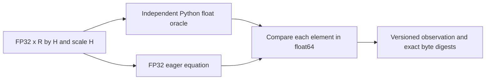

# Exact CPU tensor references and GPU preparation

This AI-written H12–H14 packet makes each tensor and identity inspectable before GPU profiling or training. The numerical reference is an executable equation; it is not a pretrained model or a serving engine. The [implementation research audit](../research/implementation-learning-research-audit-2026-10-08.md) specifies its distinguishing counterexample. Human prediction, teach-back, transfer and mastery remain pending.

**VI:** Ta có thể xây code trước rồi học theo từng dòng. Nhưng “CPU output đúng” khác “GPU kernel nhanh”, khác “coding agent giải task tốt”, khác “Huy đã tự giải thích được”. Mỗi loại evidence phải nằm đúng cột.

From the workspace root:

```sh
.venv/bin/python -m compute
.venv/bin/python -m compute.attention
.venv/bin/python -m compute.cache
.venv/bin/python -m compute.rmsnorm
.venv/bin/python -m compute.cuda_benchmark --preflight
.venv/bin/python -m compute.cuda_benchmark --backend math --repeats 10
.venv/bin/python -m unittest discover -s tests -p 'test_compute.py' -v
```

Current frozen validation uses `.venv/bin/python`, Python **3.12.11 / PyTorch 2.14.1**, with CUDA unavailable on 2026-10-09. The historical [CPU trace](cpu-trace.json) and [CUDA status](cuda-status.json) were produced on 2026-10-08 by `/Users/danghuyhoang/.pyenv/versions/3.11.7/bin/python3` with PyTorch 2.7.1. The separately preserved `*-python313.json` files record the `/opt/miniconda3/bin/python` Python 3.13.2/PyTorch 2.11.0 run. Those records remain historical evidence and are not overwritten to represent current source. The commands above run the current reference and print fresh results. Absent PyTorch reports an unavailable tensor dependency, and CUDA preflight emits a structured skip; there is no MPS/CPU substitution under a CUDA label.

**VI:** Documentation mới của PyTorch có thể khác bản đang chạy. Trace ghi version thật của interpreter; đừng dùng đường dẫn `miniconda` để đoán version. MPS có mặt trên Mac không phải CUDA, và CPU test pass không thay thế GPU measurement.

## Contracts and tiny trace

| Component | State/data owner and invariant | Independent distinguishing experiment |
|---|---|---|
| Attention | Q[B,Hq,U,D], K[B,Hkv,C+U,D], V[B,Hkv,C+U,Dv]; same dtype/device; Hq divisible by Hkv | Cached Q=0, K=0, V=[2,4,8,10], C=3 => output 6; wrong upper-left causal => 2 |
| Tensor ledger | Actual tensor shape/stride/dtype/device/storage and logical byte counts | Noncontiguous view: storage bytes can exceed logical view bytes; prefix/full suffix equality |
| KV calculator | Explicit L/B/T/Hkv/D/Dv/element bytes/block rounding | L=2,B=1,T=4,Hkv=1,D=Dv=2,b=2 => 64 ideal bytes |
| Prefix cache | Full-block chained content hashes plus model/tokenizer/template/adapter/namespace/layout/dtype; explicit owner pin sets | Same second block under different parent cannot hit; tenant/adapter changes miss; pinned pressure rolls back acquisition |
| Offline objective | Exact sampled/trainer IDs, token roles/mask, behavior/current policy versions and reward provenance | Observation logprob changes do not affect action loss; mixed versions fail; all-equal reward yields zero advantage |
| Optional CUDA benchmark | Explicit device/backend/seed/input layout/tolerance; matched eager/SDPA samples checked before event timing | CUDA absent => skipped; unsupported backend never silently falls back |

**VI:** Cache cần biết “đây là token của prefix nào dưới model/adapter/tenant nào”. Cùng text sau một template khác có thể không có cùng token IDs hoặc KV. Pinned blocks biểu thị còn chủ sở hữu thật; lease hết hạn không tự giải phóng bộ nhớ đang dùng.

For query local index i, global position is C+i. It may read key j iff `j <= C+i`. Head h maps to KV head `floor(h/(Hq/Hkv))`. Derive `score_j = sum_d Q_d*K_jd / sqrt(D)`; mask future positions, subtract max for stable softmax, normalize exponentials, then take the weighted V sum. With Q/K zero and four allowed keys, scores=[0,0,0,0], probabilities=[.25,.25,.25,.25], output=.25*(2+4+8+10)=6. A nonsquare `is_causal=True` call applies the documented upper-left mask and returns 2 for this case. Cached suffixes therefore use a Boolean absolute-position mask with `is_causal=False` and `dropout_p=0`.

**VI:** Bug nằm ở tọa độ: i=0 là query đầu trong suffix nhưng là token số 3 toàn sequence. Dùng tam giác trên-trái cho 1×4 khiến query chỉ nhìn key số 0. Q=0 cố ý loại dot-product ra khỏi thí nghiệm để chỉ kiểm tra mask.

The eager reference physically repeats KV heads, accumulates scores/output in float64, and casts output to the input dtype. The independent scalar oracle loops over actual head/index domains without calling the mask helper. SDPA uses the same semantic mask and deterministic dropout setting. Tests compare cold full causal output against cached appends for multiple C/U/head ratios, including noncontiguous inputs, and perturb future V tokens to prove they cannot affect earlier queries. Physical GQA expansion here is a reference convenience, not evidence an engine stores expanded KV heads.

**VI:** Scalar oracle phải khác đường đi của implementation để không cùng sai vì một helper mask. Ledger phân biệt `logical_bytes` của view và `storage_bytes` của allocation được share; cộng hai storage bytes của hai view cùng storage sẽ double-count nếu dùng làm peak allocator estimate.

Ideal KV bytes are `L*B*T*Hkv*(D+Dv)*element_bytes`; with D=Dv this reduces to `2*L*B*T*Hkv*D*element_bytes`. Query head count changes score compute but does not appear in this storage equation. Block rounding adds unused token positions. Weight memory, activations, graph/workspace buffers, fragmentation, headroom and sharding/replication remain separate. A byte calculator cannot prove per-rank capacity or an SLO.

**VI:** Hai trong công thức là hai tensor K và V, không phải hai agent. Nếu tăng Hq mà giữ Hkv, compute và KV memory không tăng cùng tỉ lệ. “Tổng VRAM của cluster đủ” vẫn có thể thất bại nếu một rank giữ nhiều layer/buffer hơn.

Offline action loss uses only action-token log-probabilities. For ratios [1.5,.5], advantage +1 and epsilon=.2, clipped ratios are [1.2,.8], the PPO min contributions are [1.2,.5], and mean loss is -.85. Advantage -1 yields min [-1.5,-.8] and loss +1.15. Observation and padding tokens contribute nothing. Zero-action trajectories return an explicit zero-action flag/loss 0; all-equal reward groups return zero variance/advantages. The validator rejects retokenized sequences, bad masks, unrecorded policy lag, mixed policy versions and infrastructure rewards without a separately declared policy. Token IDs, masks, policy versions, cache block counts and benchmark dimensions are nonboolean integers; logprobs, rewards and loss inputs must be finite nonboolean numbers. Cache acquisition returns detached observations/history, so editing an observed key list cannot alter owned block references or prevent release. These floats are offline arithmetic; no gradient, optimizer, rollout-quality or training-improvement claim follows.

**VI:** Khi reward bằng nhau, normalization không tạo learning signal mới từ hư không. Nếu sample token A nhưng trainer học token B sau reserialize, ratio behavior/current đã mất nghĩa; chỉ giữ cùng text là chưa đủ.

CUDA timing uses a declared math/flash backend, three independent matched correctness samples before warmup, raw synchronized CUDA-event timings, starting allocated/reserved residency, absolute and incremental peaks, and explicit transfer/expansion/compilation boundaries. Every warmup/timed output is released before the next sample or arm. Peaks are sampled before post-timing error arithmetic creates scratch tensors. Warmup primes each arm; allocator reserved blocks remain cached across repeats/arms without `empty_cache`, and that warm policy is reported. Baselines include live Q/K/V, expanded KV, mask and the reference output. Incremental peak subtracts starting residency; a zero reserved increment is not zero live memory or a fresh-device capacity measurement. Flash with an unsupported offset Boolean mask returns unsupported rather than substituting another kernel. This environment has no CUDA; the GPU measurement path is prepared and **hardware validation pending**. Python SDPA calls do not establish actual CTA/warp/Tensor Core mapping; that requires selected kernel inspection and profiler evidence.

**VI:** Reset peak stats chỉ reset counter; không giải phóng tensor còn reference hay allocator cache. Nếu sample trước vẫn giữ output khi sample mới bắt đầu, peak bị tính cả hai output. Report phải ghi baseline và policy warm cache. CUDA launch là asynchronous: đo clock host quanh API call có thể chỉ đo enqueue. Event synchronization mới đo hoàn thành device work. Eager reference materialize score matrix nên memory có thể cao hơn fused kernel; không được đổi workload rồi gọi là speedup matched.

The memory distinction follows the official [maximum allocated tensor memory](https://docs.pytorch.org/docs/2.14/generated/torch.cuda.memory.max_memory_allocated.html) and [maximum reserved allocator memory](https://docs.pytorch.org/docs/2.14/generated/torch.cuda.memory.max_memory_reserved.html) contracts; their descriptions were also checked in installed PyTorch 2.14.1. The `stable` source links currently redirect to 2.14, matching this frozen interpreter. CPU tests validate the pure baseline/peak arithmetic and reject invalid dimensions before CUDA preflight; they do not fabricate CUDA timing or peak measurements.

**VI:** Allocated nói về tensor đang sống; reserved nói về pool allocator giữ để tái dùng. Hai con số phục vụ hai câu hỏi khác nhau. Không có GPU thì helper arithmetic có thể đúng nhưng peak thực vẫn chưa được đo.

Primary sources: [PyTorch 2.7 SDPA semantics](https://docs.pytorch.org/docs/2.7/generated/torch.nn.functional.scaled_dot_product_attention.html), [PyTorch 2.7 CUDA synchronization](https://docs.pytorch.org/docs/2.7/notes/cuda.html), [vLLM prefix cache design](https://docs.vllm.ai/en/latest/design/prefix_caching/), [PagedAttention paper](https://arxiv.org/abs/2309.06180). The latter sources are rationale, not local engine-performance reproduction.

## Verified vertical code reading path

Read the [absolute-position mask](attention.py#L36), [eager equation](attention.py#L64), [independent scalar oracle](attention.py#L92), [SDPA dispatch](attention.py#L119), [6-versus-2 test](../tests/test_compute.py#L18), [cache acquisition/rollback](cache.py#L77), [trajectory validator](trajectory.py#L27), [action loss](trajectory.py#L79), and [CUDA benchmark boundary](cuda_benchmark.py#L70). These anchors were refreshed against audited source declarations on 2026-10-09. The actual model/trainer/serving-engine consumer is absent; the next implemented layer is the deterministic test and CLI trace.

**VI:** Bài transfer đang chờ Huy: đặt C=2,U=2 rồi tự vẽ mask 2×4; hàng đầu được thấy key nào, hàng sau được thấy key nào? Sau đó đổi Hq=4,Hkv=2 và trace head 3 đọc KV head nào. Đừng ghi câu trả lời AI thành prediction của em.

## NV-S0: RMSNorm numerical foundation

**Implemented and CPU-verified, 2026-10-10.** The [frozen contract](../capstone/07-reference-implementation-spec.md#nv-s0-frozen-cpu-numerical-contract) owns the supported envelope and fixed tolerance. RMSNorm rescales each row by its root mean square, then applies one weight per column. This supplies a correctness target for the later NVIDIA coding workload. It does not execute an agent-generated candidate. [Independent review](../research/nvidia-s0-review-2026-10-10.md), [verification](../research/nvidia-s0-verification-2026-10-10.json) and [saved trace — local-only](../docs/github-snapshot.md#omitted-local-evidence) retain the implementation evidence.

**VI:** Trước khi hỏi kernel nhanh hơn bao nhiêu, phải định nghĩa output đúng là gì. RMSNorm xử lý từng row độc lập; weight theo cột được broadcast qua các row. S0 kiểm toán học trên CPU, chưa nối model vào việc viết CUDA.



Read [validation](rmsnorm.py#L43), [scalar oracle](rmsnorm.py#L85), [FP32 eager path](rmsnorm.py#L99), [logical byte identity](rmsnorm.py#L108), [comparison/storage boundary](rmsnorm.py#L124), then [teaching trace](rmsnorm.py#L180). The first row of the saved two-row trace is:

| Transformation | Shape / precision | Exact operation or displayed result |
|---|---|---|
| Input and scale | x[1,3], scale[3], FP32; 12 bytes each | x=[1,2,2], scale=[1,-2,0.5] |
| Square and reduce | [1,3] → [1,1], FP32 eager | [1,4,4] → (1+4+4)/3=3 |
| Add epsilon then root | [1,1], FP32 eager | sqrt(3+0.00001), displayed 1.7320537567138672 |
| Divide and broadcast scale | [1,3], FP32 eager; 12 bytes | [0.5773493051528931, -2.3093972206115723, 0.5773493051528931] |
| Independent scalar oracle | [1,3], float64 result; 24 bytes | [0.5773493069415827, -2.309397227766331, 0.5773493069415827] |
| Compare | One predicate per element | abs(actual-reference) <= 1e-5 + 1e-4*abs(reference) |

**VI:** Hai output hơi khác vì đường eager làm tròn FP32 từng bước. Oracle đọc đúng giá trị FP32 đầu vào rồi tính bằng Python float và `fsum`, không làm tròn đáp án về FP32 trước khi so. Mean-square có shape[1,1] nên chia được cho cả row; scale[3] áp dụng riêng cho từng cột.

The trace's tiny second row makes epsilon placement visible: `sqrt(mean_square + epsilon)` differs sharply from `sqrt(mean_square) + epsilon`. [Wrong-equation controls](../tests/test_rmsnorm.py#L101) reject omitted scale, an omitted reduction tail, the wrong divisor and an unwritten output tail. [Tolerance tests](../tests/test_rmsnorm.py#L131) use adjacent representable FP32 outputs and cases where rounding the oracle would reverse the verdict. These are public development controls, not held-out coding tasks.

**VI:** Random input thông thường có thể che lỗi epsilon vì epsilon quá nhỏ so với mean-square. Chọn input gần zero là một thí nghiệm phân biệt nguyên nhân. Test tốt phải khiến implementation sai có thể quan sát được, không chỉ lặp lại cùng công thức.

The reviewer found and reproduced two boundary defects before repair: [nested tensors](../tests/test_rmsnorm.py#L314) can appear strided yet reject ordinary shape access; [different storage wrappers](../tests/test_rmsnorm.py#L328) can overlap the same bytes despite unequal base pointers. Validation now rejects nested tensors early and compares entire storage address intervals. [Identity tests](../tests/test_rmsnorm.py#L339) preserve lazy-negative logical values and distinguish signed zero. Observations contain detached JSON metadata, not live tensors or executable provenance.

**VI:** Địa chỉ đầu khác nhau chưa chứng minh hai vùng nhớ độc lập. Phải xét khoảng bytes mà storage sở hữu. Digest khớp chỉ nhận diện tensor đã đưa vào checker; nó chưa xác thực source/binary nào đã tạo tensor đó.

Run `.venv/bin/python -m pytest -q tests/test_rmsnorm.py` for the 14 new test methods. The saved selected regression run covers these plus existing compute, research and artifact tests: **76 passed, 146 subtests passed; one external Docker test skipped because no image was opted in**. Python3.12.11/PyTorch2.14.1, CUDA unavailable. No runtime schema, dependency, default CLI or workload-population change was required. The next shared integration foundation is the existing failure-evidence/regression adapter; GPU build/isolation/measurement design follows [NV-S1](../capstone/07-reference-implementation-spec.md#ordered-implementation-slices). Huy's current lesson stays H0; H12 uses this source when reached.

**VI:** Code và test đã có không tự điền mastery. Khi học H12, hãy tự dự đoán output khi scale bằng zero, chuyển epsilon ra ngoài sqrt, hoặc để output share storage với input rồi giải thích từng boundary. GPU nhanh/chậm và agent cải thiện code là các câu hỏi sau, cần evidence riêng.

## Trusted RMSNorm qualification preparation — 2026-10-11

The new [trusted probe](rmsnorm_cuda.py) and [strict plan/observation contract](gpu_contract.py) extend NV-S0's authored numerical reference. Follow the [runbook](../ops/runbooks/trusted-gpu-probe.md), [frozen boundary](../research/gpu-boundary-spec-2026-10-11.md), [independent review](../research/gpu-probe-independent-review-2026-10-11.md) and [readiness evidence](../research/system-readiness-plan-2026-10-11.md). Default configured invocation produces `not_run` without Torch or a child. The optional bounded child compares only authored FP32 eager/library RMSNorm against independently checked FP64 semantics, with exact fixture/source identities, synchronized timing and output-lifetime/allocator controls.

Actual CUDA correctness/performance is unmeasured on this Mac. Missing driver/partition/concurrency qualification withholds qualified ratios. Process exit and allocator limits never prove device isolation or retirement. Generated `.cu` build/launch isolation, durable GPU reservations and fault/health/retirement remain unimplemented parts of NV-S1 before any NV-S2 agent optimization. This source preparation changes neither the paid-execution hold nor human H12 mastery.

**VI:** Ta kiểm toán phép đo trước khi có GPU: output phải đúng, timing phải đợi device, memory phải xét lifetime. Mock chỉ chứng minh controller yêu cầu đúng thứ tự; hardware mới cho số đo thật.
