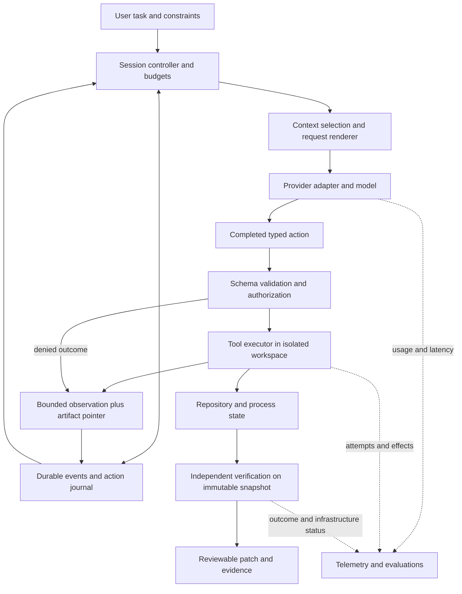

# Coding agents from first principles

A coding agent is a feedback system that uses a learned model to choose actions in a changing software environment. A harness connects model output to those actions and owns the protocol, control limits and evidence needed to continue. Its quality depends jointly on the model, tools, environment, context selection and evaluator. Success is a verified software change under stated constraints, not a persuasive final response.

**VI:** Model dự đoán hành động tiếp theo từ thông tin đang thấy; harness biến dự đoán ấy thành một hành động có hậu quả thật. Nếu tool trả thiếu dòng lỗi, model đang giải một bài toán khác. Nếu evaluator dễ bị sửa, điểm cao chưa chứng minh phần mềm đúng.

## 1. The smallest mathematical model

The NVIDIA specialization applies this same loop to generated GPU code. Its first [NV-S0 slice](../capstone/07-reference-implementation-spec.md#nv-s0-frozen-cpu-numerical-contract) establishes a CPU numerical oracle; later slices add isolated build, independent measurement and agent feedback. A numerical observation is evidence about supplied values, not proof of executable identity, GPU performance or task acceptance.

Let `s_t` be the actual environment state: repository bytes, processes, remote services and permissions. The harness stores a durable event history `E_t`, selects context `c_t = render(select(E_t, s_t))`, and requests an action `a_t ~ πθ(. | c_t)`. A validator and authorization policy either accept or reject the action. Executing an accepted action changes the environment and produces an observation:

```text
(s_(t+1), o_(t+1)) = execute(s_t, a_t)
E_(t+1) = append(E_t, action, outcome, provenance)
c_(t+1) = render(select(E_(t+1), s_(t+1)))
```

The model does not see `s_t` directly. A read returns a partial, possibly stale observation. The harness also cannot treat its journal as perfect knowledge of external state: a process can crash after an edit succeeds and before recording the outcome. This is a partially observed control problem implemented by an ordinary distributed system.

**VI:** Hãy tưởng tượng kỹ sư điều khiển robot chỉ nhìn camera từng khung hình. File hash và test log là cảm biến; tool call là động cơ. Ghi vào nhật ký “đã định sửa” khác với chứng minh ổ đĩa “đã sửa”. Khoảng cách giữa hai việc này tạo ra bài toán retry và recovery.

The optimization target is constrained, not a single benchmark maximum. For your prototype, track verified task completion, critical policy violations, dollars per completed task, latency distribution and recovery behavior. A design decision must identify which metric it improves and which it may worsen. Treat tool schema and observation formatting as part of the effective policy interface, without equating the harness itself with the model's probability distribution.

**VI:** Đổi cách cắt log có thể tăng chất lượng mà không đổi trọng số. Đổi model có thể giảm số lượt nhưng tăng giá mỗi lượt. Tối ưu hệ thống cần nhìn cả tử số và mẫu số của “chi phí cho một task đã xác minh”.

## 2. Separate the three kinds of state

| State | Owner and purpose | Important failure |
|---|---|---|
| Durable session events | Session store; records intent, attempts, observations, decisions | Lost or duplicated events; ambiguous side effects |
| Model input and opaque continuation items | Context builder and provider adapter; current information available to the model | Invalid tool pairing, stale facts, lost reasoning item, lossy compaction |
| Environment state | Workspace, sandbox, process manager and remote systems | Unrecorded edits, surviving child processes, stale index, leaked capability |

The event history can remain append-only while the next model input is shortened or rebuilt. A correct design records the transformation and preserves recoverable source evidence. Anthropic publicly describes separate session, harness and sandbox interfaces in Managed Agents; Cursor describes separating conversation storage, agent workflows and machines in its cloud system. These are product-specific reports supporting this separation, not proof that every agent uses the same implementation. [Anthropic Managed Agents](https://www.anthropic.com/engineering/managed-agents), [Cursor cloud agents](https://cursor.com/blog/cloud-agent-lessons).

**VI:** “Không sửa lịch sử” nên hiểu là không làm mất bằng chứng gốc. Context gửi cho model là một view có thể thay đổi theo budget và giao thức. Nếu gộp log với context, compaction sẽ vô tình xóa dữ liệu cần cho audit hoặc phục hồi.



This is the proposed reference architecture. The next sections trace its boundaries down to bytes, tensors and processes.

## 3. Trace one coding action all the way down

| Step | Concrete object crossing the boundary | Required contract |
|---|---|---|
| 1. Task intake | UTF-8 task, repository revision, task/session IDs | Scope and environment identity are explicit |
| 2. Context rendering | Instructions, selected file ranges, tool schemas, typed prior results | Correct roles, stable serialization where useful, provider-specific opaque items preserved |
| 3. Tokenization | Integer token IDs of shape `[B,T]` and positions | Actual template and tokenizer revision are known for self-hosted models |
| 4. Inference | Hidden states, attention, KV storage, sampled output IDs | Compatible cache identity; model and generation configuration recorded |
| 5. Streaming | Arbitrary network bytes → events → content blocks → final arguments | A chunk is neither necessarily a token nor complete JSON |
| 6. Dispatch | `(session, call_id, name, arguments, attempt)` | Validate and authorize before execution; distinguish logical call from retry |
| 7. File edit | Expected file digest, unique old text, replacement | Reject stale or ambiguous edit; atomic visibility where supported |
| 8. Verification | Patch plus base revision into a clean environment | Grader and expected outputs outside candidate write authority |
| 9. Continuation | Correlated result with success, failure or unknown outcome | Resolve or terminate pending calls before normal continuation |
| 10. Delivery | Patch hash, test evidence, limitations | Result corresponds to the exact patch tested |

**VI:** Chọn `call_id=edit-1` và theo dấu nó từ JSON tới file bytes rồi quay lại transcript. Khi em không chỉ được “ai sở hữu dữ liệu này” hoặc “dữ liệu nào chứng minh bước trước thành công”, đó là lỗ hổng thiết kế cần xử lý.

The supplied lab implements steps 6–9 with a scripted model and a trusted fixture. It does not implement the tokenizer, network protocol, isolation or GPU layers. [Lab walkthrough](../lab/README.md) links every implemented boundary to its code and contract test.

## 4. From attention to cache engineering

For conventional causal attention in one layer:

```text
X:       [B,T,d_model]
Q:       [B,h_q,T,d_head]
K,V:     [B,h_kv,T,d_head]
scores:  Q Kᵀ / sqrt(d_head) + causal_mask
output:  softmax(scores) V
```

In grouped-query attention, each KV head serves several query heads. For each new position, its upper-layer hidden state depends on preceding tokens. Therefore, reusing a cached prefix requires compatible computation: tokens, positions, weights/adapters, attention configuration and relevant modalities. Equality of all these inputs is a sufficient conservative reuse rule. It is not a theorem that every changed token necessarily changes every later KV entry, nor that JSON byte equality is the fundamental requirement.

**VI:** Cache giữ kết quả tính, không giữ “ý nghĩa câu”. Hai request JSON khác khoảng trắng có thể tạo cùng token; hai request nhìn giống nhau lại có thể dùng adapter khác. Server phải kiểm tra đủ identity của phép tính, thường bằng hash có namespace và model/config metadata.

For `L` layers, `h_kv` KV heads, head dimension `d` and `b` bytes per element, the ideal unsharded GQA KV storage is:

```text
B_KV = 2 × L × T × h_kv × d × b  bytes per sequence
```

The factor two represents K and V. With the **illustrative**, deliberately tiny values `L=2`, `T=4`, `h_kv=1`, `d=2`, `b=2`, storage is `64 bytes`. In each layer, K is `[1,4,2]`, eight two-byte numbers or 16 bytes; V adds 16 bytes, and two layers give 64. Appending one token adds 16 bytes across the two layers. A changed token at position 3 prevents a conventional exact-prefix cache from reusing positions 3 onward, while positions 1–2 can still match. Actual block granularity may make the reusable portion shorter.

**VI:** Hãy tự vẽ 4 hàng, mỗi hàng là một token, cho K và V. Thêm một token nghĩa là thêm một hàng vào cả hai bảng ở mỗi layer. Cache làm giảm việc tính lại bảng cũ; token mới vẫn phải truy cập thông tin trong bảng đó để tạo attention.

Storage layout changes the answer. MLA can store a compressed latent rather than expanded per-head K/V. Sliding-window attention retains a bounded region. Recurrent/hybrid layers hold state plus snapshots needed for prefix reuse or rollback. Tensor parallelism can shard or replicate these structures. Derive bytes from the actual implementation and configuration, then compare with allocation logs; do not reuse the GQA formula blindly.

**VI:** Đừng lấy “active parameters” của MoE để tính dung lượng weights: expert không được chọn trong một token vẫn cần hiện diện hoặc được tải. Cũng đừng suy số session production từ KV bytes duy nhất; workspace, fragmentation, replication và latency SLO cùng giới hạn hệ thống.

## 5. Token work, money and latency are different quantities

Assume `N≥1` requests, initial input length `P`, and exactly `Δ` new input tokens per later request. There is no truncation, eviction, compaction or model switch, and reuse is perfect. Then:

```text
Input_t = P + (t−1)Δ
U = sum(Input_t) = NP + ΔN(N−1)/2
W = unique tokens in the growing input prefix = P + (N−1)Δ
R = reused input tokens = U−W
```

For `P=20,000`, `Δ=3,000`, `N=100`, `U=16,850,000`, `W=317,000`, `R=16,533,000`. These are computed quantities, not a workload measurement. `W` is linear in N while `R` and a nonzero cache-read bill remain quadratic under this indefinitely growing-context model. W is a fresh-prefill work proxy only when each incremental input must actually be prefilled: previous output may already have resident KV, and billing categories are provider-specific. The lab checks the formula against explicit sums. At `N=1`, `R=0`; at `Δ=0`, every later request reuses P tokens.

**VI:** “Ít prefill hơn 53 lần” không có nghĩa task nhanh hơn 53 lần hay rẻ hơn 53 lần. Output tokens, tool time, cache-read billing và queue vẫn tồn tại. Phải xác định đang đếm token, FLOP, byte, giây hay dollar.

Use non-overlapping provider usage fields:

```text
cost = (uncached × p_in + written × p_write + read × p_read + output × p_out) / 10^6
```

Here prices are USD per million tokens, and each input token belongs to exactly one billing category for that request. Some APIs include cached tokens within total input, so normalize the adapter output before summing. Model-specific prices and cache eligibility are contracts to verify at experiment time. Example pricing is documented in the dated product audit rather than hardcoded into the lab.

For a causal Transformer, a useful **approximate compute model** for appending `u` tokens to a cached prefix `C` is:

```text
F ≈ 2 N_active u + 4 L h_q d (Cu + u(u+1)/2)  FLOP
```

The first term approximates weight multiplication; the second counts attention score and value products. Constants omit implementation details and some operations. At `C=0`, the quadratic attention term remains. At `u=1`, attention still scales with C. FLOP divided by a guessed peak utilization is a bound or estimate, not measured TTFT.

**VI:** Sai lầm quan trọng trong bản cũ là đặt `C=0` rồi quên luôn attention giữa các token mới. Kiểm tra limiting case là công cụ bắt lỗi lý thuyết rẻ nhất trước khi profile trên GPU.

For the wall-clock critical path, measure:

```text
task time = queue + environment setup + model calls + tool critical paths + verification
model call ≈ network/request + queue + prefill/restore + decode + response handling
```

Parallel independent tools contribute approximately their maximum duration plus orchestration overhead, not their sum. Dependent operations remain serial. A useful lower-bound view of decode is `max(compute/FLOP_rate, moved_bytes/bandwidth)` plus communication and scheduling; it does not replace a profiler. Track p50/p95/p99 and failures as well as averages.

## 6. Actions, retries and the impossible transaction

Consider four states: `proposed → accepted → running → completed`. Authorization rejection is a terminal outcome. Cancellation and timeout may be terminal observations while the external effect remains uncertain. A unique result per accepted logical call is a protocol design goal; it does not provide exactly-once external execution.

```text
1. Journal action_started
2. Tool changes the file or remote service
3. Journal tool_result
```

A crash between 2 and 3 leaves an ambiguous outcome. Blindly retrying can duplicate an effect. Reconcile the target state, use service-supported idempotency keys, or surface `outcome_unknown`. A single SQLite transaction cannot atomically commit an unrelated remote API call. The lab deliberately recovers uncertain actions as unknown.

**VI:** Đây là điểm mà demo agent thường che mất. “Không thấy result” không có nghĩa “chưa chạy”. Em phải biết operation là read-only, idempotent, có thể kiểm chứng bằng hash, hay không thể an toàn chạy lại.

A file hash check prevents an edit based on stale content in the single-owner case. It is not a lock against a concurrent malicious writer. Atomic rename prevents readers seeing a partially written file on the same filesystem; crash durability also involves flush policy, directory metadata and platform behavior. Tool validation, process containment and distributed concurrency are different contracts.

## 7. Verification and learning have separate jobs

The model proposes. Tests, builds, static checks and human review supply different forms of evidence. A passing narrow suite only establishes the conditions that suite checks. Independent evaluation should consume an immutable patch snapshot; otherwise a patch can change after it was tested. Record task correctness separately from infrastructure failure and report an end-to-end completion rate that includes infrastructure outcomes.

**VI:** “Test pass” là một mệnh đề có phạm vi: tests nào, trên commit nào, image nào, resource nào. Nếu model sửa luôn expected output, hoặc test chạy trên revision cũ, mệnh đề ấy không chứng minh bản sửa hiện tại đúng.

For RL extensions, a rollout is a sequence of sampled assistant tokens interleaved with environment observations. Only policy-sampled actions receive the policy-gradient mask; templates, tool output and padding do not become sampled actions because they are in the context. Preserve actual sampled IDs, model versions and behavior log probabilities. A text decode/re-encode can change token identity. The serving/training audit gives the estimator assumptions; the curriculum makes this an advanced extension after the evaluator is trustworthy.

**VI:** Reward là feedback cho quá trình học, nhưng grader vẫn là phần mềm có thể lỗi. Chỉ nên tối ưu mạnh sau khi biết metric đang đo đúng; nếu không, RL tìm lỗ hổng trong reward nhanh hơn em tìm bug trong agent.

## 8. Demonstrate understanding

Explain these without looking at the text, then change one condition and predict the trace:

1. A cached request becomes slow without losing its cache hit. Which two measurements distinguish decode pressure from a slow tool?
2. A tool succeeded but the worker died before logging its result. Which evidence permits retry, and which does not?
3. Two agents read the same file and propose individually valid edits. Why are two hash checks insufficient without an ownership/commit protocol?
4. Compaction reduces prompt length and makes success worse. What information was lost, how can it be recovered, and what ablation isolates the cause?
5. A model says every test passed, but no verifier event exists. What is the only justified status?

**VI:** Tiêu chuẩn qua phần này là em tự dựng được một ví dụ phản chứng cho thiết kế sai. Khi đổi provider, đổi repository hoặc đổi serving architecture mà vẫn tìm đúng invariant, kiến thức đã bắt đầu chuyển thành năng lực hệ thống.
