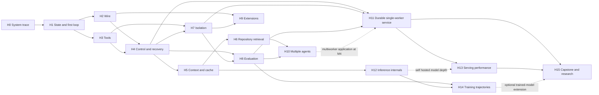

# Production route and concept reference for coding agents

**Since 2026-10-16 ([D046](../context/decision-log.md#d046-production-backward-learning-replaces-mastery-gates)):** learning starts from production traces, not from this sequence. The [build-ordered route](#build-ordered-route-2026-10-14) says what ships next and which decision Huy owns. The H0–H15 sections are a concept reference that traces draw on when they need it. Mastery gates, the rubric as a requirement, session quotas and retrieval schedules are retired. Where older text below says a module "requires" evidence or names a human gate, read it as an optional self-check from the [trace log](05-mastery-tracker.md#self-check-menu-optional).

**VI:** File này giờ là bản đồ khái niệm và lộ trình build, không phải giáo trình phải học theo thứ tự. Trace thật cần khái niệm nào thì mở đúng mục đó.

The outcome is a coding-agent system you can explain, measure and recover, plus the ability to reason about an unfamiliar implementation. Study Claude Code and Cursor through their public contracts and engineering reports; use pinned Codex and mini-SWE-agent source to inspect real implementation details. Your own harness is the controlled experiment connecting these views.

**VI:** Em không cần biết bí mật nội bộ Anthropic để đạt năng lực hệ thống sâu. Em cần nối được một quyết định sản phẩm tới giao thức, state machine, process, token, bộ nhớ và phép đo; rồi chứng minh giải thích đó vẫn đúng khi điều kiện thay đổi.

## How to use the plan

The October10 [codebase audit](../research/codebase-refactor-spec-2026-10-10.md) supplies new counterexamples for H0/H4 ownership, H7/H9 execution and protocol boundaries, and H8/H15 evidence quality. Reuse them in the existing sessions; no new module or mastery credit follows from AI repair.

The selected long-term role is **Staff Research Engineer, Multi-Agent Scaling at Anthropic**. Use the [single role and research contract](../capstone/06-target-role-and-research-contract.md) for skill priorities and evidence. Keep this H0–H15 sequence; emphasize trustworthy experimentation, durable agent execution, long-horizon coordination and resource allocation. Actual model training and custom GPU-engine work remain optional. No credential program or additional H-module is introduced.

The **NVIDIA specialization**, added October 10, targets **Senior Research Engineer — AI Coding Tools, advertised Level 6** through that same contract. Reuse H6/H9 for versioned developer knowledge and a narrow profiler interface, H12/H13 for one independently measured CUDA coding workload, and H14/H15 for reviewed data lineage and actual use. [Role audit](../research/nvidia-role-alignment-2026-10-10.md), [NV1–NV3 contracts](../capstone/07-reference-implementation-spec.md#nvidia-coding-tools-specialization). GPU measurement is necessary for that specific performance claim; self-hosted inference and model training remain conditional. These additions are outside the old hour estimate until scoped, and do not alter hackathon delivery priority.

**VI:** Role được chọn giúp quyết định phần nào cần evidence sâu hơn. Reference được AI xây trước theo yêu cầu mới; ta dùng nó để học từng cơ chế, không coi tên role hay code đã giao là năng lực Huy đã chứng minh.

**Implementation-first reference preference, 2026-10-08:** [D012](../context/decision-log.md) supersedes the earlier learn-before-build sequence. Audit/specify component purpose, state owners, invariants, source references, failure modes and distinguishing checks, then let AI implement the reference. The [reference specification](../capstone/07-reference-implementation-spec.md) and [coverage register](../capstone/08-implementation-coverage.md) distinguish delivered behavior, source gaps and unmeasured operations. Learn from [the H0 runtime packet](../study/packets/H0-reference-runtime.md) and [the line-by-line code-reading guide](06-reference-code-reading-guide.md), following H0–H15. Record Huy's actual predictions, teach-backs and transfer evidence separately. Existing evidence can satisfy a gate without repeating completed study. Use [the starting guide](../START-HERE.md) and [current state](../context/current-state.md) to resume.

**VI:** “Build” trong các module dưới đây được giữ như bài exercise và mapping tới contract; nó không chặn reference đã được Huy cho phép AI xây. Khi nói continue learning, ta tiếp cơ chế đang học qua trace, dự đoán và defect drill, không tự mở deployment. Những milestone proposal lịch sử không tự trở thành kết quả đã đạt.

This is the canonical concept sequence; the research report's H0–H13 table remains a design input. The [durable multiagent capstone](../capstone/README.md) is the implementation spine, with [eight proposed milestone contracts](../capstone/04-build-sequence-and-mastery-gates.md) reusing these modules. D012 changes reference implementation order while preserving those contracts and the human concept sequence. Since D046, traces draw on modules instead of completing them in order; AI implementation and local test passes are never recorded as Huy's understanding. Keep experiments in this folder; reuse relevant `fam`/`ladders` knowledge without changing those projects' plans or their separate training-data contracts.

**Historical effort model, not the remaining schedule:** the estimates below predate continuous implementation and are retained as planning context. Current work follows acceptance decisions without a daily-hour quota; reuse delivered code and existing evidence rather than adding these hours again.

A session means approximately 2–3 focused hours, including drawing/prediction, source inspection, a small experiment, design/review when relevant, and explanation/evidence. Allocate those activities within the session instead of assuming every session builds new code. The 52-session route is roughly **104–156 hours**. The role-focused capstone adds **104–180 hours** for integration, research and hardening beyond module prototypes, including the focused **24–40-hour increment** for scaling/allocation/independent-use evidence. Reuse builds and count pilot work once. The combined planning range is **208–336 hours**, approximately **18–28 weeks at 12 hours/week**. Deep GPU/RL specialization or substantial scale expansion can require more; no schedule guarantees mastery or hiring.

**VI:** Nếu đọc nhanh thì vẫn phải làm bài đổi điều kiện. Nếu đã có nền tảng từ `fam`, có thể qua gate sớm bằng bằng chứng thực hành, không cần học lại cả module. Đếm năng lực đã kiểm chứng thay vì đếm tuần.

Use short diagnostics when a prerequisite is first needed. An incorrect prediction identifies a focused lesson; it does not require a new curriculum. Recheck with a changed example after remediation and save Huy's actual reasoning in the existing session record. No prerequisite or mastery result has been recorded yet.

| Before | Diagnostic and discriminating observation | Minimal remediation if needed |
|---|---|---|
| H0/H1 | Trace a Python exception through a context manager and identify which file/database writes remain | Exceptions, cleanup and one transaction-boundary exercise on a trusted fixture |
| H2 | Split one UTF-8 character and one JSON argument across chunks; say which prefix is dispatchable | Bytes versus text, incremental parsing and complete-message validation |
| H3/H7 | Draw parent/child/pipe lifetimes; explain why killing one PID may leave a child alive | Linux processes, file descriptors, process groups and the separate containment boundary |
| H4/H11 | Interleave two budget reservations; identify the invariant violated by separate read then write | Transaction/compare-and-swap reasoning with two explicit timelines |
| H6/H10 | Given two branches, an interface dependency and a stale base, derive safe execution/integration order | Git base/tree identity, DAGs, critical path and conflict versus semantic compatibility |
| H8/M6 | Calculate a paired difference on four synthetic tasks and explain why repeated trials are not four new tasks | Conditional probability, sampling units, paired outcomes and task-clustered uncertainty |
| H12/H14, when used | Derive a tiny tensor's shape/byte count and distinguish an observation token from a sampled action token | Vectors/matrices, dimensions/dtypes and one masked-objective exercise; no training run |

**VI:** Diagnostic phải lộ cách nghĩ, không chỉ đáp án. Nếu em sai ở lifetime của child process, học đúng cơ chế đó rồi đổi case để kiểm tra lại; không thêm khóa Linux dài chỉ vì có một lỗi cụ thể. Python/async, Git và toán được học tại boundary đang cần dùng.

## Build-ordered route, 2026-10-14

[D044](../context/decision-log.md#d044-build-ordered-mastery-route) orders the existing modules by the build gates that now run live under [D042](../context/decision-log.md#d042-live-execution-enabled-for-the-hackathon-path) and [D043](../context/decision-log.md#d043-production-evidence-is-the-primary-track). Since [D046](../context/decision-log.md#d046-production-backward-learning-replaces-mastery-gates), the stage order and each stage's artifact stand, while the rubric and tracker conditions are retired. Each stage's exercises (predict, break, transfer) are optional starting points for traces, recorded in a [trace note](../study/templates/session-note.md). This section decides **when** each concept is learned and **on which real artifact**. The module sections below remain the concept reference. It supersedes the CPU-only [first six sessions](#historical-first-six-sessions-superseded-2026-10-14).

**VI:** Không thêm curriculum mới. Ta đổi thứ tự học cho khớp với thứ tự build: mỗi khái niệm được học đúng lúc hệ thống thật cần nó, trên artifact thật mà cổng build vừa sinh ra. Các mục H0–H15 bên dưới vẫn là tài liệu khái niệm gốc.

### The problem, the bet and what each stage proves

A coding agent is a partially observed control loop implemented on an ordinary distributed system ([first-principles map](01-first-principles-and-system-map.md)). The model only proposes. The harness decides what the model sees, which actions are admitted, what survives a crash and how "done" is verified. Public 2026 reports from Anthropic, OpenAI and Cursor attribute much of product behavior to that harness ([public evidence](../research/frontier-harness-patterns-2026-10-11.md), [practice audit](../research/mentoring-operating-model-2026-10-11.md)).

The problem this project works on is making long-running autonomous coding **trustworthy and economical**. Every claimed fix is verified on exact bytes. Every unit of money is accounted for, including uncertain charges. Every crash leaves a defensible state. Every added agent is justified by measurement. Unknown-aware billing, fenced owners and exact-candidate verification with full denominators are specified and tested locally here, not yet operated. We did not find these mechanisms in the pinned Codex source or the public Claude Code documentation we reviewed; absence from public material is not evidence of absence inside those products.

**The bet, our reasoning rather than a measured result:** stronger models run longer, act with more autonomy and become harder to evaluate. Skills whose value grows with model capability compound: verification, durable effects, containment, measurement and resource allocation. Skills that compensate for today's model weaknesses depreciate: prompt tricks and framework-specific wiring. The route invests deeply in the first group and treats the second as disposable tactics.

| Stage, target window | What ships | What it proves to another person | State on 2026-10-14 |
|---|---|---|---|
| S0 Before the first live call | Huy's written predictions | Understanding was recorded before observation | Not started |
| S1 G1 conformance, Oct 14–16 | One capped live Nemotron exchange through Nebius | The harness speaks a real provider protocol and accounts every unit | Waiting for catalog, model ID and rates |
| S2 G2 useful repair, Oct 16–22 | A live model repairs a real bug, verified independently, with a cost ledger | Useful repair with evidence; cost per verified fix by model | Waits for S1 |
| S3 G5 submission, Oct 22–29 18:00 | Public source, video, judge access through Dec 16 | Another person can reproduce, inspect and use it | Waits for S2 |
| S4 Product discovery, November | One preregistered experiment with kill criteria, chosen from G2 data | Whether users want the verified-fix workflow | Not started |
| S5 Production, December onward | Untrusted-code containment, SLOs, restore, rollback, incident record | Users can rely on it within a declared envelope | Not started |
| S6 Research result, target 2027 Q1 | 1/2/4 workers at a fixed budget, held-out confirmation | When agent teams help and what limits them | Not started |

Dates are targets; evidence gates govern progress. S4–S6 also depend on decisions D043 leaves open.

**VI:** Bài toán không phải "làm agent viết code", vì model đã làm được. Bài toán là làm cho agent chạy lâu mà vẫn **tin được và đáng tiền**: bản sửa được kiểm trên đúng bytes, tiền được ghi kể cả khoản chưa rõ, crash không làm hỏng trạng thái, và thêm agent phải có số liệu chứng minh. Cược của ta: model càng mạnh thì càng chạy lâu, càng tự chủ và càng khó đánh giá, nên kỹ năng kiểm chứng, giữ hiệu ứng bền vững, cách ly, đo lường và phân bổ tài nguyên càng có giá. Mẹo prompt và cách nối framework thì mất giá dần. Đây là lập luận, chưa phải kết quả đo.

### What frontier agent and research engineers are hired to do, as C1–C6

The [role contract](../capstone/06-target-role-and-research-contract.md#2-six-capabilities-that-matter-most) already reduces the targeted work to six capabilities; this plan adds no taxonomy. Read them through two lenses on the same system:

- **Agent and harness engineering**, building systems that act: C1 bounded execution, C2 durable ownership, C3 long-horizon information, plus H7 containment.
- **Research engineering**, establishing what is true and deciding what to do: C4 trustworthy research, C5 scaling and allocation, C6 a reproducible platform and clear findings.

| Capability | Fundamental constraint | Anthropic Multi-Agent Scaling, posting checked Oct 8 | NVIDIA AI Coding Tools, posting audit Oct 10 | OpenAI, public engineering reports only | First stage |
|---|---|---|---|---|---|
| C1 Bounded execution | Text is a proposal; an effect needs validation, authority and a receipt | Reliable infrastructure for large agent teams | Practical agent systems | Harness work shifts effort to environments, constraints and feedback, Feb 2026 | S1 |
| C2 Durable ownership | A crash separates effects from records | Reliable infrastructure for large agent teams | Verified results under resource and cleanup controls (NV1) | — | S2 |
| C3 Long-horizon information | Observations go stale; context is finite | Trustworthy long-horizon evaluation | Versioned toolkit knowledge reaching the request (NV2) | — | S4 |
| C4 Trustworthy research | A gain may come from chance, leakage or a weak grader | Design and interpret team experiments | Rigorous evaluation | Evaluate through the product harness, not a standalone loop, Sep 2026 | S2 |
| C5 Scaling and allocation | Serial work, contention and integration limit speedup | Scaling across team size, resources and horizon | Kernel, component and task benefit, counting all search cost | — | Cost from S1; scaling at S6 |
| C6 Usable platform | A result must be reconstructible by someone else | Understandable team behavior; enabling other researchers | Shipping to users; reviewed data lineage (NV3) | Daily use for code understanding, tests and incidents, Jan 2026 | S3 |

A dash means the audited material did not support a mapping, not a claim about that company. Experience, location and level requirements in the postings remain real and outside this plan's control.

**Principal-level behavior, our working definition.** The targeted level shows in five behaviors: choosing the next consequential problem and declining the rest; writing contracts that others build on; deciding under uncertainty with data and stating reversibility; owning outcomes in operation (cost, incidents, users); and producing results other people reuse. Each stage below names **one decision Huy owns**, recorded with alternatives, evidence and reversibility in the session note or decision log. AI-delivered code cannot supply this evidence.

**VI:** Hai lăng kính trên cùng một hệ thống: kỹ sư agent xây thứ hành động được an toàn (C1–C3 và H7); kỹ sư research xác định điều gì là thật rồi quyết định bước tiếp (C4–C6). Cấp principal không đo bằng số dòng code. Nó thể hiện ở quyết định: chọn đúng vấn đề, viết contract người khác dựa vào, quyết định có dữ liệu và nói rõ có đảo ngược được không, chịu trách nhiệm khi vận hành. Vì vậy mỗi giai đoạn có đúng một quyết định em tự sở hữu và ghi lại.

### 80/20 tiers

Tiers come from which gate needs a concept and which capability it proves, not from invented percentages. Inside each module, the first 20% to master is its **irreducible concept** in the [traceability map](#one-traceability-map-from-learning-to-role-evidence). Go deeper when a real artifact exercises it.

| Tier | Modules | Reason |
|---|---|---|
| Core, learn deeply now | H0, H1, H2, H3, H4, H8 | G1 and G2 cannot be trusted without them. They carry C1, C2 and C4, and every later tier assumes them |
| Gate to other people | H7, H11, H15 | Judge access and any untrusted repository need containment, a reproducible service and scoped claims (C1, C6) |
| Supporting, when real repositories bind | H5, H6, H9 | Context cost, retrieval freshness and integrations become limiting on users' code (C3) |
| Research payoff, after core evidence | H10, H13 | The scaling question needs H4 budgets, H8 measurement and H11 ownership first (C5) |
| NVIDIA specialization, on measured need | H12, H14 | GPU numerics and training data; the API-backed product does not require them ([NV1–NV3](../capstone/07-reference-implementation-spec.md#nvidia-coding-tools-specialization)) |

**VI:** Tầng lõi là phần mọi thứ khác dựa vào. Nếu chưa hiểu intent/effect/receipt, Unknown và mẫu số đầy đủ thì kết quả G1/G2 không đáng tin, và nghiên cứu multi-agent sau này cũng vô nghĩa. Mỗi module có một ý không thể rút gọn hơn: học ý đó trước, đào sâu khi artifact thật chạm tới nó.

### S0 Before the first live call: H0

- **Build state:** `runs/nebius-catalog-2026-10-13/catalog.json` does not exist yet. G1 waits for the catalog, the account's model ID and its rates.
- **First principle:** a request is an intention, an effect is a change, and a receipt is evidence about that change. Verification and acceptance are later, separate facts.
- **Exercise, before any live call:** answer the [prepared prompts](../study/sessions/2026-10-14-H0-live-G1-prediction.md) in writing, before opening the code, the expected-outcome tables they point to, or the S1 trace line below, which reveals the order of storage, charging and admission.
- **Decision Huy owns:** confirm or change the proposed ceiling (5 USD per task, 300 USD total through December 16), and write what G1 must show to pass.

### S1 G1 live conformance: H2, with H0 and H4

- **Build:** operator-verified ProviderApproval, then `repair-prepare` with a frozen ceiling and deadlines, then one capped conformance trial per candidate model ([runbook](../hackathon/05-local-repair-runbook.md)).
- **First principle:** a protocol is an agreement between two state machines. A 2xx status does not make a body a valid completion. Usage is evidence of a charge, not of correctness.
- **Trace the live artifact:** [build_request](../service/providers.py#L412) → durable intent with its bound ([harness.py:458](../service/harness.py#L458), [begin_dispatch](../service/storage.py#L718)) → [receive](../service/providers.py#L518) → raw bytes stored before parsing ([harness.py:562](../service/harness.py#L562)) → [charge](../service/billing.py#L53) and [token bounds](../service/billing.py#L68) → [finish_dispatch](../service/storage.py#L1056) → finish-state admission in [parse_nebius_response](../service/providers.py#L234) → [nebius_tool_calls](../service/protocol.py#L219) → [ToolCall](../service/protocol.py#L109) → [_budget](../service/storage.py#L380).
- **Path note:** the live Nebius request is non-streaming. [SSEDecoder](../service/protocol.py#L56) and [ToolStream](../service/protocol.py#L156) remain the H2 streaming exercise; they are not on this path.
- **Comparator:** Codex executes only completed output items ([stream_events_utils.rs:315](https://github.com/openai/codex/blob/9dd798805fdf9dd0f836f35ccc9480cb0af17784/codex-rs/core/src/stream_events_utils.rs#L315)). Claude pairs `tool_use` with `tool_result` by ID ([tool-call handling](https://platform.claude.com/docs/en/agents-and-tools/tool-use/handle-tool-calls)).
- **Break, in a disposable copy:** make the finish-state check accept a truncated `length` response that carries tool calls. Predict which existing test fails, if any, and what the workspace and ledger would show. If no test fails, write the missing regression.
- **Transfer:** move the same loop to the native Anthropic format. Which adapter code changes, and which invariants cannot?
- **Decision Huy owns:** which models enter G2, from actual catalog rates and conformance results, with the reason written down.

### S2 G2 useful repair and model comparison: H1, H3, H4, H8

- **Build:** oracle-free live repair on supported tasks, independent exact-tree verification, a downloadable diff and the full cost ledger; candidate models compared on the same frozen tasks.
- **First principle:** "done" is a claim. Verification is an observation about exact bytes under a frozen grader and environment. Cost per verified fix is all settled and unresolved spend divided by verified fixes, with every assigned attempt in the denominator.
- **Trace:** [run_task](../service/repair.py#L198) → [Harness](../service/repair.py#L249) → [Harness.run](../service/harness.py#L186) → [ToolBroker.execute](../service/harness.py#L63) → digest-guarded [Workspace.replace](../service/execution.py#L79) → [PythonFunctionVerifier.verify](../service/repair_verification.py#L337) through [bounded_process](../service/execution.py#L149) → [record_verification](../service/storage.py#L1905) → [_build_report](../service/repair_reporting.py#L112).
- **Predict first:** each model's cost per verified fix, the dominant failure category, and the allowance, reservation and resend count if the worker dies mid-request.
- **Comparator:** Codex patch matching ([seek_sequence.rs:12](https://github.com/openai/codex/blob/9dd798805fdf9dd0f836f35ccc9480cb0af17784/codex-rs/apply-patch/src/seek_sequence.rs#L12)), output bounding ([head_tail_buffer.rs:11](https://github.com/openai/codex/blob/9dd798805fdf9dd0f836f35ccc9480cb0af17784/codex-rs/core/src/unified_exec/head_tail_buffer.rs#L11)) and its follow-up decision ([turn.rs:573](https://github.com/openai/codex/blob/9dd798805fdf9dd0f836f35ccc9480cb0af17784/codex-rs/core/src/session/turn.rs#L573)).
- **Statistics by hand:** from the paired cross-tab produced by [analyze](../evals/analysis.py#L85), count discordant pairs. Explain why concordant pairs say nothing about the difference, why repeated trials are not new tasks, and roughly how large a difference ten tasks can detect.
- **Break, in a disposable copy:** let an old verification receipt publish a changed tree, or resend an Unknown dispatch. Predict the failing test first.
- **Transfer:** the grader becomes an LLM judge. Which new failure modes appear, and how can 90% agreement coexist with κ = 0?
- **Decision Huy owns:** which model ships, by cost per verified fix with its uncertainty, in a one-page memo.

### S3 G5 submission: H7, H11, H15

- **Build:** fresh-machine reproduction, licensed public source, judge access within the ceiling through December 16, and a video under three minutes ([delivery plan](../hackathon/02-delivery-and-submission.md)).
- **First principle:** value exists only when someone else can reproduce and trust a result. Access is authority: whatever a judge can trigger, anyone holding the same access can trigger.
- **Exercise:** threat-model judge access before reading any AI draft. Who can spend money, submit code or exhaust capacity, and what stops each? Predict what breaks on a clean machine, then reproduce.
- **Comparator:** Codex sandbox mounts ([bwrap.rs:409](https://github.com/openai/codex/blob/9dd798805fdf9dd0f836f35ccc9480cb0af17784/codex-rs/linux-sandbox/src/bwrap.rs#L409)); Anthropic's [containment report](https://www.anthropic.com/engineering/how-we-contain-claude).
- **Teach-back:** write and record the video script yourself. Link each claim to evidence and remove what was not measured.
- **Decision Huy owns:** which claims go public. Each publish action is confirmed when it happens ([D042](../context/decision-log.md#d042-live-execution-enabled-for-the-hackathon-path)).

### S4 Product discovery: H8 again, H5, H6, H9

- **Build:** one preregistered discovery experiment with kill criteria, chosen from G2 failure and cost data ([D043](../context/decision-log.md#d043-production-evidence-is-the-primary-track)). An example hypothesis, not a decision: a bot that opens a pull request only when its fix is independently verified.
- **First principle:** a product is a measured improvement for a user at a known cost. Demand is a falsifiable hypothesis.
- **Exercise:** predict the prompt-cache saving from real G2 token counts before enabling caching. Find a stale-retrieval case on a real repository. Trace [context offloading](06-reference-code-reading-guide.md#context-offloading-dispatch-activation-and-recovery) through [project_context](../service/context.py#L9).
- **Comparator:** Codex compaction ([compact.rs:80](https://github.com/openai/codex/blob/9dd798805fdf9dd0f836f35ccc9480cb0af17784/codex-rs/core/src/compact.rs#L80)); [Claude prompt caching](https://platform.claude.com/docs/en/build-with-claude/prompt-caching).
- **Decision Huy owns:** the experiment, its kill criteria and the go or no-go.

### S5 Production for real users: H7 in depth, H11, H13

- **Build:** hostile-code containment before any arbitrary repository ([coverage](../capstone/08-implementation-coverage.md)), SLOs, monitoring, backup and restore, canary and rollback, incident runbooks.
- **First principle:** production means a declared workload with measured objectives and demonstrated recovery. The test question is what the user sees if this process dies now.
- **Exercise:** turn each real incident into a timeline, root cause and regression ([failure to regression](06-reference-code-reading-guide.md#read-one-failure-into-a-regression)). Predict the user-visible effect before reading the logs.
- **Comparator:** Anthropic's [Managed Agents](https://www.anthropic.com/engineering/managed-agents) separation of session, harness and sandbox; the local [outbox relay](../service/workflows.py#L247).
- **Decision Huy owns:** SLO targets and the containment design.

### S6 Research result: H10, H13, H15

- **Build:** the [controlled 1/2/4 study](../capstone/06-target-role-and-research-contract.md#a1-controlled-scaling-experiment-inside-m4-and-m6) at a fixed aggregate budget, one allocation intervention, held-out confirmation and an independent reproduction.
- **First principle:** `T_N = T_serial + T_parallel/N + I_N` for balanced, unchanged work. Agents can also change the amount of work and the probability of success, so quality is measured together with time.
- **Exercise:** write the hypothesis, the predicted curve and a negative control before any run.
- **Comparator:** Codex tool admission locks ([parallel.rs:211](https://github.com/openai/codex/blob/9dd798805fdf9dd0f836f35ccc9480cb0af17784/codex-rs/core/src/tools/parallel.rs#L211)); [integrate_candidates](../service/integration.py#L57); Cursor's [scaling report](https://cursor.com/blog/scaling-agents).
- **Decision Huy owns:** the hypothesis, the negative control and the scope of the conclusion.

**NVIDIA specialization, when hardware or a measured need exists:** H12 grows from the [CPU RMSNorm oracle](../compute/README.md#nv-s0-rmsnorm-numerical-foundation) toward one CUDA operator; H14 grows from development runs toward reviewed data with lineage. It does not displace S1–S3.

**VI:** Mỗi giai đoạn có cùng một khuôn: build gì, nguyên lý gốc nào, trace đoạn code nào trên artifact thật, so với Codex/Claude Code ở đâu, làm hỏng gì để hiểu, chuyển sang tình huống nào, và quyết định nào em tự sở hữu. Lưu ý: đường live của Nebius không dùng streaming; SSEDecoder là bài tập H2 về stream, không phải đường chạy thật của G1.

### One trace, as a shape rather than a quota

Huy navigates: owns the decision, asks why, approves direction and explains back. AI drives: builds and operates bounded slices, presents alternatives with tradeoffs and explains its choices. Engineering status comes from the system's evidence; what Huy can predict and change comes from Huy's own traces. They are recorded separately.

| Step | What Huy does |
|---|---|
| Start | Pick the real artifact: a live run, an incident, a cost, a verdict, or production code |
| Expect | If it is still unobserved, write what you expect and what would prove you wrong |
| Trace | Go down the [layers](05-mastery-tracker.md#the-loop) with concrete values and source links; mark observed versus inferred |
| Change | Predict a change, then make it: a fix, a defect in a disposable copy, a parameter change |
| Ship | A regression test, a write-up, an upstream issue or PR, or an experiment |
| Record | One trace note and one log row, with AI help labeled |

If something feels like magic, that is where the next trace starts.

**VI:** Em là người điều hướng (navigator): quyết định, hỏi "vì sao", duyệt hướng đi. AI là người lái (driver): build và vận hành theo lát nhỏ, đưa phương án kèm đánh đổi. Không có giờ cố định hay lịch ôn bắt buộc. Thấy chỗ nào "như phép màu" thì đó là điểm bắt đầu của trace tiếp theo.

## The dependency map

Evaluation starts with contract tests in H1; H8 expands it to task quality. M0 borrows only H8 oracle design/failure-classification basics at H0, using trusted calibration fixtures; its isolated verifier waits for M2. M3 studies H11 single-worker durability before M4 adds H10 multiworker behavior. These cross-module slices reuse the same sessions and evidence, resolving the apparent H10/H11 ordering cycle. Confinement begins with narrow trusted tools in H1; arbitrary model-selected code waits for H7's actual execution boundary. H12–H14 deepen serving and research understanding; an API-backed production capstone can proceed without training a model.

**VI:** “Security ở H7” không có nghĩa các module trước được chạy shell tùy ý trên máy thật. Chúng dùng fixture tin cậy và interface hẹp. Tương tự, “eval ở H8” không có nghĩa bỏ test từ đầu; H8 là bước nâng từ unit contract lên chất lượng task và causal comparison.

## One traceability map from learning to role evidence

For engineering follow **inspect → specify → review → build → fault test → measure**; for learning follow the production trace loop: **real artifact → surprise → trace down → predict and change → ship an output**. The [D0–D7 design reviews](../capstone/04-build-sequence-and-mastery-gates.md) establish component contracts before implementation. The table below maps the same sixteen modules to the [six role capabilities](../capstone/06-target-role-and-research-contract.md), [system design](../capstone/01-system-specification.md), [runtime requirements `RT-*`](../capstone/02-runtime-contracts-and-recovery.md) and [research/serving requirements `EV-*` / `OP-*`](../capstone/03-evaluation-serving-and-efficiency.md). Requirement IDs identify proposed contracts; they do not mean tests have passed.

**VI:** Một dòng map phải trả lời học để quyết định gì, contract nào chịu ảnh hưởng, và evidence nào sẽ chứng minh. Map không phải checklist đã đạt skill tuyển dụng; hiện H0–H15 và D0–D7 vẫn chưa có evidence mastery/review của Huy.

| Module and irreducible concept | Capability → milestone/review | Contract the concept explains | Evidence to produce after learning/design |
|---|---|---|---|
| H0 State, authority and evidence differ | C1/C4 → M0/D0 | System actors; `RT-08`, `EV-01` | Annotated request/effect/verifier trace; correct/wrong/stale oracle predictions |
| H1 State transitions and identities | C1/C2 → M1/D1 | `RT-04`, `RT-05` | Reconstruct an event journal; reject reused ID with changed payload |
| H2 Incremental protocol parsing | C1 → M1/D1 | `RT-05`, `RT-10` | Fragmented/interleaved stream trace with zero premature dispatch |
| H3 OS effects and bounded observations | C1 → M1–M2/D1–D2 | `RT-03`, `RT-04`, `RT-07` | File/process/output lifetime trace; bounded I/O and process cleanup evidence |
| H4 Uncertain outcomes and conserved liabilities | C2/C5 → M1/M3; D1/D3 | `RT-02`, `RT-06`, `RT-10`, `RT-11` | Crash-window decisions, cancellation race and reservation interleaving |
| H5 Finite/lossy context versus durable truth | C3/C5 → M5/D5 | `RT-09`; `EV-05` | Constraint-preserving restart/probes and honest cache/usage accounting |
| H6 Evidence is revision-dependent | C3 → M4–M5/D4–D5 | `RT-07`, `RT-09` | Stale retrieval rejected; diagnosis after rename/base change |
| H7 Authority requires enforcement | C1/C6 → M2/D2 | `RT-01`, `RT-03`, `RT-08`; `OP-01` | Tenant/credential/grader boundary and actual denial/cleanup traces |
| H8 Measured differences need an identifiable comparison | C4 → M0/M6; D0/D6 | `EV-01`–`EV-07` | Calibrated oracle, frozen protocol, paired outcomes and uncertainty |
| H9 Interface discovery is separate from authorization | C1/C6 → M2/D2 | `RT-01`, `RT-05`, `RT-10` | Version/schema/revocation cases and one adapter's responsibility boundary |
| H10 Dependencies and coordination constrain scaling | C3/C5 → M4/M6; D4/D6 | `RT-02`, `RT-03`, `RT-06`; `EV-07` | Predicted then measured N=1/2/4 curve; fixed-N allocation comparison |
| H11 Durable work requires fenced ownership | C2/C6 → M3/M5/M7; D3/D5/D7 | `RT-02`, `RT-09`–`RT-12`; `OP-01`, `OP-02`, `OP-06`, `OP-07` | Duplicate/partition recovery, restore and active-run upgrade evidence |
| H12 Inference has a concrete token/compute/memory path | C5 support → M6/D6 | `EV-05`, `OP-03`; optional inference-depth boundary | Shape/byte derivation; separate measured API timings from unobservable GPU internals |
| H13 Tail latency depends on workload and admission | C5/C6 → M6–M7/D6–D7 | `EV-05`, `EV-08`; `OP-02`–`OP-04`, `OP-08` | Workload replay, critical path, queue/resource diagnosis and one intervention |
| H14 Sampled actions define valid training evidence | Optional C4 depth; outside required M0–M7 release | Offline trajectory provenance; no required production training contract | Token/action-mask audit and held-out-transfer reasoning; actual training optional |
| H15 Research judgment and independent use | C4/C6 → M6–M7/D6–D7 | `EV-06`, `EV-08`; `OP-05`–`OP-08` | Reproducible conclusion, defended decision, unseen transfer and real independent critique |

**VI:** H12 giúp tránh bịa nguyên nhân latency khi chỉ thấy timing API; H14 giúp hiểu training boundary nhưng không cần dựng RL stack cho role này. Phần cốt lõi cần evidence sâu là C1–C6 qua service và experiment đang có.

Use the [trace log](05-mastery-tracker.md) and trace notes as the only record of Huy's learning. A single artifact can satisfy several rows if its scope and attribution are explicit; reuse it rather than duplicating experiments. Concept explanation, reviewed design, passing implementation checks, measured research and restricted production operation remain separate evidence layers. The capstone's review gates define those boundaries. Current work specifies those gates; it does not complete them.

**VI:** Một trace tốt có thể chứng minh nhiều liên hệ, nhưng không được đếm hai lần cùng số giờ hay cùng task độc lập. Evidence do AI tạo phải ghi đúng tác giả; mastery cần dự đoán, giải thích và transfer của em.

## H0 Trace the entire system

**2 sessions. Goal:** explain one user request down to data and state ownership. Read [the first-principles map](01-first-principles-and-system-map.md), then run the supplied [first lab](../lab/README.md). Trace four model responses, three accepted actions and the final verified fixture. Label the model as scripted; its predetermined repair proves execution semantics, not reasoning capability.

**Build and derive:** draw separate session, context and environment stores. Annotate every arrow with type, producer, consumer, trust level and failure outcome. Define verified success, unverified stop, exhausted budget, infrastructure failure and unknown effect. Explain why `P(next token | context)` cannot itself execute a filesystem syscall.

**Predict and break:** have the model announce completion before any test. Predict the status, run it, and find the event that justifies the result. **Gate:** explain why a passing process, a passing verifier and a solved user task are different. **Transfer:** replace a code edit with a remote issue update; identify the new persistence boundary.

**VI:** Bài đầu nên đủ nhỏ để em tự viết trace trên giấy. Nếu đã cần nhiều framework mới hiểu được thì đang che cơ chế thay vì học nó. “Scripted model” giúp loại noise của model để thấy chính xác bug của harness.

## H1 State, actions and the minimal loop

**3 sessions. Prerequisite:** H0. Read [the lab action journal](../lab/harness.py#L35) and [mini-SWE-agent's loop](https://github.com/SWE-agent/mini-swe-agent/blob/04d809ceab9df28f9adaed044884180159172930/src/minisweagent/agents/default.py#L88). The irreducible ideas are finite-state machines, unique identities, append-only events, transactions and projections.

**Build:** extend the teaching harness with explicit terminal enums and a session identifier. Define `ToolCall`, `ToolResult`, `ModelReply`, `Event` and `Usage`; separate logical call ID from attempt ID. Keep denied/error outcomes in the transcript. Persist schema version and event sequence. Document the difference between event replay, model continuation and executing tools again.

**Predict and break:** reuse a call ID with changed arguments; replay a completed edit; open a journal with an unfinished action. **Oracle:** database rows and file bytes, not the model's explanation. **Gate:** manually reconstruct one episode's state and identify every point where a transaction ends. **Transfer:** decide whether event order or tool completion order should determine the next batched request.

**VI:** Một ID duy nhất không tự giải quyết distributed systems. Nó chỉ cho em một khóa để hỏi “đây là cùng ý định hay một ý định mới?”. Phải quy định rõ khi nào reuse ID là hợp lệ và khi nào phải báo collision.

## H2 The wire from bytes to a completed tool call

**3 sessions. Prerequisite:** H1. Study [Claude streaming](https://platform.claude.com/docs/en/build-with-claude/streaming), [tool-call handling](https://platform.claude.com/docs/en/agents-and-tools/tool-use/handle-tool-calls), and [Codex item dispatch](https://github.com/openai/codex/blob/9dd798805fdf9dd0f836f35ccc9480cb0af17784/codex-rs/core/src/stream_events_utils.rs#L315). Keep provider semantics in adapters.

**Build:** an incremental UTF-8/SSE assembler with per-block buffers; dispatch only after complete validated arguments; retain opaque continuation items exactly as the provider contract requires. Add bounded backoff, rate-limit handling, attempt IDs and cancellation. Store a request fingerprint without putting credentials in traces. Normalize usage categories without double-counting cached input.

**Predict and break:** split a multibyte character between packets; interleave two argument streams; disconnect before versus after a completed item; receive an error after HTTP 200. **Oracle:** recorded expected event sequence and zero premature tool executions. **Gate:** implement the same internal action protocol through two different recorded provider response formats. **Transfer:** explain why retrying a model request and replaying a side-effecting tool need separate policies.

**VI:** Network chunk không phải token, token không phải JSON object. Buffer phải theo đúng ID/index của giao thức. Một request HTTP thành công vẫn có thể chứa stream lỗi; status code không thay thế state machine của response.

## H3 Tools, files, processes and observations

**3 sessions. Prerequisite:** H1. Inspect [mini process execution](https://github.com/SWE-agent/mini-swe-agent/blob/04d809ceab9df28f9adaed044884180159172930/src/minisweagent/environments/local.py#L72), [child cleanup test](https://github.com/SWE-agent/mini-swe-agent/blob/04d809ceab9df28f9adaed044884180159172930/tests/environments/test_local.py#L138), and [Codex output buffer](https://github.com/openai/codex/blob/9dd798805fdf9dd0f836f35ccc9480cb0af17784/codex-rs/core/src/unified_exec/head_tail_buffer.rs#L11).

**Build:** a process backend for trusted fixtures with bounded streaming/spooling, process-group cancellation, separate stdout/stderr, exit status and output artifact references. Add line-range reads, digest-guarded patches, explicit partial-view markers and immutable diff artifacts. Compare strict literal matching with a patch parser; inspect [Codex matching](https://github.com/openai/codex/blob/9dd798805fdf9dd0f836f35ccc9480cb0af17784/codex-rs/apply-patch/src/seek_sequence.rs#L12) rather than assuming all products use the same rule.

**Predict and break:** a grandchild holds a pipe open; output exceeds memory budget; the only diagnostic is in the middle; two identical edit anchors exist; a file changes after read. **Gate:** the tool returns an honest bounded observation and cleans up its process tree, while the full log remains retrievable. **Transfer:** explain the POSIX process-group versus Windows Job Object requirements and why neither alone is a filesystem sandbox.

**VI:** Head+tail tốt hơn head-only cho nhiều log nhưng vẫn có thể bỏ mất lỗi ở giữa. Pointer tới toàn bộ artifact là phần quan trọng của contract; truncation không nên biến dữ liệu bị bỏ thành dữ liệu không tồn tại.

## H4 Budgets, termination and crash recovery

**3 sessions. Prerequisites:** H2, H3. Learn idempotency, compare-and-swap, crash windows, cancellation races and deadline propagation. Read [Codex follow-up decision](https://github.com/openai/codex/blob/9dd798805fdf9dd0f836f35ccc9480cb0af17784/codex-rs/core/src/session/turn.rs#L573) and its [cancellation test](https://github.com/openai/codex/blob/9dd798805fdf9dd0f836f35ccc9480cb0af17784/codex-rs/core/src/tools/parallel.rs#L607).

**Build:** total deadline, call/turn/output/token/cost reservations, progress-sensitive repetition detection, and restartable context reconstruction. Reserve budget before requests; reconcile actual usage afterward, including failed billed attempts. Distinguish cancelled-before-start from cancelled-during-effect and completed-before-cancel. Persist a conservative `unknown` outcome where reconciliation is insufficient.

**Predict and break:** kill the worker before execution, after edit, after result commit, and before the user sees completion. **Gate:** no blind duplicate mutation; every crash window has a recovery decision and evidence. **Transfer:** explain how a workflow engine can redeliver an activity while your external side effect still requires idempotency.

**VI:** Hãy vẽ timeline ba hàng: database, worker, filesystem. Đặt dấu crash giữa từng cặp hành động. Nếu lời giải chỉ là “retry” ở mọi điểm thì chưa giải quyết bài toán recovery.

## H5 Context, durable memory and cache economics

**3 sessions. Prerequisites:** H2, H4. Learn tokenization, causal attention, working sets, lossy compression and cache locality. Read [context projection](https://github.com/openai/codex/blob/9dd798805fdf9dd0f836f35ccc9480cb0af17784/codex-rs/core/src/compact.rs#L80), [Claude cache contract](https://platform.claude.com/docs/en/build-with-claude/prompt-caching), and the model/account-scoped [preserved-thinking contract](https://platform.claude.com/docs/en/build-with-claude/preserved-thinking).

**Build:** stable prompt sections, a token/billing ledger, output offloading with digests, provenance-bearing summaries and deterministic reloading of task constraints. Implement a toy token-prefix cache with block-size and eviction controls; label it a simulation. Derive `U`, `W`, `R` from the first-principles chapter and test one early-token mutation versus a tail append.

**Predict and break:** drop a required constraint during compaction, change tools mid-session, switch model, remove a continuation artifact, or expire a prefix. **Gate:** explain quality, cost and protocol effects separately and reconcile predictions with usage. **Transfer:** design a context projection for a model with a different window/template without modifying the durable event log.

**VI:** Summary không phải file zip. Cần câu hỏi probe hoặc schema để phát hiện nó bỏ mất một quyết định quan trọng. Cache là tối ưu của computation; không được để mục tiêu cache hit cao buộc model giữ context sai hoặc quá dài.

**Course comparator within these sessions:** trace full history → deterministic offloading → durably accepted projection → actual next provider request using [the implemented bounded slice](../research/context-offloading-spec-2026-10-10.md) and [its code trace](06-reference-code-reading-guide.md#context-offloading-dispatch-activation-and-recovery). Semantic summary/tail generation remains a separate proposed step. Use the [paired source map](06-reference-code-reading-guide.md#course-comparators-for-four-existing-modules) and [context extension contract](../capstone/07-reference-implementation-spec.md#context-derived-state-with-durable-activation). Distinguish byte bounds, token occupancy, cumulative usage and unresolved charges. Test a tool-only fact after activation with its original source messages removed; freeze whether summary-only retention or authorized retrieval is allowed. Crash before activation, revoke the owner, and check that the compactor's own receipt does not invalidate its source frontier. Custom summaries and signed native provider compaction have different continuation contracts. The course's single-prompt recall case alone does not establish post-compaction retention.

**VI:** Hãy trace đúng payload gửi đi, không chỉ object tên `projection`. Compactor cũng là một model request có tiền và failure window; xóa history khỏi context không xóa usage. Bài này cụ thể hóa H5, không thêm một khóa học thứ hai.

## H6 Repository retrieval and evidence freshness

For NV2, reuse this module's retrieval/freshness exercise with a small pinned NVIDIA developer-document corpus. Trace source version → chunk → query → evidence → code outcome; a toolkit mismatch is stale evidence. Compare one knowledge intervention under unchanged model/budgets before considering another retrieval backend.

**VI:** Không cần thêm vector DB trước khi có case retrieval thất bại rõ ràng. Chọn đúng API của đúng toolkit quan trọng hơn tên công nghệ tìm kiếm.

**2 sessions. Prerequisites:** H3, H5. Learn lexical search, AST/symbol references, indexing, version identity and precision/recall. Read [Cursor semantic search](https://cursor.com/blog/semsearch) and [fast regex search](https://cursor.com/blog/fast-regex-search) as vendor reports, then test your own repository cases.

**Build:** lexical file/line retrieval first; add symbol-aware retrieval and optional embeddings as comparators. Every result carries path, revision/digest and line range. Create a small evidence set for “find this exact symbol”, “find code implementing this behavior” and “find callers after a rename”. Measure downstream repair quality at matched context budget, not retrieval relevance alone.

**Predict and break:** edit or rename a file after indexing; include plausible but unrelated snippets. **Gate:** demonstrate freshness checks and explain a case in which each retrieval method fails. **Transfer:** adapt to a monorepo where reading all code is impossible.

**VI:** Embedding không phải bước bắt buộc của agent. Thêm index khi nó giảm đủ chi phí tìm kiếm hoặc tăng khả năng tìm thông tin để bù chi phí xây, refresh và kiểm soát quyền truy cập.

**Course comparator within these sessions:** add one pinned LSP server as the first symbol-aware comparator, following the [LSP contract](../capstone/07-reference-implementation-spec.md#lsp-bounded-semantic-evidence-over-an-exact-workspace). Trace exact tree → synchronized document/version → encoded position → request ID → evidence identity. For `a😀b`, derive why `b` is offset 2 in Unicode code points and 3 in UTF-16. Change a dependency while a query is in flight; distinguish stale, empty and unavailable. H2/H7/H9 supply the protocol, containment and lifecycle concepts when engineering the adapter; this does not require completing H9 human mastery before studying H6. Compare lexical/LSP repair outcomes at equal aggregate resources and context budgets. Diagnostics remain advisory; the independent verifier establishes exact-candidate verification, and acceptance additionally requires the specified review.

**VI:** Symbol đúng ở tree cũ vẫn có thể dẫn tới edit sai. Server process, encoding và freshness là phần của retrieval engineering, không phải chi tiết phụ chỉ dành cho editor.

## H7 Authorization, containment and hostile inputs

**4 sessions. Prerequisites:** H3, H4. Learn capabilities, identities, process/filesystem/network boundaries and prompt injection as untrusted input crossing an authority boundary. Read [Anthropic containment](https://www.anthropic.com/engineering/how-we-contain-claude), [sandboxing](https://code.claude.com/docs/en/sandboxing), and [Codex mount policy](https://github.com/openai/codex/blob/9dd798805fdf9dd0f836f35ccc9480cb0af17784/codex-rs/linux-sandbox/src/bwrap.rs#L409).

**Build:** an isolated Linux execution backend with restricted mounts, bounded resources, controlled egress and no long-lived provider secrets inside candidate code. On this Mac, use a dedicated Linux VM/container environment for Linux-specific experiments and state its kernel boundary. Keep authorization decisions outside the model; define narrowly scoped tool capabilities and audit their use.

**Predict and break:** malicious instructions in repository text, a symlink escape, unexpected child process, a write outside the worktree, and an allowed endpoint used with the wrong account. **Gate:** show actual enforcement evidence and scope limitations. **Transfer:** explain why a domain allowlist alone cannot prevent all data transfer through allowed services.

**VI:** Permission prompt là giao diện hỏi người; policy là quyết định; sandbox là nơi cưỡng chế; audit là bằng chứng. Bốn lớp khác nhau. Không có prompt nào biến `subprocess.run` trên host thành một môi trường cách ly.

## H8 Task evaluation and causal diagnosis

**3 sessions. Prerequisites:** H4 and H7 for implementation/evaluation; its oracle and failure-classification concepts can be introduced during H0/M0 with trusted fixtures. Learn paired experiments, uncertainty, heterogeneous tasks, infrastructure failure and grader integrity. Read [Anthropic eval guidance](https://www.anthropic.com/engineering/demystifying-evals-for-ai-agents) and [infrastructure-noise experiment](https://www.anthropic.com/engineering/infrastructure-noise).

**Build:** versioned task records with repository commit, issue/spec, immutable grader, environment image, network policy, resource limits and trial IDs. Reuse M0's six calibration cases, then the capstone's fixed 36-task diagnostic pilot (12 per tier, three trials per task and two arms, 216 attempts) under the evaluation contract. These counts provide diagnostic coverage, not power to resolve tiny quality differences; repeated trials do not increase the independent task count. Later scaling/held-out allocation uses the same registry and compatible frozen runs, not a second generic pilot. Grade patches in a fresh environment with grader files outside agent write authority.

**Predict and break:** give the grader a no-op patch, hardcoded answer, deleted test, environment failure and correct patch. Run paired A/B on exactly one harness change; report paired outcomes, task-clustered intervals where appropriate, cost, latency and all failure categories. **Gate:** state precisely what the experiment supports and what remains uncertain. **Transfer:** explain why `mean(p_i^k)` differs from `(mean p_i)^k` across heterogeneous tasks.

**VI:** Task lỗi hạ tầng không nên lặng lẽ trở thành “model sai”, nhưng cũng không được biến mất khỏi báo cáo reliability. Báo cáo cả conditional task quality và end-to-end completion, kèm quy tắc retry đã định trước.

For the selected role, use this same evaluator for the [bounded scaling study](../capstone/06-target-role-and-research-contract.md). Distinguish the original single-agent baseline from the coordinator topology at N=1; freeze shared resources, task strata and endpoints. Learn causal comparison, clustering, censoring and held-out confirmation before interpreting curves.

**Course comparator within these sessions:** derive assigned completion 1/2 versus conditional quality 1 from one success and one infrastructure failure; reconcile parent10 + child7 + compactor3 = 20 after pruning. Use the [implemented bounded evidence guide](../evals/README.md#failure-observations-and-development-regressions) and [broader failure-to-regression contracts](../capstone/07-reference-implementation-spec.md#evals-evidence-to-regression-inside-the-existing-evaluator) to trace one immutable failure into data controls. First explain why causal generation1 remains valid after current generation2, why settled9 can coexist with Unknown, and why malformed accounting becomes null rather than0. Fresh candidate-fix controls remain a later requirement. Absence of an incorrect read cannot by itself establish successful repair; incomplete traces invalidate the behavioral probe, while task acceptance still requires independent verification and review. Preserve lineage; mined cases do not expand the independent sample count. Establish an A/A control, then change one mechanism. Distinguish read-only event reconstruction, recorded-tool counterfactual and fresh verified execution; none automatically grants recovery authority.

**VI:** Một N=1 vẫn có planner không giống baseline một agent tự làm toàn task. So đúng estimand trước khi tính gain; nếu tên arm mơ hồ thì con số cũng mơ hồ.

**VI:** Failure mining chọn giả thuyết để kiểm tra; nó không tự chứng minh nguyên nhân. Bài regression học từ development trace không được quay lại làm held-out confirmation cho chính thay đổi đã tune từ trace đó.

## H9 Extension interfaces and product integration

For NV2, implement one immutable development skill and bounded profiler operation through the existing broker; then expose the same operation through one MCP profile. Distinguish instructions, transport, execution authority and advisory results. This reuses the course skills/supervisor work and does not block the first GPU experiment on a new transport.

**VI:** MCP wrapper không làm profiler tự đáng tin hơn; identity, permission và measurement boundary vẫn phải đúng khi bỏ wrapper đi.

**3 sessions. Prerequisites:** H2, H7. Learn schema evolution, RPC lifecycle, authentication, cancellation and trust boundaries. Use the pinned-date [MCP specification](https://modelcontextprotocol.io/specification/2026-07-28) and current product docs when implementing, not a universal assumption about all MCP versions.

**Build:** one narrow local tool server, client schema validation, versioned discovery, cancellation and authentication-boundary documentation. Add one skill/instruction package whose metadata is discovered before its full content is loaded. Keep tool implementation, prompt instructions, protocol transport and authorization distinct. Show why a tool being discoverable does not authorize it.

**Predict and break:** reorder tool discovery, change a schema, return an untrusted resource, revoke permission mid-session. **Gate:** identify which changes affect prompt cache, protocol validity, authority and user experience. **Transfer:** connect the same harness to a CLI and an editor view without embedding UI state in the reasoning loop.

**VI:** MCP chuẩn hóa giao tiếp với tool, không phải toàn bộ agent runtime. Một framework có nhiều integration cũng không tự cung cấp isolation, grader hay exactly-once effects. Mỗi interface phải có trách nhiệm và giới hạn rõ.

**Delivered starting point, 2026-10-11:** trace [capture](../service/skills.py) → [broker receipts](../service/skill_runtime.py) → [accepted disclosure](../service/skill_disclosure.py) using [frozen step-4 specification](../research/skills-disclosure-spec-2026-10-11.md), [independent review](../research/skills-disclosure-independent-review-2026-10-11.md), [verification](../research/skills-disclosure-verification-2026-10-11.json) and [exact request trace](06-reference-code-reading-guide.md#accepted-skills-catalog-request-and-resource-authority). Reduce the mechanism to immutable byte identity, durable receipt evidence, an accepted request snapshot and current-owner capability. The three-request mock trace distinguishes loaded membership from source-request disclosure; omitted history, fabricated state and wrong actual payload must fail. Existing broker-v1 is separate and never promoted. Step5 now supplies typed post-turn checkpoints and fresh-owner recovery under [its separate contract](../research/skills-recovery-spec-2026-10-11.md); the [recovery trace](06-reference-code-reading-guide.md#skills-recovery-pre-request-state-post-turn-state-and-a-fresh-owner) keeps historical request state distinct from later membership. This extends H5/H9 within the existing curriculum; AI checks do not advance H0 or human mastery.

**Course comparator within these sessions:** trace metadata catalog → package digest → body → resource reference → attempted command → broker decision under the [skills contract](../capstone/07-reference-implementation-spec.md#skills-immutable-instructions-without-capability-escalation). Test package mutation between discovery and activation, name collision, symlink/resource escape and bounded parsing. Discovery is progressive context disclosure, not necessarily lazy file I/O. Skill scripts and `allowed-tools` remain data until existing capabilities authorize an action. Use the same identity/lifecycle reasoning for the LSP server; defer a generic plugin marketplace or a second permission system.

**VI:** Thay đổi skill có thể đổi prompt/cache identity mà không đổi capability. Cần giải thích được vì sao “đã đọc hướng dẫn commit” không đồng nghĩa “được phép chạy commit”.

## H10 Multiple agents and shared-state concurrency

**3 sessions. Prerequisites:** H6, H8. Learn dependency graphs, critical paths, ownership, serializability and coordination overhead. Read [Cursor scaling research](https://cursor.com/blog/scaling-agents), and inspect [Codex tool admission locks](https://github.com/openai/codex/blob/9dd798805fdf9dd0f836f35ccc9480cb0af17784/codex-rs/core/src/tools/parallel.rs#L211).

**Build:** one coordinator plus two bounded workers, independent worktrees, explicit input/output contracts, shared budget and one integration owner. Begin with parallel read-only investigation; add independent patch candidates only after tests. Handoffs contain evidence paths/digests and unresolved assumptions, not just confident summaries. Read-only declarations are not a proof of independence.

**Predict and break:** both workers modify the same interface, one returns stale evidence, one dies, or the coordinator exceeds its budget. Compare with one agent at matched aggregate resources. **Gate:** report quality and coordination cost even when parallelism loses. **Transfer:** derive `T_parallel ≥ max(branch critical paths) + integration` and explain what limits useful fan-out.

**VI:** Số agent không phải metric tiến bộ. Nếu chia việc làm mất ngữ cảnh hoặc tạo nhiều conflict, thêm agent làm task chậm và sai hơn. Việc tốt nhất cho parallelism là có input rõ, output kiểm được và ít shared writes.

Study scaling/resource allocation within these sessions: derive serial-work and work-inflation limits, predict a 1/2/4-worker experiment, then compare one static versus progress-aware allocation policy at fixed N. Use the [frozen research profile](../capstone/06-target-role-and-research-contract.md) only after H7/H11 implementation gates; production remains two workers. This is the capstone's main research thread, not another orchestration stack.

**VI:** H10 cho mô hình toán và dự đoán; M4/M6 mới triển khai và đo. Thêm worker không được bỏ qua physical-slot accounting hoặc làm tổng budget tăng ngầm.

## H11 Durable production service

**4 sessions. Prerequisites:** H4, H7 and H8 task/outcome basics for the single-worker M3 design; H10 is needed when applying the same contracts to multiple workers in M4. Read [the production design](03-production-architecture-and-stack.md). Learn queues, leases, fencing, transactional outbox, tenant identity, quotas, idempotency and observability.

**Build:** session API → durable task queue → worker → isolated workspace → verifier → artifact store. Add scoped credentials, cancellation propagation, recovery, overload response, retention/redaction and a versioned configuration manifest. Start with one machine; separate services only for a demonstrated fault/security/scale boundary. Instrument session, model request, logical tool call and attempt IDs.

**Predict and break:** crash a worker after edit, expire its lease, deliver a duplicate queue message, saturate the queue and disconnect a streaming client. **Gate:** old workers cannot publish after lease loss; sessions recover with a defensible status; one noisy tenant cannot consume another's budget. **Transfer:** plan a rolling upgrade while tasks are in flight.

**VI:** Production không bắt đầu khi thêm Kubernetes. Nó bắt đầu khi em trả lời được “người dùng thấy gì nếu process này chết ngay bây giờ?” và có evidence cho câu trả lời. Durable execution giải quyết orchestration nhưng không tự giải side effects của mọi tool.

## H12 Model execution and inference internals

Implementation follows [NV-S0–NV-S4](../capstone/07-reference-implementation-spec.md#ordered-implementation-slices), starting with a [frozen CPU RMSNorm oracle](../capstone/07-reference-implementation-spec.md#nv-s0-frozen-cpu-numerical-contract) and deliberate wrong-output tests. The [delivered CPU source and exact trace](../compute/README.md#nv-s0-rmsnorm-numerical-foundation) supply an H12 learning object; they do not move Huy past H0 or establish GPU performance. Reuse existing attention/KV work rather than rebuilding it.

**NVIDIA evidence extension, NV1:** after the existing semantics trace, follow one CUDA C++ operator from shape/stride/dtype to index arithmetic, launch geometry, warp/lane memory access, synchronization and output. Start from the specified RMSNorm candidate and a pinned consumer; retain the current attention reference rather than rebuilding it. Explain a wrong-tail or reduction defect before interpreting speed. Exact GPU mapping and performance stay pending until selected source/profiler evidence exists.

**VI:** Ta học CUDA qua một đường dữ liệu nhỏ có oracle và consumer. Chưa có GPU trace thì không suy ra warp mapping hoặc speedup từ Python API.

**4 sessions. Prerequisite:** H5 plus the corresponding `fam` fundamentals. Follow the same tool-call request through template → token IDs → embeddings → Q/K/V → attention/MLP → logits → sampling → stop/parser. Maintain shapes, dtype, layout and memory-space annotations. Use the [serving audit](../research/serving-evaluation-training-audit-2026-10-08.md) for corrected formulas and source boundaries.

**Build:** a CPU token/KV memory calculator and a tiny exact attention reference. Trace the first-principles chapter's small tensor by hand, then substitute a pinned real model config. Compare MHA/GQA, MLA and recurrent-state storage. Reuse existing `fam` attention, MLA/KDA and cache work rather than starting another engine. GPU kernel study is a depth option after semantic correctness.

**Predict and break:** use the wrong KV-head count; count only active MoE weights; change tokenizer/template; incorrectly share cache across adapters. **Gate:** reconcile equation, tensor values, source layout and allocator output, with measured versus estimated quantities labeled. **Transfer:** explain why a linear/recurrent model's checkpoint and rollback policy differs from a full-attention model's KV pages.

**VI:** “Lowest level” không phải đọc assembly của mọi thứ. Với mỗi bottleneck, đi xuống đủ sâu để giải thích: dữ liệu nằm đâu, ai đọc/ghi, bao nhiêu byte/FLOP và đồng bộ ở đâu. Chỉ khi profiler chỉ vào kernel mới cần đào sâu kernel đó.

## H13 Serving agent workloads and profiling

**NVIDIA evidence extension, NV1/NV2:** trace agent patch → exact binary → independent numerical checks → clean GPU timing → profiler-supported revision. Separate produced-code performance from the inference service that generates it. Compare eager and an appropriate optimized baseline, measure kernel/component/task boundaries, reject faster-but-wrong or stale results, and run one fixed-budget profiler or knowledge intervention. Use H6 retrieval and H9 skill/MCP contracts for one versioned NVIDIA documentation package and bounded profiler operation; no new framework or module. Apply the [NV specification](../capstone/07-reference-implementation-spec.md#nvidia-coding-tools-specialization).

**VI:** Profiler dùng để chẩn đoán; clean timing dùng để so sánh. Candidate không được tự sở hữu timer hay ghi receipt xác nhận performance của chính nó.

**4 sessions. Prerequisites:** H11 for API-backed service profiling; H12 for self-hosted inference analysis. First measure task queues, provider limits, tools, environments and time to verified completion using the [capstone evaluation contract](../capstone/03-evaluation-serving-and-efficiency.md). Then learn continuous batching, chunked prefill, preemption, cache-aware routing, KV tiering, disaggregation and speculative decoding. Study [vLLM prefix caching](https://docs.vllm.ai/en/latest/design/prefix_caching/) and the [dated serving evidence report](../research/serving-evaluation-training-audit-2026-10-08.md).

**Build:** a workload replayer with warm appends, cold starts, human/tool idle gaps, retries and long outputs. Measure queue, TTFT, inter-token latency, cache residency, memory and time-to-verified-patch. On CPU first compare policy simulations; later use an explicitly budgeted GPU run with fixed model/config/workload. Compare routing to a warm overloaded worker versus a cold idle worker.

**Predict and break:** cache thrashing under fan-out; a slow tool makes session KV idle; prompt compaction changes locality; a router believes evicted blocks are resident. **Gate:** explain p95 degradation, not just average tok/s; establish whether compute, HBM, network or queueing is limiting. **Transfer:** design admission control for a mix of short interactive turns and long autonomous tasks.

**VI:** Một token/s cao chưa nói user được bản sửa đúng nhanh hơn. Khi agent phần lớn chờ tool, tối ưu decode có thể ít tác dụng hơn chuẩn bị environment hoặc giảm lượt tìm kiếm. Profile theo critical path của task.

Prioritize the role's API-backed system diagnosis: measure queueing, duplicate investigation, conflict/integration, tool/verification time and resource starvation from the same scaling runs. Use one controlled intervention to test the suspected cause. Self-hosted GPU specialization is optional and cannot be claimed from provider timing alone.

**VI:** Trace giúp chọn giả thuyết; intervention mới giúp phân biệt nguyên nhân. Nếu N=4 chậm hơn, cần biết là contention, làm trùng việc hay constraint mất trong handoff.

## H14 Training in the harness

**NVIDIA evidence extension, NV3:** turn a small set of the same development runs into reviewed data proposals with source permissions, lineage/split, exact verifier references, transformations and rejection reasons. Prevent sibling leakage and hidden-answer export. Differentiate valid SFT text from exact-token on-policy records; missing native metadata remains unsupported. This refines the existing trajectory lesson. Fine-tuning stays a separately justified experiment and an explicit role-duty gap until performed.

**VI:** Data có thể dùng để debug nhưng chưa đủ điều kiện train. Mỗi lần promote cần biết source, split, oracle và mục tiêu học; không lấy test pass làm positive label tự động.

**4 sessions. Prerequisites:** H8, H12 and existing post-training foundations. This module begins with offline trace correctness, not a training launch. Study [Composer 2](https://arxiv.org/abs/2603.24477), [Polar](https://arxiv.org/abs/2605.24220), and the audit's loss-mask/importance-ratio limitations.

**Build:** a trajectory validator recording exact sampled token IDs, observations, action mask, model version, behavior log probabilities, rewards, termination reason and environment version. Hand-compute a short masked objective. Compare rollout and trainer tokenization. Diagnose policy lag and all-equal-reward groups before considering an RL framework. Use `verl` or another one chosen stack only when the experiment requires it; do not learn four orchestration systems at once.

**Predict and break:** include tool tokens in the loss; re-tokenize tool-call JSON differently; mix model versions without metadata; reward an infrastructure failure as a deliberate failed action; let candidate code alter a grader. **Gate:** trace one sampled token from its conditional probability to its contribution to the gradient. **Transfer:** evaluate a trained policy under a held-out harness and explain what a transfer gap can and cannot identify.

**VI:** Training data phải phản ánh action thật mà policy đã sample. Nếu model sinh A nhưng trainer học từ B sau một bước reserialize, logprob ratio không còn ý nghĩa cũ. Kit giáo dục ở đây không phải reward dataset và không được ngầm đưa vào Code RL project có contract riêng.

## H15 A production capstone and one research result

Use the [current offline release](../releases/README.md) and [exact source-to-install trace](06-reference-code-reading-guide.md#offline-release-source-to-installed-evidence) as the existing bounded reproduction artifact. The preserved October10 candidate has two separate AI runs on this Mac; the current October11 candidate has its own strengthened installed acceptance, establishing only their respective installed package behavior; fresh-machine/human reproduction, the causal research result and production operation remain separate gates. The [delivered skill capture foundation](../research/immutable-skills-capture-spec-2026-10-11.md) now supplies an H5/H9 source trace; the separately delivered [broker step 3](../research/skills-broker-spec-2026-10-11.md) extends that trace to ordinary receipt-derived loading. [Accepted disclosure step4](../research/skills-disclosure-spec-2026-10-11.md) now adds request-byte and resource-authority evidence; [step5](../research/skills-recovery-spec-2026-10-11.md) now supplies fresh-owner checkpoint integration under the full frozen design. None adds a module or human mastery credit.

**4 design/review sessions, with 104–180 additional engineering hours distributed across the capstone's eight milestones.** Follow the [capstone specification](../capstone/01-system-specification.md), [runtime contracts](../capstone/02-runtime-contracts-and-recovery.md) and [role evidence contract](../capstone/06-target-role-and-research-contract.md): receive a scoped issue, coordinate bounded workers, recover, integrate, verify independently and produce a reproducible research result. API inference is sufficient. Self-hosted serving and training remain optional. H15 consolidates evidence produced throughout the curriculum; it does not restart implementation.

**Acceptance packet:** architecture/data-flow map, typed contracts, dependency/environment lock, threat model, task/benchmark manifest, trace examples, recovery matrix, paired comparison, cost/latency breakdown and rollback/runbook. Demonstrate normal repair, malformed output, stale edit, denied action, timeout, worker crash, duplicate delivery, budget exhaustion, invalid environment and a known wrong patch rejected by the verifier. Label unsupported cases.

**Primary research question:** under fixed aggregate budgets and deadlines, when does bounded worker fan-out improve long-horizon coding outcomes, and which bottleneck limits the gain? Run the controlled 1/2/4 candidate study with the original single-agent reference, then one fixed-N allocation-policy comparison. Freeze a hypothesis and negative control, retain failures, and confirm on held-out tasks. Context/recovery investigations are targeted causal ablations when traces point to them. Report the tested scope rather than a universal scaling claim.

**Final gate:** present a 20-minute system/research review, diagnose an unseen failure, implement one unfamiliar requirement, defend a cost/quality decision from raw evidence, and obtain one independent experiment reproduction/critique. Keep that gate pending until a real reviewer participates. The criterion is demonstrated transfer and ownership, not private-architecture imitation or guaranteed hiring.

Include one source-linked failure → minimized regression → controlled fix packet: original evidence, failing/passing controls, fresh-workspace proof, exact verifier receipt, all-role costs, one changed variable and development/held-out lineage. This is the reproduction detail for the same capstone result, not another research project. [Course audit](../research/course-audit-2026-10-10.md).

For the NVIDIA specialization, extend that same packet with one correct GPU-code intervention, raw matched timing/profiler evidence, knowledge/data provenance and actual user/reviewer feedback. A null performance result is acceptable if diagnosed and reproduced. Neither one operator nor a public benchmark calibration proves broad CUDA capability, principal-level impact or hiring readiness. Preserve the existing scaling study's population and hypothesis; NV results carry their separate workload/treatment identities.

**VI:** Sản phẩm cuối cùng nên đủ nhỏ để em hiểu hết các boundary, nhưng đủ thật để crash, retry, race và chi phí xuất hiện. Research contribution tốt có thể là một kết quả âm rõ ràng: cách tưởng hợp lý không cải thiện chất lượng vì bottleneck nằm ở chỗ khác.

## Historical first six sessions, superseded 2026-10-14

Superseded by the [build-ordered route](#build-ordered-route-2026-10-14). The CPU-only start below predates live execution ([D042](../context/decision-log.md#d042-live-execution-enabled-for-the-hackathon-path)) and the production track ([D043](../context/decision-log.md#d043-production-evidence-is-the-primary-track)). Keep it as optional practice on the original lab.

**VI:** Lộ trình CPU-only này được viết trước khi mở live call. Giờ bài đầu tiên là request thật của G1. Các bài dưới vẫn dùng được như bài luyện thêm.

| Session | Concrete output |
|---|---|
| 1 | Draw the three state owners, predict the scripted trace, then inspect the recorded run |
| 2 | Explain every contract test; reproduce stale-verification replay and early-exit failures in a disposable copy |
| 3 | Read mini-SWE-agent loop plus tests; compare its termination/errors with your lab |
| 4 | Extend event schema and terminal statuses; document accepted call versus attempt |
| 5 | Draw crash windows; run the unknown-outcome test and propose reconciliation |
| 6 | Start a recorded stream assembler; prove that partial JSON never reaches dispatch |

These are learning exercises: inspect the delivered reference and use disposable defect/refactor copies when the component already exists. Do not rebuild the event schema, tool loop, parser or evaluator as a second implementation. For every session save a short evidence record in [the tracker](05-mastery-tracker.md). Predictions may be wrong; inventing a prediction after seeing the result defeats the exercise. AI-generated predictions must be labeled as such.

**VI:** Sáu buổi đầu chỉ cần CPU và không cần mua API/GPU. Điều quan trọng là tạo thói quen dự đoán trước, quan sát sau, giải thích chênh lệch và giữ lại cả negative result. Khi chuyển sang model thật, em đã có công cụ tách lỗi model khỏi lỗi hệ thống.

## Current reference mapping — 2026-10-11

Keep H0–H15 as the concept reference; human gates are retired by [D046](../context/decision-log.md#d046-production-backward-learning-replaces-mastery-gates). The [readiness implementation](../research/system-readiness-plan-2026-10-11.md) adds concrete source for existing modules:

| Module | Reference mechanism and distinguishing exercise |
|---|---|
| H5 context | Compare accepted pre-request empty membership with post-turn loaded checkpoint; retain exact protocol history |
| H9 tools | Trace immutable catalog → receipt → disclosure → resource permission; deleting original provenance must refuse |
| H11 durability | Trace intent/nonce → immutable Docker ID → terminal observation → slot release; delayed create cannot become absence proof |
| H12 compute | Follow FP32 fixture bytes → FP64 oracle → authored CUDA arms → synchronized timing; no hardware result exists locally |
| H15 serving/evidence | Race pending admission, kill the actual child, inspect readiness and install a frozen wheel outside the checkout |

Study the [reading guide](06-reference-code-reading-guide.md) and selected [runbooks](../ops/README.md) within those modules. Tests are AI engineering evidence, not Huy's understanding. Open these when a trace reaches them, not all at once.

**VI:** Một source có thể phục vụ nhiều bài học, nhưng không tạo thêm topic track. Ví dụ journal phục vụ H11 về crash và H15 về vận hành; bài học vẫn dựa trên cùng object/trace.

## Current qualification exercise within the existing sequence

The [provider-qualification trace](06-reference-code-reading-guide.md#provider-qualification-manifest-receipt-and-authority) adds a concrete H0/H4/H9/H12/H15 case: distinguish approved inputs, observed bytes, unresolved liabilities and execution authority. The reference is implemented and installed under [dated verification](../research/provider-qualification-verification-2026-10-11.json). Huy's prediction, teach-back and transfer remain pending; no H-module or mastery gate is added.
