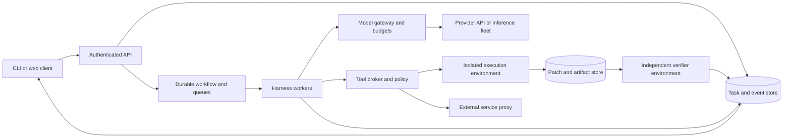

# 03 — From a coding loop to a production service

Design reference, **2026-10-08**. This is a proposed architecture for Huy's learning system, informed by public engineering accounts. It is not a reconstruction of private Anthropic or Cursor infrastructure. No deployment, paid API run, or cloud purchase is performed by this document. The accompanying initial lab uses deterministic fixtures; it does **not** establish an OS sandbox or production reliability.

**VI:** Mục tiêu là biết mỗi thành phần giải quyết lỗi nào, rồi tăng độ phức tạp khi có bằng chứng cần thiết. Sơ đồ production là đích nghiên cứu; lab nhỏ chỉ chứng minh những invariant được kiểm thử.

For the chosen implementation path, use the [durable multiagent capstone](../capstone/README.md). Its [runtime contracts](../capstone/02-runtime-contracts-and-recovery.md) and [evaluation contract](../capstone/03-evaluation-serving-and-efficiency.md) govern the project; this chapter remains the broader design reference. Its example SLOs below are teaching examples, not a second release checklist.

**VI:** Tách reference tổng quát khỏi contract cụ thể để không có hai bộ tiêu chí release mâu thuẫn. Khi build capstone, dùng milestone và gate trong `capstone/` làm chuẩn.

## 1. Begin with the failure model

The [NVIDIA implementation order](../capstone/07-reference-implementation-spec.md#ordered-implementation-slices) reuses these boundaries. NV-S0 is a local compute reference; later generated CUDA work needs explicit build/loading, GPU supervision and independent measurement before runtime integration. Self-hosting the coding model is a separate inference-serving decision. No new deployment stage or vendor stack is required for the CPU slice.

A coding agent combines a probabilistic planner, fallible tools, changing repositories, and external services. Processes can crash after performing an action but before reporting it. Networks can delay acknowledgements. Retries can repeat effects. A model can generate an invalid command or confidently misreport success. Design around four independently owned objects: **task intent, conversation/event history, execution environment, and committed artifact**. The context window is a projection of stored evidence, not the only copy of history.

This separation has public precedent. [Anthropic Managed Agents](https://www.anthropic.com/engineering/managed-agents), April 8, 2026, separates session history, harness, and sandbox so each can recover or change independently. [Cursor's cloud-agent lessons](https://cursor.com/blog/cloud-agent-lessons), June 2, 2026, describes separating loop, machine, and conversation state and adopting Temporal for durable execution. These are reported design patterns; their private scale and reliability are not reproduced here.

**VI:** “Agent còn sống” không đồng nghĩa “VM còn sống”. Khi VM chết, task và bằng chứng phải còn; khi loop được nâng cấp, môi trường và artifact không nên tự nhiên biến mất.

## 2. Reference architecture and ownership

The **control plane** authenticates, authorizes, schedules, records state, enforces budgets, and decides release eligibility. The **execution/data plane** performs inference, tool execution, transfers, and verification. These are logical boundaries; initially several components can share one trusted process. Arbitrary repository code must not share the control plane's authority. Object storage contains large immutable outputs; database rows hold identities, status, ownership, hashes, and references. The UI consumes durable events with sequence numbers, and distinguishes provisional streamed output from a completed attempt.

**VI:** Chia control/data plane không bắt buộc tạo mười microservice. Điều cần giữ là code do agent chạy không có quyền sửa budget, approval hoặc kết quả verifier để tự tuyên bố thành công.

## 3. Grow through five deployment stages

| Stage | Chosen implementation | Graduation evidence |
|---|---|---|
| A. Inspectable CLI | Python, typed tool schemas, deterministic model fixture, local artifacts | Trace every state transition; reject malformed tool calls; reproduce failures |
| B. Single-user persistent agent | Python + SQLite transactions, append-only events, one task owner, per-task workspace | Restart after forced termination; recover attempts and budgets without inventing results |
| C. Durable service | FastAPI, PostgreSQL, object store, Temporal workflows/activities, separate sandbox workers | Duplicate requests, worker loss, authorization, cancellation, and clean regrading pass |
| D. Multi-tenant fleet | Quotas, fair scheduling, worker pools, image registry, secret proxy, telemetry, deployment versioning | Load/chaos tests plus tenant-isolation tests; explicit SLOs |
| E. Optional inference fleet | Pinned vLLM or SGLang serving experiment, then cache-aware routing/tiering if justified | Quality parity and measured cost/latency advantage on real trace replays |

[SQLite's guidance](https://www.sqlite.org/whentouse.html) supports local application storage but warns about many concurrent writers and network filesystems. Use it on local disk; do not manufacture a distributed database by sharing its file. [FastAPI deployment guidance](https://fastapi.tiangolo.com/deployment/concepts/) covers replication and process concerns; an HTTP framework does not supply a durable job system. Choose a supported stable dependency set and pin it for experiments, rather than treating the latest version number as an architectural advantage.

**VI:** Chỉ chuyển SQLite sang Postgres khi có nhu cầu nhiều worker, truy cập mạng và vận hành; chỉ thêm fleet GPU khi workload chứng minh API không còn phù hợp. Mỗi bước thêm một loại failure cần học, không chỉ thêm logo công nghệ.

Python is the default because it keeps research, evaluation, and orchestration close. TypeScript is a good alternative for teams building editor/web integrations. Rust is appropriate later for a broker or high-throughput service whose profiling and security requirements justify the extra implementation effort. These are proposed choices, not vendor claims. For a production baseline, compare your own loop with the [Claude Agent SDK](https://code.claude.com/docs/en/agent-sdk/overview), which exposes Claude Code capabilities in Python/TypeScript. Own the loop when experiments require precise context, tool, and trajectory control; use an SDK when product integration matters more than reimplementing it. Both still need deployment, identity, budgets, and containment.

**VI:** Viết harness để hiểu là hợp lý; viết lại mọi phần của một SDK trước khi có hypothesis là lãng phí. Cùng một benchmark phải đo cả baseline SDK và loop tự xây.

## 4. Durable execution: the hard boundary is an ambiguous result

For each operation, persist `tenant_id, task_id, run_id, attempt_id, tool_call_id, idempotency_key, lease_epoch, input_hash, policy_version, status`. A client submission key is unique within its tenant; the same key with different input is rejected. Record intent before dispatch and evidence after completion. Database transactions and an outbox bridge committed intent to eventual dispatch. They do not make a remote side effect atomic with your database.

| Durable status | Meaning | Recovery |
|---|---|---|
| Planned | Authorized intent, execution not yet claimed | Claim under current ownership |
| Running | Attempt started; effects may exist | Heartbeat/lease tracking |
| Succeeded | Receipt and output persisted | Reuse result, do not repeat effect |
| Failed | Known failure with explicit retry classification | Retry only under operation policy |
| Unknown | Worker/connection lost after possible execution | Query receipt, reconcile, or require a decision |

**VI:** `Unknown` không phải `Failed`. Nếu đã tạo PR nhưng response bị mất, gọi lại có thể tạo PR thứ hai. Chỉ tool biết cách tìm receipt theo key hoặc kiểm tra trạng thái bên ngoài mới quyết định retry an toàn.

A queue commonly delivers more than once. A lease makes one worker the current owner; a monotonically increasing fencing token lets cooperating storage reject stale writes. Lease expiry alone cannot stop an old subprocess or an external API call. A cancellation request therefore propagates to model streams and process groups, then records observed termination and any unresolved effects. Make external mutations idempotent where the service supports keys; otherwise implement operation-specific reconciliation.

[Temporal activities](https://docs.temporal.io/activities) are the boundary for model/network/tool calls; [workflows](https://docs.temporal.io/workflow-execution) describe durable orchestration. Keep workflow replay deterministic; isolate nondeterministic model sampling in activities. [Temporal's idempotency discussion](https://temporal.io/blog/idempotency-and-durable-execution) makes clear why retries still require application-level effect handling. Bound workflows by tasks or explicit continuation boundaries; pin behavior for active runs rather than silently changing their semantics during replay.

**VI:** Durable workflow lưu được quá trình điều phối, không tự tạo transaction xuyên qua GitHub, filesystem và model provider. “Exactly once” phải nói rõ là ghi event, xử lý message, hay effect thực tế.

## 5. Execution isolation, identity, and secrets

A subprocess, working directory, Git worktree, or Python virtual environment is not a security sandbox. On Linux, combine a dedicated unprivileged identity, isolated filesystem/mounts, namespaces, syscall restrictions, network policy, and resource limits. [cgroup v2](https://docs.kernel.org/admin-guide/cgroup-v2.html) governs resource accounting/control; it is one layer, not complete isolation. For untrusted multi-tenant code, evaluate hardened container isolation or per-task VMs/microVMs according to the threat model. [Firecracker](https://firecracker-microvm.github.io/) uses Linux KVM; it is not a native macOS sandbox.

On the Mac, use a disposable Linux VM for exercises that need Linux behavior. Docker Desktop runs Linux containers through a VM, as explained in [Docker's FAQ](https://docs.docker.com/desktop/troubleshoot-and-support/faqs/general/). Host mounts, sockets, and credentials can reconnect that VM to valuable resources. Explicitly list them. Test CPU, memory, process count, disk quota, output size, runtime deadline, child-process cleanup, and network egress. The fixture lab proves none of these kernel boundaries.

**VI:** Worktree cô lập thay đổi Git, không cô lập quyền hệ điều hành. Một mount tới home hoặc Docker socket có thể phá ý nghĩa của môi trường “riêng”. Cần kiểm tra ranh giới thật bằng các bài thử có chủ đích.

Authenticate humans at the API and workers using distinct service identities. Authorize tenant/repository/tool scope on every relevant operation, including artifact download and event streaming. Never trust a tenant ID supplied in tool arguments. Enforce tenant keys in storage and queries; [PostgreSQL row security](https://www.postgresql.org/docs/current/ddl-rowsecurity.html) can add defense in depth, but owner/bypass privileges must be tested. Keep provider keys and broad repository credentials outside generated-code environments. A broker exchanges a narrow task capability for authorized external work. Redaction reduces accidental logging; it cannot retract a secret already exposed to a process.

**VI:** Authentication trả lời “ai gọi”; authorization trả lời “được làm gì trên repo nào lúc này”. Task tồn tại lâu nên quyền có thể hết hạn hoặc bị thu hồi giữa chừng; kiểm tra lại tại commit boundary của effect quan trọng.

## 6. Checkpoint, verify, observe, and budget independently

Checkpoint four things separately: event offset, workspace/artifact state, environment recipe/image digest, and outstanding effects. A Git commit captures tracked content, not running processes, databases, untracked secrets, or remote mutations. A VM snapshot captures more machine state but cannot undo a sent message. Restore from a manifest and verify hashes; treat caches as disposable accelerators.

The producer emits a patch against a pinned base. A separately provisioned verifier applies it to a clean checkout, supplies protected tests, and records exit status plus structured results. The agent cannot edit the verifier or success record. Unit tests, integration tests, static checks, and human acceptance address different properties. “Model said done” remains an assertion. A second LLM reviewer supplements these checks; correlated model errors remain possible.

**VI:** Rollback local file không đảo ngược effect ngoài máy. Verifier sạch giúp phát hiện agent sửa test hoặc môi trường để pass; nhưng test thiếu vẫn có thể bỏ sót lỗi, nên tiêu chí chấp nhận cần nhiều lớp.

Use [OpenTelemetry signals](https://opentelemetry.io/docs/concepts/signals/) for correlated traces, metrics, and logs. Record queue delay, model TTFT, tool latency, cache usage, retry/Unknown rates, verifier failures, cancellation time, dollars per attempt, and dollars per verified resolution. Store sensitive full transcripts separately with explicit access and retention. Pin model/harness/prompt/tool-schema/environment/grader versions in every run manifest.

Reserve budget before dispatch: `spent + reserved + next_operation_upper_bound ≤ task_limit`. Atomically share the ledger across parent and subagents; release unused reservations on reconciliation. Bound token output, calls, tool CPU time, elapsed time, and fan-out. Estimated spend may differ from provider billing, so reconcile actual usage and preserve a margin for in-flight work.

**VI:** Nếu mỗi subagent tự nhìn cùng một số dư rồi cùng tiêu tiền, budget tổng có thể vượt trần dù từng agent “đúng”. Reservation là bài toán concurrency, không phải một dòng nhắc trong prompt.

## 7. Capacity and cost: use the correct denominator

For stable arrivals, Little's law gives average in-flight work `L=λW`. At 0.2 tasks/second and 120-second mean residence time, expect 24 tasks in flight. This does not imply 24 GPU sequences: tasks alternate inference, tool execution, queueing, and idle waits. For c homogeneous workers with mean service time S, utilization is approximately `ρ=λS/c`; keep headroom and measure burst/tail behavior. Retry amplification with independent failure probability r has expected attempts `1/(1−r)` only under unlimited geometric retries; real policies are capped and failures correlated.

Input/output/cache billing, tools, sandbox runtime, storage, and failed attempts all belong in total cost. Compare `total dollars / verified resolutions`, while reporting unresolved tasks separately. GPU memory fit is only a feasibility bound; qualify throughput under a latency SLO. See the [serving/evaluation audit](../research/serving-evaluation-training-audit-2026-10-08.md) for the corrected KV and compute equations.

**VI:** Queue tăng thường không chữa được chỉ bằng model nhanh hơn: có thể bottleneck là tạo VM, chạy test hoặc API rate limit. Trace phải cho thấy thời gian nằm ở đâu trước khi chọn tối ưu.

## 8. Release gates and research proof

The following targets are **arbitrary teaching examples**, not vendor promises: p95 task acceptance below 500 ms at the declared load; p95 start delay below 10 s with warm capacity; cancellation acknowledgement below 2 s; recovery within 60 s after worker loss; no duplicate externally visible effects in the tested fault matrix. Define eligible traffic, measurement window, exclusions, and error budget. Verified coding success needs its own task-distribution metric; it cannot be inferred from service availability.

**VI:** Một API luôn trả 200 có thể có reliability rất thấp nếu patch sai. Tách SLO phục vụ, SLO phục hồi và chất lượng task giúp tránh dashboard đẹp nhưng người dùng không nhận được giá trị.

| Gate | Required test and artifact |
|---|---|
| Semantics | Invalid tools, partial streams, context overflow, stale file edits; state-transition trace |
| Recovery | Crash before dispatch, after effect, before receipt; proof of idempotency or explicit Unknown |
| Isolation | Cross-tenant artifact access, secret access, forbidden mounts/network, resource exhaustion |
| Evaluation | Clean regrade, matched baseline, paired task outcomes, held-out repositories |
| Load | Burst arrivals, heavy-tail tools, rate limits, cancellations, growing contexts; latency/cost curves |
| Chaos | Kill worker/VM, duplicate queue delivery, storage delay, provider outage; bounded recovery |
| Release | Shadow read-only evaluation, small canary, version-pinned active runs, tested rollback |

For rollout, separate code rollback from artifact/effect reconciliation. Drain incompatible workers, retain environment digests, and replay saved histories against candidate versions. Release only after the appropriate stage's gates pass. The mastery test: explain a case where the queue is healthy but tasks fail, where replay succeeds but an external effect duplicates, and where cache hits improve while p95 latency worsens. Then design the smallest measurement that distinguishes the competing causes.

**VI:** Thành thạo là chẩn đoán hệ thống mới bằng invariant và bằng chứng, không phải nhớ tên framework. Mỗi lỗi phải chỉ ra được owner, state trước/sau, effect, và quan sát nào có thể bác bỏ cách giải thích của mình.
