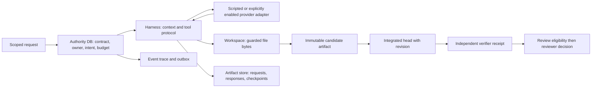
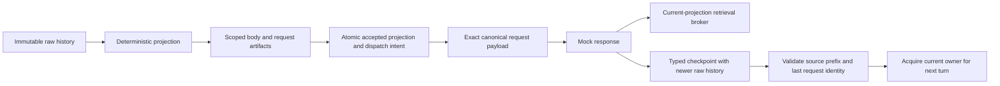
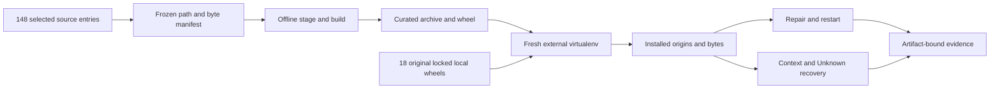
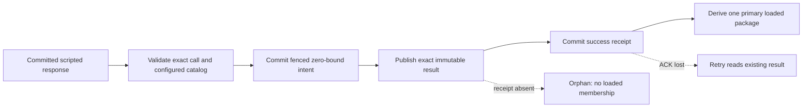

# Reference code reading guide: concepts → state → source → evidence

**AI-authored reference reading map; prepared 2026-10-08, affected source anchors refreshed 2026-10-11.** [H0–H15](02-mastery-learning-plan.md) is the concept reference; since [D046](../context/decision-log.md#d046-production-backward-learning-replaces-mastery-gates), learning follows production traces, and this guide is where a trace enters our code. This guide supplies implementation entry points and exact traces; it does not add a second curriculum. The reference was built under Huy's current build-first instruction. Study the delivered object from first principles, explain each boundary, then debug or refactor it. Human predictions, teach-backs and transfer answers remain unrecorded and pending; they do not block delivery of authorized code.

**VI:** Học không bắt đầu bằng nhớ tên framework. Ta theo một object thật: ai tạo nó, ai được sửa, khi nào commit, và evidence nào khiến hệ thống tin nó. Đọc code AI đã viết vẫn cần Huy tự dự đoán và giải thích; guide này không làm bài đó thay em.

The [9 October review](../research/production-code-review-2026-10-09.md) repaired 22 defect groups; its [dated verification](../research/production-review-verification-2026-10-09.json) records 273 tests plus 15 subtests. The [October10 Nebius verification](../research/hackathon-2026-10-10/verification.json) tracks later provider changes separately. Use the regressions as mechanism examples: a later bill must preserve result evidence, malformed verifier transport cannot count as an expected application exception, and an evicted prefix requires prefill again. The saved tests are AI engineering evidence; human answers remain open.

**VI:** Đọc bug từ invariant: result đã biết không mất khi hóa đơn đến muộn; transport lỗi không được biến thành candidate pass; cache đã eviction thì phải tính lại phần token đó. Test phân biệt cơ chế đúng/sai, không thay phần tự giải thích của Huy.

## Begin with the four owners

The latest [audit specification and tiny identity trace](../research/codebase-refactor-spec-2026-10-10.md#first-principles-and-state-ownership) connects ten concrete failures to the same owners. Read [authority controls](../tests/test_codebase_authority.py), [execution controls](../tests/test_codebase_execution.py) and [research controls](../tests/test_codebase_research.py) beside the affected source. [Current verification](../research/codebase-review-verification-2026-10-10.json) records AI engineering evidence; use an unseen variation for your own prediction.

A model generates content. The controller decides whether that content is a valid action. An environment changes bytes/processes. A verifier measures a particular immutable candidate. PostgreSQL/SQLite authority records what the system can prove; artifact storage holds content addressed bytes; the provider transcript holds model/tool protocol blocks; workspace bytes hold the actual file state. These stores may disagree after a crash. A fluent completion message establishes neither a known tool effect nor a verified task.

**VI:** “File đã sửa” và “database biết file đã sửa” là hai câu khác nhau. Sau crash, sổ ghi intent còn đó nhưng receipt chưa có. Retry lúc này có thể làm effect hai lần; recovery phải dựa vào identity và evidence, không dựa vào câu trả lời tự tin của model.



## Read one method line by line

Use the same six questions for each source block: (1) which input was already trusted; (2) which identity pins it; (3) what state is read; (4) what invariant is checked; (5) which write/side effect occurs; (6) what is still unknowable if execution stops here. Annotate Python values before and after the block. Identify the transaction boundary and external RPC separately. Keep a tiny trace table beside the source rather than treating passing tests as a substitute for explanation.

**VI:** Ví dụ `begin_dispatch` không gọi provider: nó chỉ ghi intent và chuyển phần allowance sang dispatch reservation. Call thật nằm sau transaction. Hãy đánh dấu khoảng giữa hai bước đó; đây chính là crash window mà “exactly once” không tự xuất hiện.

| Reading pass | Current source | What to reconstruct |
|---|---|---|
| Contract and task identity | [validate_contract](../service/contracts.py#L145), [submit](../service/storage.py#L424) | Request → frozen contract/digest → task/generation; same idempotency key with changed body conflicts |
| Claim authority and physical capacity | [claim](../service/storage.py#L551), [_owner](../service/storage.py#L353) | service incarnation/tenant/task/generation/node epoch/attempt → current owner; physical slot reserved separately from model calls |
| Intent before external execution | [begin_dispatch](../service/storage.py#L718), [ToolBroker.execute](../service/harness.py#L63) | Current owner → immutable action/input digest → dispatch intent; replay known result, reject unresolved replay |
| Effect and billing knowledge | [finish_dispatch](../service/storage.py#L1056), [_budget](../service/storage.py#L380) | Receipt → effect state and independent billing state; Unknown liability retained even after cancellation |
| Guarded mutation and evidence | [Workspace.replace](../service/execution.py#L79), [candidate_manifest](../service/integration.py#L11) | File path + expected old digest → new bytes → baseline/changed paths/tree/manifest digests |
| Exact acceptance boundary | [record_verification](../service/storage.py#L1905), [publish_review](../service/storage.py#L1957), [record_review](../service/storage.py#L2023) | Passing receipt for current tree/head/contract → DB decision-time eligibility → later review decision |

**VI:** Owner tuple giống chìa khóa có thời hạn và version. Sau replacement hoặc restore, worker cũ vẫn có thể giữ object Python nhưng không còn quyền publish. Candidate digest và head revision làm reviewer biết chính xác đang xem bytes nào.

## One complete reference run

Run from the workspace root after the documented environment setup:

```sh
.venv/bin/python -m service.cli demo --workers 2
```

The default creates a fresh `.runtime/demo-...` directory. It uses the explicit scripted-fixture model and trusted fixture verifier. Inspect the printed output directory's `snapshot.json`, `trace.json` and `trace.html`. Passing fixture verification produces **execution_state=review_eligible, review_state=pending**; it does not create a human acceptance decision. A pinned `--sandbox-image` selects the external Linux verifier when its backend is available; it never silently upgrades a trusted-host fixture to hostile-code isolation.

**VI:** Model script biết sẵn reference edit nên run này đo orchestration, không đo khả năng tự giải. Review pending là kết quả đúng của demo: có verifier receipt nhưng chưa có con người quyết định accept. Đừng đổi nhãn pending thành accepted để kết quả trông hoàn chỉnh.

| Stage | Exact object/data transformation | Source and distinguishing test |
|---|---|---|
| Submit frozen workload | Baseline files → `tree_digest(base)`; frozen requirements/capabilities/grader/environment → task contract | [submit_fixture](../service/engine.py#L37); [frozen submission test](../tests/test_storage.py#L88) |
| Build bounded graph | Changed reference files → one patch node per file with allowed paths; worker concurrency is `patch_slot_limit` | [run_task](../service/engine.py#L63); [1/2/4-worker mechanics test](../tests/test_engine.py#L19) |
| Execute read/edit/finish loop | Requirements → user message → projected context → model request artifact → dispatch intent → raw response → validated tool call → result block | [Harness.run](../service/harness.py#L186), [ToolCall](../service/protocol.py#L109); [partial-call test](../tests/test_protocol.py#L23) |
| Publish branch output | Workspace snapshot → candidate manifest/artifact → fenced accepted branch; completed branches reused on resume | [accept_candidate](../service/storage.py#L1202); [integration rejection test](../tests/test_artifacts_execution.py#L41) |
| Integrate once | Branch manifests → conflict-checked tree → current integrated head with compare-and-swap revision | [integrate_candidates](../service/integration.py#L53), [integrate](../service/storage.py#L1846); [saved-head resume test](../tests/test_engine.py#L35) |
| Verify and expose review | Auxiliary verifier slot → exact tree/grader/environment receipt → final DB-time eligibility → pending review | [FixtureVerifier](../service/verification.py#L75) / [LinuxVerifier](../service/verification.py#L123); [exact-head review test](../tests/test_storage.py#L278) |
| Retire and report | Confirmed retirement evidence releases physical slot/unused allowance; immutable events/snapshot become trace | [retire_sandbox](../service/storage.py#L1537), [compact_report](../service/reporting.py#L11); [retained verifier capacity test](../tests/test_storage.py#L536) |

**VI:** Một branch completed có thể được load từ artifact thay vì chạy model lại. Nhưng active attempt có effect Unknown không được tự thay thế. Resume completed graph frontier khác với rewind filesystem rồi giả vờ remote effect chưa xảy ra.

## Exact budget/effect trace: limit 100, claim 40, dispatch bound 12, actual 9

This is the independent tiny fixture in [Unknown/replacement test](../tests/test_storage.py#L189) and [cancel/late settlement test](../tests/test_storage.py#L214). Units are integer accounting units, not inferred provider FLOPs. Let A be unspent attempt allowance, D unresolved dispatch bounds, S settled charges. [Budget derivation](../service/storage.py#L380) computes `reserved=sum(A)+sum(D)` and `spent=sum(S)`. Dispatch transfers exposure instead of reserving twice.

**VI:** 40 là cơ hội chi tiêu đã giữ cho attempt. Dispatch lấy 12 từ đó, nên còn 28 allowance và 12 dispatch liability, tổng vẫn 40. Unknown làm thông tin ít đi, không làm hóa đơn có thể có biến mất.

| State/event | A | Unsettled D | S | Total reserved | Physical slots | Safe conclusion |
|---|---:|---:|---:|---:|---:|---|
| Submitted, no claim | 0 | 0 | 0 | 0 | 0 | Ceiling 100 is authorization, not money already spent |
| Claim reserves 40 | 40 | 0 | 0 | 40 | 1 | Current owner has bounded allowance |
| Begin dispatch with bound 12 | 28 | 12 | 0 | 40 | 1 | Intent exists; effect not yet proved |
| Response lost; effect Unknown | 28 | 12 | 0 | 40 | 1 | Repeat or replacement cannot assume no effect |
| Cancellation, if exercised | 28 | 12 | 0 | 40 | 1 | Generation increments; old authority revoked; cleanup still required |
| Confirm sandbox retirement | 0 | 12 | 0 | 12 | 0 | Unused 28 freed; possible bill/effect remains |
| Trusted late receipt actual 9 | 0 | 0 | 9 | 0 | 0 | Billing settled once; effect reconciled under receipt rules |
| Same receipt delivered again | 0 | 0 | 9 | 0 | 0 | Same identity/content returns prior receipt; changed charge conflicts |

For the uncancelled case, replacement can proceed only after effect reconciliation and confirmed retirement; its node epoch becomes 2 and the old owner is fenced. For the cancelled case, later settlement records historical facts without reviving execution. A settled bill can coexist with an unresolved effect: [independent billing/effect test](../tests/test_storage.py#L441) distinguishes those axes.

**VI:** Thanh toán biết “mất 9 units” chưa chắc biết “issue đã được tạo hay chưa”. Nếu bill settled mà effect vẫn Unknown, muốn retry vẫn phải tra effect identity. Hai state machine có thể tiến khác tốc độ.

## Exact tensor trace: why cached output is 6, not 2

The later [NV-S0 RMSNorm packet](../compute/README.md#nv-s0-rmsnorm-numerical-foundation) adds a second H12 numerical trace: FP32 values → square/reduce → fixed epsilon → root/divide/scale → float64-oracle comparison → byte-bound observation. Start at [the oracle](../compute/rmsnorm.py#L85), [the checker](../compute/rmsnorm.py#L124) and [the distinguishing tolerance tests](../tests/test_rmsnorm.py#L131). [Independent review](../research/nvidia-s0-review-2026-10-10.md) explains the nested-tensor and overlapping-buffer defects. This is delivered CPU arithmetic, with GPU execution and agent integration still pending; it does not advance human mastery.

**VI:** Hai bài attention và RMSNorm đều nối phương trình với shape, dtype, bytes và phép kiểm cụ thể. Chọn bài theo concept đang học; không cần nhảy từ H0 sang GPU chỉ vì đã có file mới.

At [absolute_mask](../compute/attention.py#L36), local query i corresponds to global token C+i, so key j is visible iff `j <= C+i`. Here Q shape=[1,1,1,1], K/V=[1,1,4,1], C=3; Q/K=0 and V=[2,4,8,10]. The [eager reference](../compute/attention.py#L64) gives scores=[0,0,0,0], Boolean mask=[true,true,true,true], probabilities=[.25,.25,.25,.25], output=.25*(2+4+8+10)=6. A nonsquare upper-left causal mask sees only key0 and returns 2. This scalar 6 is a hand-derived oracle, independently checked by [scalar_attention](../compute/attention.py#L92), [explicit-mask SDPA](../compute/attention.py#L119) and [counterexample test](../tests/test_compute.py#L18).

**VI:** i=0 là index suffix, không phải index sequence. Với C=3, query đầu suffix phải thấy bốn key. Q=0 cố ý làm dot-product giống nhau để defect mask không bị che bởi random logits.

| Tensor/transformation | Shape | Values/precision/bytes in tiny trace |
|---|---|---|
| Q | [1,1,1,1] | [0], float32, 4 logical bytes |
| K | [1,1,4,1] | [0,0,0,0], float32, 16 logical bytes |
| V | [1,1,4,1] | [2,4,8,10], float32, 16 logical bytes |
| Q·Kᵀ / sqrt(D) | [1,1,1,4] | float64 eager scores [0,0,0,0] |
| Allowed absolute mask | [1,4] | Boolean [true,true,true,true], 4 logical bytes |
| Softmax / weighted sum | [1,1,1,4] → [1,1,1,1] | float64 probabilities → output cast float32 [6] |

[Tensor ledger](../compute/attention.py#L50) records real strides, contiguity, dtype, device, logical bytes and backing storage bytes; noncontiguous views can share a larger storage. In GQA, query head h reads KV head `floor(h/(Hq/Hkv))`; the reference expands KV physically for clarity. Actual inference-engine allocation/kernel mapping is not inferred from that convenience. The [KV calculator](../compute/cache.py#L11) derives ideal bytes from `L*B*T*Hkv*(D+Dv)*element_bytes`; block padding and weights/workspaces remain separate. See [compute guide](../compute/README.md) for cache/action-loss traces and prepared CUDA benchmark boundary.

**VI:** Storage bytes là allocation được share, logical bytes là số phần tử view nhìn thấy. Cộng storage của hai view cùng buffer sẽ double-count. Hq ảnh hưởng compute; Hkv quyết định KV storage trong công thức này.

## H0–H15 entry map with the canonical names

Use one row when reaching that module; revisit deeper source only when the concept or observed defect requires it. A source method being present does not finish every build target in the canonical chapter.

| Canonical module | First-principles question → current code/test | Scope still pending or absent |
|---|---|---|
| **H0 Trace the entire system** | Who owns intent, bytes, context and verification? Start with [new H0 packet](../study/packets/H0-reference-runtime.md), `ReferenceEngine.run_task`, budget/tensor traces above | Human prediction, causal explanation and transfer evidence pending |
| **H1 State, actions and the minimal loop** | How does one call ID become a durable intent/result? `ToolBroker.execute`, `RuntimeStore.begin_dispatch/finish_dispatch`; ambiguous-tool replay test | Scripted and mock transport evidence does not establish model planning |
| **H2 The wire from bytes to a completed tool call** | When do bytes become a complete authorized object? [SSEDecoder](../service/protocol.py#L56), [ToolStream](../service/protocol.py#L156), [Nebius native parser](../service/providers.py#L234) | Live SSE adapter consumption and measured retry/backoff policy absent; native second provider has mock evidence |
| **H3 Tools, files, processes and observations** | What byte/process mutation occurred? `Workspace.replace`, [bounded_process](../service/execution.py#L149), guarded-edit/timeout tests | General patch parser and production log-spooling pipeline absent |
| **H4 Budgets, termination and crash recovery** | What must remain reserved across uncertainty? budget trace above; [recovery_plan](../service/recovery.py#L7), stale-owner/cancellation tests | Active-attempt replacement/reconciliation is manual; no general automatic crash recovery agent |
| **H5 Context, durable memory and cache economics** | Which protocol state must be preserved? [project_context](../service/context.py#L9), [restore_checkpoint](../service/recovery.py#L34), prefix-cache identity test | Deterministic offloading/accepted requests are implemented on an explicit path; semantic/native compaction remains pending; irreducible overflow fails closed |
| **H6 Repository retrieval and evidence freshness** | Is this snippet still current? [Workspace.search](../service/execution.py#L121), [evidence_is_current](../service/context.py#L33) | AST/symbol/embedding index and repair-quality retrieval study absent |
| **H7 Authorization, containment and hostile inputs** | Who grants authority and where is it enforced? [create_app](../service/api.py#L137), [DockerSandbox](../service/execution.py#L259), symlink/API/sandbox tests | Docker checks have bounded tested scope; adversarial escape assessment and production host hardening pending |
| **H8 Task evaluation and causal diagnosis** | What was assigned before seeing outcomes? [manifest validator](../evals/manifest.py#L59), [paired analysis](../evals/analysis.py#L85), denominator/cluster tests | Real fresh tasks, independent live grading, powered held-out results unrun |
| **H9 Extension interfaces and product integration** | Is discovery also authorization? `ToolCall`, `tool_schemas`, API/CLI contract | Full MCP server/client and skill discovery lifecycle absent |
| **H10 Multiple agents and shared-state concurrency** | What can run independently and who integrates? `ReferenceEngine`, [integration](../service/integration.py#L53), [DAG simulation](../evals/simulation.py#L21), stale/overlap tests | Graph replanning is not implemented; bounded static graph only; live coordination quality unrun |
| **H11 Durable production service** | Can intent survive delivery duplication and restore? [local outbox](../service/workflows.py#L198), [Temporal relay](../service/workflows.py#L247), incarnation/cursor tests | Source/backends and integration checks are distinct from deployed production/SLO evidence |
| **H12 Model execution and inference internals** | Which exact head/position/value is read? eager/scalar/SDPA/ledger and 6-vs-2 trace | Full embedding/MLP/sampling model path, selected GPU kernel/warp profiling absent or unmeasured |
| **H13 Serving agent workloads and profiling** | Which resource keeps the critical path waiting? [open-loop replay](../evals/simulation.py#L156), retained-slot/overload tests | Real provider load, engine batching/KV residency and measured service SLOs pending |
| **H14 Training in the harness** | Which sampled action token contributes loss? [trajectory validator](../compute/trajectory.py#L27), [action-only objective](../compute/trajectory.py#L79), version/mask tests | Gradient/optimizer/full training and training improvement unrun |
| **H15 A production capstone and one research result** | Can a reviewer reproduce evidence and can Huy defend the causal finding? [evidence report](../service/reporting.py#L11), frozen research packets | Bounded same-machine independent AI release reproduction delivered; independent human/fresh-machine reproduction, held-out research finding, unseen transfer and production operation pending |

**VI:** Các hàng là đường vào source, không phải bảng “đã master”. H15 cần người khác rerun/critique và Huy giải thích, chứ không chỉ thêm README. H13 simulator dùng time/token-rate synthetic; không có đường tắt từ JSON đó tới claim GPU nhanh hay team tốt hơn.

## Evidence labels used here

**Inspected source** means the method and contract exist in the current checkout. **Executable test** identifies a distinguishing oracle; its filename alone is not proof that an optional backend ran. **Recorded final observation:** the durable [PostgreSQL/Linux snapshot — local-only](github-snapshot.md#omitted-local-evidence) and [readable trace — local-only](github-snapshot.md#omitted-local-evidence) show two completed branch nodes, 12 dispatch records, a passing external Linux verification, review eligibility with review pending, and budget spent0/reserved0/limit1000. This is a scripted end-to-end mechanism run using actual PostgreSQL and the isolated Linux verifier. The final [test evidence — local-only](github-snapshot.md#omitted-local-evidence) records 154 passing tests plus 15 passing subtests, with no failures or skips; that run includes actual PostgreSQL, Linux/Docker and Temporal integration checks. The earlier [evaluation/compute record](../evals/reports/reference-verification.json) records its separate 20 focused CPU/research checks and explicit CUDA skip; it is not the final full-suite total. **Absent/unmeasured** marks the stronger boundaries listed below. Documentation maintenance checked links and evidence records without rerunning unchanged runtime tests.

**VI:** Source có sẵn, test có sẵn và backend thật đã chạy là ba tầng evidence. Ví dụ test CUDA có thể kiểm tra “skipped đúng” trên Mac; đó không phải phép đo kernel. Snapshot thật ở đây vẫn do scripted model tạo, nên không nâng thành coding capability.

## Be precise about continuation and capability

**Source present, with mechanism tests:** Anthropic Messages can run through `Harness.run` only with explicit provider enablement, frozen model identity and a trusted gateway-approved price/token/request envelope. [mock HTTP harness test](../tests/test_live_harness.py#L49) checks protocol/billing/tool feedback; [mock transport-loss test](../tests/test_live_harness.py#L92) checks Unknown exposure. The [replay token-bound regression](../tests/test_review_regressions.py#L40) rejects tools after a bound violation on replay. Paid live requests have not been run. Opaque provider blocks and workspace snapshots are checkpointed; the restore helper preserves their supported adapter representation and rejects post-checkpoint unresolved effects. The [causal-frontier regression](../tests/test_review_regressions.py#L113) rejects post-checkpoint dispatches even when timestamps tie. Restored data grants no new owner authority.

**VI:** Mock HTTP dùng cùng controller boundary nhưng response vẫn do test tạo. Nó chứng minh code đi đúng đường, không chứng minh model thật giải bài hoặc price envelope thật đã được provider bảo đảm. Trước paid run còn cần pinned model/rates/bounds và user-authorized spend.

**New provider, October10:** [NebiusChatCompletions](../service/providers.py#L383) supports global-only native nonstreaming function calls and exact assistant/tool history. [Its tests](../tests/test_nebius_provider.py#L80) exercise read/edit/finish, nullable fields, disjoint cache/reasoning counters, retained raw successful responses and replay. The dated [E0 review](../research/hackathon-2026-10-10/nebius-review.md) records its repaired assumptions and then-open limitations. Later [supported repair](../hackathon/05-local-repair-runbook.md) adds tuple-bound approval, oracle-free native proposals and protected function checks; [HTTP evidence](../hackathon/06-http-error-evidence-contract.md) adds bounded sanitized diagnostics and replay guards. [Current verification](../research/hackathon-2026-10-10/http-error-verification.json) owns the integrated results. The original fixture engine remains preserved; general dependency-aware repository support and live model quality remain pending.

**VI:** Parser nullable đúng và cache không double count là hai cơ chế cụ thể để trace. Model thật và repo runner cần gate khác; mock native tool call không nâng fixture thành general agent.

**Present bounded resume:** the fixture engine reuses completed branch candidates and the existing integrated head, then can retry later verification with the required environment accounting. **Manual frontier:** replacing an active attempt requires current authority, confirmed physical retirement and effect/billing reconciliation; checkpoint reloading alone cannot make a previous external effect disappear. **Bounded context support:** explicit deterministic offloading with current-projection retrieval, per-dispatch acceptance and typed recovery. **Absent, fail closed:** graph replanning, semantic/native compaction and arbitrary model backends. **Prepared, unmeasured hardware:** CUDA benchmark checks equivalent attention samples before synchronized event timing, but this machine has no CUDA; no selected-kernel mapping or profiler measurement is claimed.

**VI:** “Resume” phải chỉ rõ resume cái gì: load artifact đã hoàn thành, tiếp tục protocol transcript, hay chạy lại tool. Ba việc đó có luật khác nhau. Một checkpoint prose không thay được thinking/tool protocol artifact; restore database cũng không cấp quyền lại cho worker incarnation cũ.

The old [H0 system-boundaries packet](../study/packets/H0-system-boundaries.md) and historical lab remain preserved. Use the new packet as the bridge to this reference. Original code anchors were checked on October8; changed broker/storage/protocol anchors were refreshed on October11. Documentation edits require link/evidence checks, not repeated execution of unchanged service code.

## Course comparators for four existing modules

Added **2026-10-10** from [this pinned reading snapshot](https://github.com/decodingai-magazine/building-a-coding-agent-from-scratch-course/blob/4691f51e0f4977be0d3f0fc9a4667e75366f22ee/README.md). Use the row for the module currently being studied; reading the whole course is not a prerequisite. These source/test links were inspected, not executed in this audit. The [audit](../research/course-audit-2026-10-10.md) explains source findings; [07](../capstone/07-reference-implementation-spec.md#course-derived-extension-contracts--proposed-2026-10-10) owns implementation contracts; [08](../capstone/08-implementation-coverage.md) retains missing-feature status.

| Module | Our mechanism first | Course comparator | Explain or break before claiming understanding |
|---|---|---|---|
| H5 | [Full-history projection](../service/context.py#L9), [actual request construction](../service/harness.py#L186), [restore](../service/recovery.py#L34) | [Tail split](https://github.com/decodingai-magazine/building-a-coding-agent-from-scratch-course/blob/4691f51e0f4977be0d3f0fc9a4667e75366f22ee/src/decode/context/compaction.py#L148), [activation](https://github.com/decodingai-magazine/building-a-coding-agent-from-scratch-course/blob/4691f51e0f4977be0d3f0fc9a4667e75366f22ee/src/decode/agent/loop.py#L345), [compaction tests](https://github.com/decodingai-magazine/building-a-coding-agent-from-scratch-course/blob/4691f51e0f4977be0d3f0fc9a4667e75366f22ee/tests/unit/decode/context/test_compaction.py) | Original source fact → summary/artifact → accepted projection → next request. Prove an after-activation probe and durable publication; distinguish protocol validity from semantic retention |
| H9 | [Broker](../service/harness.py#L63), [tool schema](../service/protocol.py#L108) | [Loader](https://github.com/decodingai-magazine/building-a-coding-agent-from-scratch-course/blob/4691f51e0f4977be0d3f0fc9a4667e75366f22ee/src/decode/skills/loader.py#L36), [catalog](https://github.com/decodingai-magazine/building-a-coding-agent-from-scratch-course/blob/4691f51e0f4977be0d3f0fc9a4667e75366f22ee/src/decode/skills/catalog.py#L26), [payload](https://github.com/decodingai-magazine/building-a-coding-agent-from-scratch-course/blob/4691f51e0f4977be0d3f0fc9a4667e75366f22ee/src/decode/skills/payload.py#L35), [loader tests](https://github.com/decodingai-magazine/building-a-coding-agent-from-scratch-course/blob/4691f51e0f4977be0d3f0fc9a4667e75366f22ee/tests/unit/decode/skills/test_loader.py) | Metadata → immutable package → body/resource → attempted action. Change bytes after discovery; instruction loading must not alter capabilities |
| H6 | [Bounded lexical search](../service/execution.py#L121), [digest freshness](../service/context.py#L33) | [Client](https://github.com/decodingai-magazine/building-a-coding-agent-from-scratch-course/blob/4691f51e0f4977be0d3f0fc9a4667e75366f22ee/src/decode/services/lsp/client.py#L36), [server reuse](https://github.com/decodingai-magazine/building-a-coding-agent-from-scratch-course/blob/4691f51e0f4977be0d3f0fc9a4667e75366f22ee/src/decode/services/lsp/service.py#L37), [service tests](https://github.com/decodingai-magazine/building-a-coding-agent-from-scratch-course/blob/4691f51e0f4977be0d3f0fc9a4667e75366f22ee/tests/unit/decode/services/lsp/test_service.py) | Exact tree/document → UTF-16 position → correlated response. Compare empty/unavailable/stale; two concurrent cold calls and one dependency edit distinguish weak implementations |
| H8/H15 | [Frozen assignments](../evals/manifest.py#L30), [analysis](../evals/analysis.py#L85), protected verifier and existing controls | [Mining](https://github.com/decodingai-magazine/building-a-coding-agent-from-scratch-course/blob/4691f51e0f4977be0d3f0fc9a4667e75366f22ee/evals/harness/mine.py#L188), [mined case](https://github.com/decodingai-magazine/building-a-coding-agent-from-scratch-course/blob/4691f51e0f4977be0d3f0fc9a4667e75366f22ee/evals/regression/cases/mined_guessed_file_path.py#L3), [aggregates](https://github.com/decodingai-magazine/building-a-coding-agent-from-scratch-course/blob/4691f51e0f4977be0d3f0fc9a4667e75366f22ee/evals/harness/aggregates.py#L377) | Derive 1/2 assigned versus 1 conditional; preserve 10+7+3 spend after pruning; minimize a failure without leaking its lineage into held-out evidence |

**VI:** Mỗi hàng nối một cơ chế nhỏ với owner và counterexample trong code của mình. Khi code extension chưa có, đọc source comparator và contract rồi ghi rõ “proposed”; không dùng source course để đánh dấu project đã implement hoặc Huy đã master.

## Read one failure into a regression

The [frozen adapter contract](../research/failure-regression-spec-2026-10-10.md), [independent review](../research/failure-regression-independent-review-2026-10-10.md) and [source-bound verification](../research/failure-regression-verification-2026-10-10.json) define this bounded H0/H8/H15 reading path. It adds no new curriculum module or human mastery evidence.

1. [capture_failure_source](../service/storage.py#L2307): scoped task identity → one database read transaction → bounded full snapshot and committed event frontier. Inspect [concurrent-write controls](../tests/test_failure_capture.py); the next capture may advance, while the saved one remains unchanged.
2. [extract_failure_evidence](../evals/evidence.py#L550) and [FailureEvidence](../evals/evidence.py#L443): exact causal candidate/verification or dispatch → artifact integrity → whole-task accounting → complete/incomplete/invalid observation. Inspect [substitution, missing-evidence and accounting controls](../tests/test_failure_evidence.py).
3. [evaluate_regression_fixture](../evals/regressions.py#L155) and [freeze_regression_case](../evals/regressions.py#L215): evidence-derived expected fields → actually evaluated good=true/bad=false controls → immutable pending proposal. These predicates check data attribution and accounting, not fresh patch correctness.
4. [record_regression_review](../evals/regressions.py#L311): exact case digest → separate declared review. [Review/control tests](../tests/test_failure_regressions.py) reject changed fields, unsupported predicates and invalid records. Human review is never inferred from AI delivery.

The [saved two-case packet — local-only](github-snapshot.md#omitted-local-evidence) shows failed-verification generation1 while the current task is generation2, and Unknown exposure12 becoming spent9/reserved0 while effect knowledge remains Unknown. These are AI-run fixture observations. For Huy's later exercise, predict an unseen variant before inspecting its result: remove one receipt, change the candidate digest, or damage an owning attempt. Explain why the first loses completeness, the second contradicts attribution, and broken accounting must report unavailable totals rather than0.

**VI:** Trace theo đúng object: capture giữ một ảnh DB; evidence giữ identity và điều chưa biết; regression kiểm một invariant; review trỏ về đúng proposal. Không bước nào trong đó tự sửa code hay cấp quyền chạy lại effect Unknown. Bài học của Huy vẫn cần prediction và giải thích riêng.


## Context offloading: dispatch, activation and recovery

The [frozen contract/addenda](../research/context-offloading-spec-2026-10-10.md), [independent review](../research/context-offloading-independent-review-2026-10-10.md) and [verification](../research/context-offloading-verification-2026-10-10.json) own this bounded slice. It supplies H5 context mechanics and H11 recovery evidence; it does not award mastery or measure live-model recall.



Read in this order:

1. [plan_context](../service/context.py#L72): canonical bytes, complete batches, protected tail, unchanged opaque fields and deterministic selection. The planner changes outgoing working context, not source history.
2. [begin_projected_dispatch](../service/storage.py#L667): validate artifacts outside the writer lock; inside it compare owner/frontier/prior projection, then commit acceptance and ordinary intent together. Inspect [the independent concurrency controls](../tests/test_context_integration.py).
3. [Harness.run](../service/harness.py#L186): construct the request from projected messages, preserve raw history, pin the accepted projection to its response and checkpoint typed identities. An exact canonical request record and raw HTTP bytes are different artifacts.
4. [ToolBroker.execute](../service/harness.py#L63) and [read_context_artifact](../service/context_retrieval.py#L9): authorize membership under current accepted projection, record a normal tool intent, verify scoped bytes and return at most the configured chunk. An arbitrary digest grants no read permission.
5. [restore_checkpoint](../service/recovery.py#L34) and [validate_accepted_request](../service/recovery.py#L332): verify the older request's source prefix inside the newer checkpoint history, reproduce canonical request identity and preserve Unknown/frontier restrictions. A reconstructed request is not sent again by this validation.

**VI:** Mỗi mũi tên có owner riêng. Artifact giữ bytes; transaction quyết định request nào được phép chạy; broker giới hạn nguồn đọc; recovery chỉ dựng lại evidence. Nếu chỉ thấy object tên `projection` mà không kiểm payload thực sự gửi đi thì chưa chứng minh offloading hoạt động.

The [recorded demonstration — local-only](github-snapshot.md#omitted-local-evidence), with its [machine-readable observations — local-only](github-snapshot.md#omitted-local-evidence), uses an old-tool-only fact, later tool output, an accepted offload marker, a subsequent bounded retrieval and a fresh-owner restart. Follow the old body digest into the accepted allowlist and the returned base64 byte range. Observe that the original messages retain the fact while the selected outgoing payload excludes it. A scripted request chooses the reload: this proves reachability and authorization, not that a live model remembers or chooses the right evidence.

Run a new disposable demonstration directory:

```sh
.venv/bin/python scripts/context_offloading_demo.py --output runs/my-context-offloading-demo
```

**VI:** Sau checkpoint, raw history đã có thêm response/tool result nên dài hơn source của request vừa chạy. Recovery kiểm quan hệ prefix và identity; không giả định hai history phải bằng nhau, không xóa Unknown và không cấp lại quyền cho owner cũ. Hãy tự dự đoán một interleaving chưa xem trước khi làm bài debug; các số đo AI đã chạy không phải prediction của Huy.

## Offline release: source to installed evidence

The [release index](../releases/README.md), [frozen specification](../research/offline-release-spec-2026-10-10.md), [independent review](../research/offline-release-independent-review-2026-10-10.md) and [verification](../research/offline-release-verification-2026-10-10.json) form a bounded H11/H15 trace. A source test may pass while a wheel omits an asset or imports a different checkout; byte identity and installed behavior therefore require separate observations.



1. [freeze](../scripts/build_offline_release.py#L188) and [check_sources](../scripts/build_offline_release.py#L234): reviewed selection → exact path/hash/size → reject source drift. Follow one `service/context.py` record through the manifest.
2. [build](../scripts/build_offline_release.py#L424): fresh staging → controlled local backend → source archive and wheel → compare member bytes. Root learning/context files stay outside the distribution.
3. [install](../scripts/build_offline_release.py#L548): exact original dependency wheels and product wheel → isolated venv → installed version/origin/content checks. Acquisition of public dependency wheels was a separately recorded online preparation, not part of offline acceptance.
4. [repair_checks](../release/acceptance/installed_package_acceptance.py#L150): installed CLI → real local Docker → pause after2 requests → new process/epoch →3 more requests → same patch/tree → read-only report replay. Both paths stop at review eligible/pending.
5. [context_case](../release/acceptance/installed_package_acceptance.py#L276): capture actual mock HTTP bytes → canonical accepted-request identity → offload/retrieve → restore raw/typed state → acquire fresh owner. Lost response retains bound4; late charge1 releases exactly4 reserved units once, while effect remains Unknown.

**VI:** Manifest trả lời “đã ship bytes nào”; `module.__file__` trả lời “Python đang chạy bytes ở đâu”; request/receipt trả lời “cơ chế thực sự làm gì”. Ba câu hỏi khác nhau. Reviewer dùng môi trường mới trên cùng máy: đó là kiểm độc lập của AI, chưa phải tái lập trên máy khác hay bằng chứng Huy đã hiểu.

The October10 release trace above remains bound to its original bytes. The October11 source adds capture and broker receipt-derived loading below; accepted disclosure/resource authority are now the separate step4 trace below, with typed recovery now supplied by [step5](../research/skills-recovery-spec-2026-10-11.md) under the same frozen design. Human study remains H0 until actual prediction/teach-back/transfer evidence advances it.


## Immutable skills capture: source to snapshot

[Contract](../research/immutable-skills-capture-spec-2026-10-11.md), [review](../research/immutable-skills-independent-review-2026-10-11.md), [verification](../research/immutable-skills-verification-2026-10-11.json) and [saved byte trace — local-only](github-snapshot.md#omitted-local-evidence) support existing H5/H9 concepts. The purpose is to make a package's meaning stable after capture: later reads resolve the catalog's exact artifact bytes. A content hash checks identity; it does not authenticate a publisher or grant tool access.


After capture, changing the origin folder cannot affect this path: validation reads the scoped artifacts only.

1. [Fixed profile and config](../service/skills.py#L21): one package, up to64 resources, 256KiB per resource, 4MiB total resources and at most8192 bytes per read. These are fixed profile limits, not user-adjustable policy. Capture does not enforce loaded membership; the broker slice below enforces one primary loaded package.
2. [Parse](../service/skills.py#L237): split exact frontmatter delimiters, bound YAML events before constructing the metadata mapping, preserve body bytes. Implicit-looking YAML scalar values remain strings. Tags, aliases, duplicate keys and unsupported structures are rejected; this is a deliberately partial format profile.
3. [Capture source](../service/skills.py#L297) and [publish](../service/skills.py#L460): traverse verified directory handles; reject links/nonregular files and bounded inventory drift; store full file, body, resources, manifest, config and catalog under tenant/task scope. The catalog digest commits the package digest and declared provenance. This supports quiescent trusted fixtures, not atomic capture under hostile concurrent writers.
4. [Resolve snapshot](../service/skills.py#L483): read only scoped artifacts, validate exact schemas/digests/size/type, and reparse full `SKILL.md` to check metadata/body agreement. [Local](../service/artifacts.py#L101) and [S3](../service/artifacts.py#L153) reads apply the smaller store/call cap before integrity checks. Sanitized public errors suppress private parser/filesystem exception context.
5. [Read resource](../service/skills.py#L566): validate package membership/path/range, slice bytes and base64-encode the chunk. Offset0/limit2 returns the first two bytes `OK` (`T0s=`), next_offset2, total_size193, eof false. Offset193 returns size0, an empty payload and eof true. Offset194 is rejected. Concatenating97 two-byte-or-final-one-byte chunks reconstructs all193 bytes, even though eight individual chunks split UTF-8 characters.

**VI:** Đơn vị của offset là byte, không phải ký tự. Có thể cắt giữa một ký tự tiếng Việt; phải ghép bytes đầy đủ trước khi decode UTF-8. Hash và manifest giữ mối liên hệ giữa source, body, resource và scope; biết hash không tạo quyền đọc trong agent loop.

[The demo](../scripts/skills_capture_demo.py#L17) copies the fixture, captures it, mutates the copied origin and proves the captured193 bytes remain unchanged. It corrupts a separate artifact-store copy and observes rejection, preserving original evidence. Reproduce with `.venv/bin/python -m scripts.skills_capture_demo --output runs/my-skills-capture` using a new output directory. The [independent tests](../tests/test_skills_capture.py) and [artifact bounds tests](../tests/test_skills_artifact_bounds.py) cover malformed/rehashed records and read limits. Four [disposable mutations — local-only](github-snapshot.md#omitted-local-evidence) demonstrate that the error, allocation and integrity assertions reject flawed implementations.

**VI:** Hãy dự đoán trước khi mở kết quả: sửa source sau capture khác gì sửa artifact đã được hash? Vì sao parser đúng chưa bảo đảm exception không lộ private path? Đây là câu hỏi học để Huy trả lời sau; AI chạy tests không thay thế prediction/teach-back của Huy.

The subsequent broker slice below implements receipt-derived loading; accepted-request disclosure and recovery remain the next engineering work. Capture alone creates no load receipt, model request, current-owner authorization or checkpoint. No skill script, installation, provider request or paid execution runs in this slice.


## Broker skills: intent, result, receipt and retry

[The frozen broker contract](../research/skills-broker-spec-2026-10-11.md), [independent review](../research/skills-broker-independent-review-2026-10-11.md), [verification](../research/skills-broker-verification-2026-10-11.json) and [three-case demo — local-only](github-snapshot.md#omitted-local-evidence) extend existing H2/H9 material. No new curriculum or human mastery credit is added.



The read model is deliberately narrow: `broker_skill_loads_v1.loaded` is empty or one package plus original load dispatch/result. There is no mutable activation table. The broker requires both skill capabilities in its own selection and the actual frozen task contract; skill instructions cannot add either. The accepted source proves a scripted response emitted the exact call. Its context-v1 format does **not** prove a catalog was advertised. This broker-v1 mode therefore keeps resource access denied; the separate accepted-mode trace below supplies stronger proof.

**VI:** Body là data; receipt là evidence một operation đã commit; capability là quyền. Đừng dùng bất kỳ cái nào thay cho hai cái còn lại. Ngay cả load thành công cũng chưa tạo quyền đọc resource từ một request chưa chứng minh disclosure.

1. [Broker entry](../service/harness.py#L63) reconstructs the mutable nested call arguments and checks opt-in/capabilities. [Source checks](../service/skill_runtime.py#L114) read the actual model dispatch/receipt, revalidate context and parse the exact response/tool-call linkage.
2. [Bounded database read](../service/storage.py#L761) returns one attempt's dispatches and directly referenced receipts from a consistent snapshot. The combined cap is64; new intent needs room for itself and its receipt. It is a conservative first-profile limit, not a measured throughput optimum. A read grants no live-owner authority.
3. [Prepare and execute](../service/skill_runtime.py#L283) checks the whole canonical result wrapper against65,536 bytes before intent. [Typed intent](../service/storage.py#L877) rechecks current owner, durable capabilities, source success and exact task frontier inside the transaction. Artifact reads/writes remain outside that lock.
4. [Derive membership](../service/skill_runtime.py#L189) compares receipt fields, intent/provenance, deterministic body/resource descriptors and canonical result bytes. A forged succeeded result, competing primary roots or an indirect/cyclic already-loaded reference fails. [The public read](../service/skill_runtime.py#L261) returns detached data with no restored seed.
5. [Known result reuse](../service/skill_runtime.py#L268) re-reads durable evidence. If another caller wins after initial preparation, the returned duplicate flag is checked again: an unresolved winner blocks; a committed winner supplies its verified result. The losing caller never republishes or finishes the winner's unresolved operation.

| Interruption | Durable facts | Derived membership and retry |
|---|---|---|
| Before intent | No admitted operation | Empty; no operation to replay |
| After result, before receipt commit | Intent + orphan artifact | Empty; explicit retry refuses unresolved intent |
| After receipt commit, before ACK | Intent + immutable result + success receipt | One primary; exact retry returns original bytes without new events/cost |
| New call after primary | Second zero-bound receipt pointing directly to primary | Still one member; no recursive chain |
| Valid resource call after load | Failed-known `not_disclosed` receipt | Membership remains; no resource chunk disclosed |

**VI:** Từ caller, cả “chưa commit” và “commit rồi mất ACK” có thể chỉ là exception. Phải đọc durable receipt để phân biệt. Đặc biệt, kiểm duplicate trước khi gọi DB là chưa đủ: một caller khác có thể thắng ngay giữa lúc đọc và lúc insert intent.

Run `.venv/bin/python -m scripts.skills_broker_demo --output runs/my-skills-broker` with a fresh output directory. The demo owns three local SQLite fixtures, manually persists scripted source responses and retires only its logical fixture slots; no model request or physical sandbox is launched. [Independent tests](../tests/test_skills_broker.py) instrument artifact publication and receipt boundaries, exercise exact wrapper/record limits and attack scope/provenance. Reading the trace is AI engineering evidence; Huy's prediction, teach-back and transfer remain separate.

The next section covers the delivered accepted catalog/tool/prompt integration. Post-turn checkpoint/fresh-owner recovery is now implemented in [the step5 trace](#skills-recovery-pre-request-state-post-turn-state-and-a-fresh-owner). No broker-only record is automatically upgraded into that stronger proof.

## Accepted skills: catalog, request and resource authority

[The frozen step4 specification](../research/skills-disclosure-spec-2026-10-11.md), [independent review](../research/skills-disclosure-independent-review-2026-10-11.md), [verification](../research/skills-disclosure-verification-2026-10-11.json) and [saved native mock trace — local-only](github-snapshot.md#omitted-local-evidence) extend the existing H5/H9 material. A model can choose from catalog metadata before receiving a skill body. A successful load records which immutable body was returned. A subsequent accepted request proves that exact body and its receipt-derived state were included. A resource call requires that source request's state plus the current owner's frozen capability. No one of these facts substitutes for the others.

**VI:** Hãy phân biệt “server đã load” với “request sinh ra call này đã nhận body”. Nếu Q0 đề xuất load và read cùng lúc, read vẫn dùng state rỗng của Q0. Thứ tự chạy hai tool không thể sửa ngược bằng chứng của request đã được gửi.

```mermaid
sequenceDiagram
    participant H as Harness
    participant S as RuntimeStore
    participant M as Native mock HTTP
    participant B as Skill broker
    H->>S: Accept Q0: catalog, loaded=[]
    H->>M: Exact Q0 payload
    M-->>B: load(P), read(P,path)
    B->>S: Load result + succeeded receipt L
    B->>S: Read failed-known: not_disclosed
    H->>S: Accept Q1: loaded=[P,L], exact load result
    H->>M: Exact Q1 payload
    M-->>B: Read two byte chunks
    B->>S: Validate Q1 state; commit exact chunks
    H->>S: Accept Q2 with results
    H->>M: Exact Q2 payload
```

For the retained three-request demonstration, the catalog/system and frozen capabilities remain identical. Request and prompt digests change because messages change. The 193-byte resource is read as `[0,2)` and `[2,193)`; Base64 decodes to the captured resource hash even after the disposable origin copy is modified. Opaque native assistant fields survive into Q2. The raw HTTP wire hash is recorded separately from the canonical request record: JSON transport spacing does not redefine accepted request identity. These are authored mock responses, not measured model reasoning.

**VI:** Digest kiểm tra byte identity; nó không tự chứng minh nguồn hợp lệ. Kẻ giả mạo có thể sửa history rồi tính lại mọi hash. Vì vậy validation phải dựng lại history từ dispatch/receipt đã commit và raw response, rồi so với history/request đang xin accept.

| Layer and inspected entry | Exact transformation and ownership |
|---|---|
| [Harness opt-in](../service/harness.py#L186) | Explicit capture/config/context and both capabilities select exact scripted/native support. Existing dispatch uses saved state and references; a new dispatch derives current state |
| [State derivation](../service/skill_disclosure.py#L440) | Bounded current dispatches/direct receipts → empty or one direct primary member; no mutable activation table or caller-supplied seed |
| [Prompt/request construction](../service/skill_disclosure.py#L70) | Frozen requirements + canonical catalog suffix; actual tools + projected messages → prompt digest and exact scripted/native request |
| [Pure artifact validation](../service/recovery.py#L122) | Closed v2 manifest/state/projection/config/request associations; no current database derivation during this layer |
| [History reconstruction](../service/skill_disclosure.py#L413) | Exact initial user message → ordered accepted raw responses → deterministic call IDs and exact durable tool results; rejects invented, omitted or reordered evidence |
| [Store preflight](../service/storage.py#L667) | Validate outside authority transaction, compute internal record fingerprint, then recheck owner/frontier/capability/previous acceptance and evidence under the lock; commit acceptance and intent together |
| [Historical source charge](../service/skill_disclosure.py#L160) | Parse actual response and receipt; native units must match frozen rates/usage and token bounds, while scripted/tool charge is zero |
| [Resource decision](../service/skill_disclosure.py#L293) | Use emitting request's accepted state. Valid unloaded package → `not_disclosed`; disclosed nonmember path → `resource_denied` before range checks; exact member → bounded snapshot chunk |
| [Known retry](../service/skill_disclosure.py#L552) | Validate original source, receipt, capture/config and result bytes; reuse the original primary reference without promoting newer state |
| [Actual mock send and replay assertion](../scripts/skills_disclosure_demo.py#L89) | Inspect the real HTTPX body against accepted artifacts; same-owner replay has zero sends/publications and unchanged durable snapshot |

Context-v2 offloading may replace eligible ordinary tool bodies, but preserves load/resource/context-retrieval results, including errors. If protected evidence and request envelopes exceed their cap, planning refuses rather than dropping the body or claiming loaded membership without it. The shared 64-record proof limit now counts dispatches, directly referenced receipts and checkpoint rows across the required original-owner ancestry. New model/skill admission reserves two records for intent and receipt; checkpoint admission reserves its additional record. It is a conservative profile bound, not a throughput claim.

**VI:** Offload chỉ thay representation của phần được phép; không được xóa bằng chứng mà authorization đang dựa vào. Ngược lại, body `read_file` thông thường không mang giới hạn65,536-byte riêng của skills: nó vẫn theo bound chung của artifact/context. Test 78KB đã phân biệt hai giới hạn này.

Run `.venv/bin/python -m scripts.skills_disclosure_demo --output runs/my-skills-disclosure` with a fresh output directory. It creates only local SQLite/artifacts and uses native HTTPX MockTransport; it launches no physical sandbox or live request. Inspect `request-0.observation.json`, `request-1.observation.json`, `request-2.observation.json`, their wire files and the final durable snapshot. [Independent tests](../tests/test_skills_disclosure.py#L239) replace publication helpers with throwing guards during exact retry; coherent forgery, failure and mutation controls exercise distinct defective alternatives.

Step5 is now implemented under [the typed recovery trace](#skills-recovery-pre-request-state-post-turn-state-and-a-fresh-owner). Preserve pre-request accepted state separately from post-turn membership; Huy’s mastery evidence remains empty and paid execution disabled.

**VI:** Bài transfer sau này: Q1 đã được accept nhưng trước khi checkpoint thì resource call mất ACK. Owner mới phải chứng minh membership nào, giữ Unknown nào và có quyền gì? Không điền sẵn câu trả lời của Huy từ kết quả AI test; đó là learning gate riêng với engineering delivery.

## Skills recovery: pre-request state, post-turn state and a fresh owner

The [frozen recovery contract](../research/skills-recovery-spec-2026-10-11.md) extends the preceding disclosure seam with typed `harness_skills_v1` checkpoints. The [independent review](../research/skills-recovery-independent-review-2026-10-11.md) records two repaired counterexamples: a missing original receipt must not be recreated during replay, and a bounded typed checkpoint must not materialize unrelated whole-task history. Final delivery evidence is indexed by the [readiness plan](../research/system-readiness-plan-2026-10-11.md).

| Boundary | Exact state or action | What it proves |
|---|---|---|
| Owner A accepts Q0 | `loaded=[]`, `source_checkpoint=null` | Q0 did not disclose a loaded skill |
| Q0 returns a load | Successful ordinary load receipt refers to captured package P | Knowledge is available after Q0; same-response resource access remains denied |
| Save K0 | Accepted context retains empty Q0 state; `skills_after_turn` contains the direct original load | Restart preserves the effect that happened after the model request |
| Retire A, reopen, claim B | Restore validates K0/protocol/receipts; the store separately grants B a fresh owner | Restored data does not itself confer authority |
| B accepts Q1 | `loaded=[original A receipt]`, `source_checkpoint=K0` | Q1 discloses the captured body; B's current capability authorizes its new resource call |
| Save K1, claim C | Original root stays A; seed becomes K1; raw opaque native fields remain exact | Lineage advances without relabeling who performed the original load |
| Known retry | Validate historical checkpoint and original records before any tool; reuse exact bytes | Missing or uncertain original evidence causes refusal, never repair by re-execution |

**VI:** Hãy vẽ hai snapshot ở Q0: state trước request rỗng, state sau load có P. Nếu chỉ lưu state trước request thì recovery quên load; nếu sửa Q0 thành đã chứa P thì ta tạo lịch sử giả. K0 phải giữ cả hai thời điểm, còn owner B phải xin quyền mới từ store.

Read [validate_skills_checkpoint](../service/skill_recovery.py#L41), [validate_seed_proof](../service/skill_recovery.py#L83) and [restore_skills_checkpoint](../service/skill_recovery.py#L105) against [the bounded store proof reader](../service/storage.py#L857). The first joins immutable bytes to durable source records, the second checks ancestry at each historical cut, and the third reconstructs data without claiming an owner. Run `.venv/bin/python -m scripts.skills_recovery_demo --output runs/my-skills-recovery` in a fresh directory for the three-owner native-mock trace.

**VI:** Đọc từ validator xuống artifact chưa đủ; cần quay lại row proof để biết receipt thật sự thuộc owner nào. Handoff đúng giữ cả lịch sử opaque của provider và lineage của state.

The authoritative reader follows a bounded original-owner proof, rejecting missing/cyclic/stale evidence and recording internal row/frontier fingerprints before the final transaction. The transaction rechecks those fingerprints without artifact I/O. A duplicate known turn lacking its accepted typed checkpoint refuses under the [frozen addendum](../research/skills-recovery-addendum-a-2026-10-11.md); no later tool in that response may run to finish a partly recorded turn. This preserves the distinction between a safe exact retry and a new execution requiring reconciliation.

**VI:** Thí nghiệm transfer: giữ K0 nhưng xóa receipt load gốc trong một bản copy disposable. Dự đoán số event, số artifact publication và số HTTP send trước khi chạy. Kết quả đúng là từ chối với cả ba bằng0; “chạy load lại cho đủ” vi phạm retry contract. Đây là bài chờ Huy tự dự đoán, không phải human evidence đã có.

## Service and device qualification use different evidence

Follow the [configured service runbook](../ops/runbooks/offline-service.md) for the existing harness behind authenticated loopback HTTP. The pending cap is checked in the same transaction as task creation. With a cap of1, two connections racing for the last slot yield one new task and one capacity rejection; a same-key retry returns the original ID. Physical slots and unsettled money remain independently reserved. A saved service-root identity rejects a missing/empty database or replacement with a different service incarnation. It does not detect rollback to a stale backup with the same incarnation.

**VI:** Có hai câu hỏi: service có nhận thêm task không, và máy có đủ physical resource không. Cancel có thể mở chỗ trong queue nhưng không chứng minh process đã chết. Readiness cũng chỉ quan sát; nó không được tự sửa accounting để trở thành xanh.

The [trusted GPU probe](../ops/runbooks/trusted-gpu-probe.md) starts from the RMSNorm CPU oracle, binds exact fixture/source/measurement identities, then prepares authored eager/library CUDA comparisons. Default invocation produces `not_run`. A fabricated complete result with a failed synchronization record must reject, and missing qualification metadata must withhold a ratio. Actual CUDA, arbitrary generated-kernel containment and GPU retirement remain separate gates.

**VI:** Đo được một timing không có nghĩa workload đúng, và workload đúng trên CPU không có nghĩa kernel CUDA đúng. Vẽ đường data: FP32 input bytes → FP64 oracle → CUDA output → immutable observation → validated comparison. Điểm nào chưa chạy trên hardware thì giữ là pending.

## Provider qualification: manifest, receipt and authority

The [runbook](../ops/runbooks/provider-qualification.md) gives the exact two-request and synthetic-cost trace. The system question is: what binds an observation to the configuration and task it claims to describe? A hash in a report index alone is insufficient; the original durable dispatch contract must contain the manifest identity.

| Transition | Inspected source | Invariant to reconstruct |
|---|---|---|
| Unstarted repair → immutable manifest | [read-only snapshot](../service/qualification.py#L172), [prepare](../service/qualification.py#L269) | Include WAL state; keep original repair bytes/private cases unchanged; pin source, approval, contract, image and frontier |
| Manifest → probe authority | [probe contract](../service/qualification.py#L348), [run](../service/qualification.py#L486) | Full manifest digest in durable requirements before dispatch; exclusive start marker prevents a second run |
| Native reply → second request | [evidence derivation](../service/qualification.py#L377) | Exact opaque assistant fields plus matching broker tool result; raw receipt and bill knowledge remain separate |
| Evidence → report → handoff | [report](../service/qualification.py#L542), [handoff](../service/qualification.py#L576) | Reconstruct contract/request/history/budget; reject reindexed manifests and changed repair state; no execution authority |

The installed mock example uses two envelope bounds35 and budget70; two authored usage records settle1 each, ending spent2/reserved0. If the first response is lost, explicit local retirement releases unused allowance35 and retains liability35. No retry or handoff follows. [Installed evidence — local-only](github-snapshot.md#omitted-local-evidence) and [independent source tests](../tests/test_provider_qualification.py) retain the measured scope. Mock counters are not tokenizer measurements or current provider prices.

**VI:** Bốn object có owner riêng: manifest khóa input; contract cấp authority cho probe; receipt giữ bytes quan sát; handoff đối chiếu repair tại một thời điểm. Retire worker không làm bill Unknown biến mất. Bài transfer của em là đổi remote provider hoặc thay task sau khi report đã pass rồi giải thích check nào phải từ chối; chưa có câu trả lời của Huy được ghi nhận.
