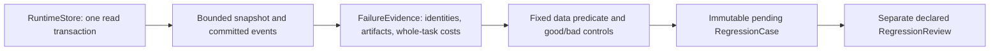

# Offline evaluation and scaling workbench

This AI-written reference implements H8/H10/H13 research instruments. It freezes planned attempts before observing results, retains every valid assigned row, and reconstructs synthetic scheduling decisions. The arithmetic/scheduling fixtures are synthetic; the bounded failure adapter also reads committed local RuntimeStore evidence. Neither establishes live-model capability. Human predictions, teach-backs, held-out confirmation and independent reproduction remain pending. The authoritative design is [EV-02–08](../capstone/03-evaluation-serving-and-efficiency.md) and the [Multi-Agent Scaling contract](../capstone/06-target-role-and-research-contract.md).

**VI:** Công cụ này giúp tránh tự đánh lừa bằng số đẹp: task đã được giao vẫn nằm trong mẫu số nếu process chưa kịp chạy, review chưa tới, hoặc effect còn Unknown. AI xây dụng cụ không phải evidence rằng Huy đã hiểu hay rằng nhiều agent giải code tốt hơn.

Run from the workspace root with the frozen `.venv` interpreter. The arithmetic/scheduling instruments use the standard library; runtime evidence capture also uses the existing service and SQLAlchemy dependencies:

```sh
.venv/bin/python -m evals --output "runs/research-demo-$(date +%Y%m%d-%H%M%S)/packet.json"
.venv/bin/python -m unittest discover -s tests -p 'test_evaluation.py' -v
.venv/bin/python -m unittest discover -s tests -p 'test_simulation.py' -v
```

The CLI writes a deterministic JSON packet containing frozen manifest/digest, raw outcomes, denominator counts, rates by arm/tier/repository, paired task differences, bootstrap intervals, all-role accounting, completion curves, 1/2/4-worker DAG traces, open-loop serving traces and one fixed-N allocation decision. Each new output directory keeps prior evidence intact. The historical [2026-10-08 packet](reports/synthetic-reference-demo.json) remains preserved and predates the 2026-10-09 cache-history/accounting fixes; it is not a current-source result. New packets are instrument demonstrations, not empirical comparisons. Calling `demo_manifest(tasks_count=36, trials=3, arms=("bare", "coordinated_n2"))` creates the planned **216** pilot rows without running them. Four-arm smoke fixtures are a separate synthetic development study.

**VI:** Bare và coordinated N=1 có cùng một patch worker nhưng khác overhead: N=1 vẫn phải trả planner/integration. JSON ghi rõ cả role count lẫn arm identity để không đổi treatment bằng cách đổi tên.

To analyze external outcome snapshots, save `{"manifest": ..., "manifest_digest": ...}` and a JSON outcome list, then run:

```sh
.venv/bin/python -m evals --manifest frozen.json --outcomes outcomes.json --cluster repository --output analysis.json
```

Immutable task/base/grader identities must match assigned rows. Acceptance needs independently supplied eligibility/review receipts, matching candidate/tree/grader digests and proper timestamps. The analyzer validates arithmetic and identities; it does **not** authenticate arbitrary strings as trusted production receipts. The runtime/verifier adapter must establish that trust before creating these records. `recorded_at`, `analysis_cutoff` and review cutoff use one declared time coordinate. Outcome revisions are full cumulative snapshots with unique `result_id`, matching `supersedes_id` and increasing `recorded_at`; prior snapshots remain in the raw digest. Reports ignore later revisions at earlier cutoffs. USD categories are disjoint settled/reserved/Unknown amounts, never incremental charges repeated in each revision; token counts include every role and retry in that attempt. Cumulative settled USD, input/output tokens, CPU seconds and human-review minutes cannot decrease between revisions. Unresolved reserved/Unknown amounts may decrease during valid reconciliation. Decreasing a consumed counter as a refund or cost correction is unsupported; it requires a separately specified accounting protocol.

**VI:** Không được đổi settled5 thành0 rồi dùng phần đó chi lại. Reconciliation có thể biến Unknown7 thành settled5 và giảm total exposure, nhưng không xóa consumption đã biết. `recorded_at` cho biết dữ liệu đã có khi phân tích hay chưa. Không thể ghi review vào ngày mai rồi để nó làm báo cáo hôm nay thành pass. Receipt string trong fixture chỉ là dữ liệu giả; production cần adapter xác thực và provenance trước khi dùng số đó.

## Purpose, ownership and discriminating evidence

| Component | State owner / invariant | Failure it exposes / test |
|---|---|---|
| [Frozen manifest](manifest.py) | Canonical immutable bytes/hash; complete task × trial × arm table; resource/environ/model/grader identities | Missing RAM ceiling, aliased arm, duplicate assignment and changed grader fail before dispatch |
| [Analysis](analysis.py) | Assigned table owns denominator; snapshots own measured facts; missing/Unknown=0 at cutoff | Hand fixture A=.25, B=.75, paired Δ=.5 even with infra/missing/Unknown |
| [Allocation](allocation.py) | Aggregate allowances plus explicit role reserves never exceed ceiling; settled + reserved + Unknown is a worker's floor | Completing a worker does not free its uncertain bills; future observations rejected |
| [DAG simulation](simulation.py) | Dependencies, CPU, model slots and physical patch slots constrain starts separately | Chain 9/9/9 seconds; branch+integration 11/7/7 under N=1/2/4; CPU=1 restores 11 |
| [Serving replay](simulation.py) | All arrival times are fixed before service; retained sandboxes stay occupied during tool idle | Model slot availability cannot admit a task when its required physical slot is retained; overload rows remain rejected |

**VI:** Longest dependency path là giới hạn dưới. Timeline thực còn có contention: N=1 phải chạy branch A rồi B, nên resource predecessor nối hai branch vào causal path 11 giây. Integration nằm sau cả hai branch, không được giả vờ parallel miễn phí.

## Derive and trace one paired result

Let Q=1 only when the exact immutable candidate was eligible before its execution limit and positively reviewed by the preregistered cutoff. At cutoff every other assigned row has Q=0 while keeping its status. For equal R trials per task, `q_a = mean_t(mean_r(Q_tar))`, `delta = mean_t(q_tB - q_tA)`. With task0 A=[1,0], B=[1,1] and task1 A=[0,0], B=[1,0], A=1/4, B=3/4, and both task deltas are 1/2. Resampling whole paired tasks preserves their repeated trials; repository resampling preserves complete groups of dependent tasks. The fixture interval collapses to [.5,.5] because both synthetic task differences are identical; that says nothing about confidence coverage on a real population.

**VI:** Nếu bỏ infra failure của task1, A sẽ có một mẫu số khác và so sánh không còn cùng cơ hội được giao. Bootstrap từng trial độc lập còn giả vờ rằng ba lần sửa cùng repo là ba repo khác nhau. Khi số repo nhỏ, báo số cluster và kết quả từng repo, không gọi interval hẹp là bằng chứng mạnh.

Excluding an invalid task requires a complete-task adjudication ledger with reason/receipt; report both excluded and original denominators. Exclusion does not delete spending. Cost/acceptance is undefined (`null`) when no task is accepted. Acceptance curves divide cumulative accepted events by **all** assigned valid attempts, so missing rows never become zero-latency wins. Few synthetic repositories cannot establish interval coverage, superiority, noninferiority or sample-size power.

**VI:** Chi phí đã trả vẫn thật dù grader hỏng và task bị loại khỏi quality score. Cần giữ hai ledger: inclusion cho estimand và spending cho tiền. Điều này ngăn sửa báo cáo bằng cách bỏ task tốn tiền nhất.

## Synthetic service model boundary

DAG duration, token-rate and arrival inputs are proposed synthetic values. Scheduling uses deterministic node-ID order; completed work releases resources before same-time arrivals. CPU capacity and model-call capacity stay fixed across the N comparison; physical patch-slot limit varies explicitly. The DAG report provides structural critical path, realized causal path including resource predecessors, start/finish times, readiness and resource occupancy. Idle tool intervals retain physical slots. On tool return, phase1 prompt is `initial_prompt + prior_generated_output + appended_tool_tokens`. The simulator assumes only the shared initial-prefix cache, with no private pinned session KV. It subtracts the initial prefix only when that prefix is actually resident at model dispatch; zero capacity or LRU eviction makes it cold again. Even a warm return must prefill prior output and appended tokens. Cache identity and stored size remain those of the initial shared prefix. Serving cache replay is a simplified token/LRU model; exact full-block ownership belongs to [`compute/cache.py`](../compute/cache.py). This simulation omits engine batching, network/provider variability, actual KV residency and hostile-code isolation. Do not derive real coding accuracy or production SLOs from it.

**VI:** Giữ sandbox không tự giữ KV: model này không có private pinned KV. Với prompt10, output3, tool append2, prompt lần sau dài15; resident prefix10 thì prefill5, bị evict thì prefill15. Queue replay vẫn tiếp tục gửi khi hệ thống bận. Closed-loop generator chỉ gửi sau khi request trước xong sẽ che overload. Report đặt rejected count cạnh latency quantile; nhìn p95 của request được admit mà bỏ rejects sẽ làm hệ thống có vẻ nhanh hơn.

Primary sources: [Anthropic paired/dependence-aware statistical evaluation](https://www.anthropic.com/research/statistical-approach-to-model-evals), [Anthropic infrastructure sensitivity](https://www.anthropic.com/engineering/infrastructure-noise), [Cursor agent scaling account](https://cursor.com/blog/scaling-agents). These motivate contracts; their findings are not independently reproduced here.

## Numeric input boundary

Counts (trials, worker/resource slots, token IDs/counts, seeds, queue/cache capacity and dimensions) are nonboolean integers. Times, rates, spending and other real measurements must be finite and nonboolean; service-time/path arithmetic must remain finite after derivation. A tiny positive rate such as `1e-320` is rejected if it makes the declared work duration infinite. The primary contrast names two distinct assigned arms. Allocation observations reject future/nonfinite times and preserve monotone settled consumption before redistributing only safely unused allowance.

**VI:** Python coi `True == 1`, nhưng một boolean không phải một worker count. Kiểm tra input finite vẫn chưa đủ: `1 / 1e-320` overflow thành infinity. Không được xuất timing đó vào report như một simulation hợp lệ.

## Verified code reading path

Read the [manifest validator](manifest.py#L59), [assigned-row generator](manifest.py#L30), [eligibility predicate](analysis.py#L38), [paired analysis](analysis.py#L85), [hand-oracle denominator test](../tests/test_evaluation.py#L46), [Unknown-preserving allocation](allocation.py#L76), [DAG scheduler](simulation.py#L21), and [arrival replay](simulation.py#L156). These anchors were refreshed against audited source declarations on 2026-10-09; regenerate them if code moves.

**VI:** Bài transfer đang chờ Huy: nếu một repo chứa hai task liên quan nhưng repo khác chỉ có một task, bootstrap repo phải giữ cả block; hãy giải thích khác biệt giữa resampling cluster và thay đổi estimand bằng equal-repo weights. Việc đọc lời giải này chưa ghi mastery.

## Failure observations and development regressions

The [frozen adapter contract](../research/failure-regression-spec-2026-10-10.md) defines a library slice for two observations: an exact failed verification and a dispatch whose effect remains Unknown. The bounded implementation has [independent review](../research/failure-regression-independent-review-2026-10-10.md) and [source-bound verification](../research/failure-regression-verification-2026-10-10.json); the [coverage register](../capstone/08-implementation-coverage.md) owns delivery status.



`capture_failure_source` pins the full task state and event frontier on one database connection. `extract_failure_evidence` verifies causal identities and scoped artifact bytes, then preserves whole-task accounting even when the selected event window is narrow. `freeze_regression_case` evaluates a fixed predicate against evidence-derived expected values; a correct attribution fixture must satisfy it and an altered fixture must fail it. Reviews are separate immutable records with an explicit `reviewer_kind`; delivered AI reviews are labeled `ai`.

**VI:** Một snapshot chứa fail của candidate A cần nối đúng A, grader và environment. Fixture đổi A thành B phải bị bắt. Test này kiểm tính đúng của evidence, chưa phải chạy B và chứng minh B sửa được bug.

The accounting unit is `runtime_budget_units`, retaining the declared rate snapshot without converting generic units to USD. A task can have spent9, reserved0 and an Unknown effect simultaneously. Settling the charge tells us how much was consumed; it does not tell us whether the action succeeded. Missing events/artifacts remain incomplete, contradictory identities are invalid, and no incomplete or invalid observation can create an eligible regression proposal. The adapter never updates runtime authority or runs historical tool responses.

**VI:** Tổng cost thuộc toàn task: chọn riêng event summary3 không được làm mất parent10 và child7. Các số này là ví dụ invariant; kết quả đã chạy phải xem record có source hash và môi trường tương ứng.

All cases retain development lineage. These two controls test evidence/accounting invariants; fresh candidate correctness, a general outcome exporter, old-incarnation reconstruction, training export and authenticated external review remain separate contracts. A hash verifies byte identity, while local source and reviewer provenance remain caller-declared. CPU numerical observations cannot become execution acceptance through this adapter.

Run `.venv/bin/python scripts/failure_regression_demo.py --output runs/my-failure-regression-demo` with a fresh output directory. [The saved packet — local-only](../docs/github-snapshot.md#omitted-local-evidence) records the source hashes and both control pairs. The demo executes only preauthored, hash-locked FixtureVerifier controls, then reads real local RuntimeStore records. It never replays an agent action or calls a provider. Its AI-labeled review objects explicitly demonstrate the declared review format; the independent code review is a separate artifact.
