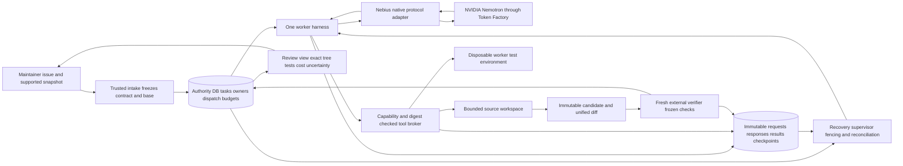

# Verified repository repair system design

Design status: contract-derived hackathon product on the inspected reference. The supported stateless Python function path is implemented; [runbook](05-local-repair-runbook.md), [delivery verification](../research/hackathon-2026-10-10/repair-delivery-verification.json) and [coverage](../capstone/08-implementation-coverage.md) own its measured scope. The original [architecture audit](../research/hackathon-2026-10-10/architecture-audit.md) remains dated inspection evidence. Live NVIDIA coding quality, general repository support and operated service remain pending.

## User and outcome

The first user is a maintainer of a small Python service facing a reproducible behavior bug across one to three source files. They need a change they can review without reconstructing an agent's claims. The initial product accepts a supported repository snapshot, issue, allowed source paths, frozen developer-test recipe, spending ceiling and deadline. It returns a unified diff, before/after failing-test evidence, final independent result bound to the exact candidate, and settled/reserved/unknown cost.

The user flow is: choose a supported task -> set ceiling -> start repair -> inspect progress -> review diff and evidence -> download. Completion remains a proposal until the external verifier evaluates the exact tree. Human acceptance is a separate decision. A model's explanation and a candidate process printing PASS cannot create the verifier receipt.

The novelty hypothesis is useful repair with a verifiable chain across a supported interruption. Validate it by showing the repair and by asking a maintainer whether the evidence reduces review effort. Contacting people, posting PRs and collecting feedback are separate human actions; no feedback or adoption is assumed.

**VI:** Người dùng cần quyết định “có nên nhận patch này không?”. Trace và ledger có giá trị khi giúp trả lời câu đó. UI cần cho xem diff, test và phần chưa chắc chắn ngay; số lượng agent đang chạy không phải lợi ích tự thân.

## Derive the architecture from constraints

A language model generates a conditional proposal from a finite view. Files, processes, database transactions and remote inference evolve separately. Therefore a sentence cannot prove an effect, and a saved conversation cannot prove the state of a file or remote request. Each effect needs a durable identity, and each claim must name the object it describes.

A repair is valid for a particular task contract, base, candidate tree, grader and environment. Define its evidence identity as `E=(contract_digest, base_git_commit, base_tree_digest, candidate_tree_digest, grader_digest, environment_digest)`. Git commit and service tree digest are distinct: one includes repository history/metadata, the other identifies the supported file manifest. If any required identity changes, the previous verdict cannot certify the new candidate.

Every live turn consumes money and time. A fixed ceiling requires intent-before-network reservation, trusted usage settlement and retention of possible charges when a response is lost. Restarting a controller does not cancel a remote charge. Mutable workspaces require stale-read guards; surviving crashes requires fenced ownership and immutable checkpoints.

**VI:** Ba ràng buộc tạo ra hệ thống: model có view không đầy đủ; effect không commit cùng database; tiền và thời gian hữu hạn. Owner, digest và reservation là cách giải quyết các ràng buộc đó, không phải thêm kiến trúc chỉ để có nhiều service.

Token Factory serves inference. The application's guarded tools execute code in separately controlled environments; a chat inference endpoint does not itself provide repository execution containment. Serverless Jobs/Endpoints are options, not prerequisites for this design. The supervisor retains authority regardless of what the model requests.

## Frozen input and state ownership

| Component | Owns | Invariant and failure experiment |
|---|---|---|
| Intake | Issue, base snapshot, operator-selected supported files, environment/recipe identity | Optional Git provenance verifies the declared files against HEAD/index; unrelated dirty files are outside that claim. Mutation after intake cannot silently change the base; embedded secrets are not automatically detected |
| Authority store | Task generation, owner epoch, lease, physical slot, dispatch and money | A stale owner cannot dispatch/publish; cancellation revokes authority without erasing liabilities |
| Operator gateway | Secret, exact model/endpoint, approved price and enforced bounds | Client/model text cannot choose a cheaper invented price; reject unavailable or unverified configuration |
| Provider adapter | Supported native wire protocol and usage normalization | Complete raw bytes retained; malformed calls authorize no tools; usage is separate from semantic validity |
| Harness | Turn loop, exact transcript, evidence/checkpoint frontier | Request intent precedes HTTP; known replay consumes saved response; unresolved replay requires reconciliation |
| Tool broker | Capability admission and effect journal | Path/schema/digest checks precede edits; same unresolved action cannot run twice |
| Worker test supervisor | Fixed command/image and resource/cleanup limits | Model cannot choose arbitrary shell; timeout/output overflow returns bounded failure; uncertain cleanup retains occupancy |
| Candidate integrator | Immutable delta/tree and current head | Candidate paths are permitted; a new head invalidates old verification authority |
| Final verifier | Protected checks and verdict over exact candidate | Candidate cannot edit checks or author verdict; stale tree or mismatched environment cannot publish review |
| Recovery supervisor | Observed retirement/reconciliation and replacement | Checkpoint reconstruction grants no execution authority; old owner is fenced before new claim |
| Report | Derived user-facing view | Reloading saved evidence reproduces identities without extra model calls; Unknown remains visible |

**VI:** Mỗi hàng có owner độc lập vì nó biết một loại sự thật khác nhau. Workspace biết bytes; provider biết usage; DB biết quyền dispatch; verifier biết kết quả checks. Report chỉ tổng hợp, không được tự tạo các sự thật đó.

The task schema supports `patch_slot_limit=1` for this profile while retaining the default elsewhere. Implemented defaults: supported UTF-8 source manifest <=50 files and <=256 KiB, immutable file allowlist, <=12 model turns, serial tool execution, <=4 worker-test runs and a separately admitted final verifier. The concrete function recipe may impose tighter file/byte limits. Set deadlines and dollar ceilings after actual pricing/latency calibration. Unsupported source formats, symlinks, protected paths, online installs and arbitrary test commands are rejected or outside the fixed recipe. General repository/dependency support remains pending.

## Provider and model decision

Use the documented global Token Factory endpoint for the first deployment. A preflight records the actual account catalog, exact case-sensitive model ID, date, pricing, supported functions, cap fields and a returned protocol sample. Choose Nemotron Super as the first calibration candidate, then compare Nano on the same calibration tasks if credits permit. Ultra is a stretch candidate for difficult tasks; it adds no value unless its extra cost/latency produces a measured result.

No routing policy is required for the first product. All coding decisions in its first trial use one frozen model, simplifying attribution. Later routing needs a bounded experiment: same tasks, total budget and deadline; router overhead included. Availability in a public cookbook is reported documentation, not measured account access. [Provider audit](../research/hackathon-2026-10-10/provider-and-research.md).

**VI:** Không chọn model bằng số parameter trên poster. Ta quan tâm xác suất repair đúng trong deadline và ngân sách. Public docs có model ID nhưng account cụ thể có thể chưa dùng được; live preflight là boundary cần xác minh.

## Exact tiny state and data trace

Use a tiny bug `def add(a,b): return a-b` with a developer test requiring `add(2,3)==5`. Expected flow below is a design trace, not a live-model measurement.

| Step | Exact object or state change | Why it matters |
|---|---|---|
| 1 | Intake freezes `calc.py`, issue, visible test, base digest B, protected external assertion and image digest V | Model has no reference patch or editable grader |
| 2 | Claim owner `(incarnation,tenant,task,generation,node,epoch,attempt)` with allowance40 under limit100 | Authority, physical capacity and money have explicit owners |
| 3 | Model request M0 is stored; dispatch reserves bound12 by moving attempt allowance40 ->28 plus request liability12 | Total reserved stays40, not52 |
| 4 | Complete response names `read_file(calc.py)`; raw body saved, trusted actual3 settles once | Bill can be settled before validating a tool proposal |
| 5 | Tool read yields original text and digest d0; linked result enters native transcript | Following edit has a verifiable read identity |
| 6 | Proposed `replace_text` expects d0 and changes `a-b` to `a+b`; intent then effect then immutable result | A stale d0 fails; a crash between effect and result creates uncertainty |
| 7 | Worker test executes the frozen recipe over snapshot C; bounded failure/pass output becomes feedback | Test output informs the model but does not create final acceptance |
| 8 | Committed checkpoint stores exact messages/tool IDs, C, evidence and next turn | It can reconstruct this state, not later effects |
| 9 | Final fresh verifier checks C; stores candidate/grader/environment identity and result | A verifier pass over B cannot certify C |
| 10 | Publish review eligibility only for current C; show diff and measured spend; human decision pending | Model completion, verification and acceptance remain separate |

Clean-restart experiment: kill after step8 and before the next dispatch. Retire the old workspace/environment with trusted identity evidence, fence old owner, obtain a fresh claim, restore checkpoint and continue. Ambiguous-response experiment: kill after step3 before response receipt; retain liability12 and stop pending reconciliation. A checkpoint predating an advanced dispatch frontier must be rejected. Do not implement blanket retry as recovery.

**VI:** Nếu request đã gửi mà response mất, ta chưa biết model có trả kết quả hay provider có charge không. Khoản12 vẫn là exposure. Nếu chỉ dừng sau checkpoint và chưa dispatch tiếp, có thể tiếp tục từ state đã biết với owner mới. Hai case cần hai kết quả khác nhau.

## Implementation order and rejection gates

| Slice | Build | Accept only when |
|---|---|---|
| S0 Provider | Native nonstreaming Nebius adapter and durable harness | NB01–NB10 mock/fault tests plus preserved existing provider tests pass |
| S1 Repo intake and live runner | Supported frozen snapshots; one static patch node; no oracle reads | Transport-driven edit/test loop operates on new source bytes; unauthorized paths fail |
| S2 Test and final verifier | Pinned recipe, accounted disposable worker tests, protected external API checks | Correct/unchanged/plausible-wrong controls distinguish verdicts; candidate cannot forge a pass |
| S3 Diff and report | Downloadable unified diff plus exact candidate/result/ledger | Applying diff to frozen base reconstructs verified digest; report replay sends no model calls |
| S4 Restart | One clean-boundary process restart and separate Unknown stop | Old owner rejected; effects/cost retained; no lost-response request repeated |
| S5 Product delivery | Brief issue-to-diff UI or complete test-build workflow | Fresh install and a genuine NVIDIA/Nebius repair reproduce declared behavior |

The existing `ReferenceEngine` deliberately reads authored oracle material and admits only scripted fixtures; it remains preserved mechanics evidence. The separately named `RepairEngine` now uses native tool proposals without reference-patch imports. Its stateless function recipe complements the original issue-tracker verifier rather than weakening that verifier's exact-file guard. Trusted host input/output assertions operate through a bounded container protocol; process exit0 from candidate-controlled tests alone is insufficient final proof. Actual model repair capability still needs live evidence.

**VI:** Không bỏ guard của fixture để gọi nó là arbitrary repo runner. Runner mới cần source contract mới; grader mới cần oracle độc lập và checks đúng behavior. “Tests passed” phải chỉ đúng lớp evidence đã có.

## Scope and threat boundary

Hackathon scope is a supported, single-tenant test build or small hosted demo with fixed tasks. New user code executes without host secrets, network, privileged mounts or mutable grader access, within pinned Linux resource settings. Existing Docker evidence supports bounded local containment; it does not establish resistance to kernel escape or production multi-tenant hosting. Public arbitrary uploads need a separately reviewed containment product and are excluded.

Cut dynamic replanning, training, custom CUDA kernels, four-worker scaling, generalized Git editing, external PR posting/merge, automatic remote-effect lookup, distributed restoration and broad SaaS operations. Keep the broader capstone gaps recorded. A second worker is optional only after it improves the same-budget verified outcome. Recovery and verification depth must serve an understandable product result within the three-minute demonstration.

**VI:** Tập task cố định giảm mặt tấn công và chi phí vận hành. Những phần chưa có vẫn là gap của capstone, không được đổi tên thành “optional” để tuyên bố production hoàn tất. Hackathon chỉ chọn phạm vi chứng minh được trước hạn.

## Current supporting source — 2026-10-11

[The readiness program](../research/system-readiness-plan-2026-10-11.md) supplies optional typed skills continuation, durable per-case Docker identity and explicit physical reconciliation. Both actual verifier paths can opt in before execution. Cleanup does not authorize Unknown retry or task replacement. The new loopback HTTP service uses fixed scripted fixtures; it is not yet this live repository-repair product. Preserve the live provider/repair/access gates and paid-execution hold.
