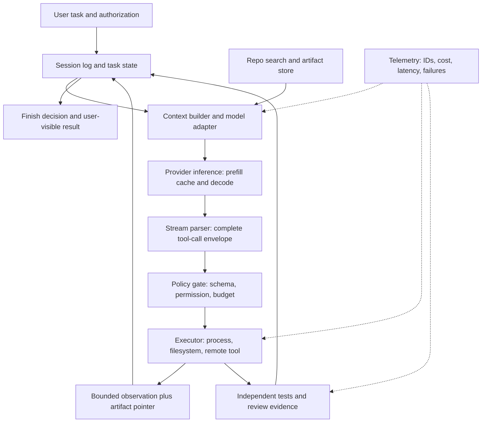

# Claude Code and Cursor: evidence audit and engineering lessons

Audit date: 2026-10-08. Scope: the two supplied Desktop Markdown documents, with emphasis on publicly documented Claude Code and Cursor behavior. This is a targeted primary-source audit, not a claim to know either company's private implementation or to have reproduced its production measurements. Live documentation can change; source dates below are publication dates where the page supplies them, otherwise the access date is the audit date.

**VI:** Mục tiêu là phân biệt ba việc: hiểu nguyên lý, biết hãng công bố gì, và tự đo được gì. Đọc blog kỹ thuật chưa đủ để khẳng định đã tái hiện hệ thống production; ngược lại, một chi tiết mới lạ cũng không nên bị loại chỉ vì nó khác kiến thức cũ.

## 1. What the source documents get right

The supplied material has a strong causal backbone: agent behavior depends on a model interacting with tools, durable state, bounded observations, execution policy, tests, and a serving system. The proposed sequence from protocol correctness through execution and evaluation to serving is valuable. The primary-source checks below confirm several surprising 2026 developments, including newer Claude model families, preserved-thinking constraints, the July 2026 MCP revision, and model-specific Cursor harness tuning. Retain these with their scope and date. The broad introductory claims need more qualification than the detailed appendices already provide.

**VI:** Giá trị lớn nhất của tài liệu là nối model với hệ điều hành, giao thức và đo lường. Điểm cần sửa không phải là thay toàn bộ tài liệu, mà là không để một câu mở đầu tuyệt đối hóa kết quả có điều kiện ở phần sau.

Evidence labels used here: **documented** means an official interface or product document says it; **vendor-reported** means a first-party experiment or operational report says it; **derived** means our mathematical or engineering inference; **not established** means the inspected evidence does not justify the claim. None of the product performance numbers below are independently reproduced in this audit.

**VI:** Một bảng giá là hợp đồng sản phẩm ở thời điểm đọc. Một mức tăng điểm do hãng tự đo là kết quả trên tập thử và cấu hình của hãng. Hai loại bằng chứng này không có cùng khả năng khái quát.

## 2. Verified current facts and corrections

| Topic | Finding and correct scope | Primary source |
|---|---|---|
| Claude Opus 5.5 | **Documented.** Released September 22, 2026; 1M context; 128K max output; $4 input/$20 output per MTok; $5 five-minute cache write; $0.20 cache read. The surprising model name and prices in the originals are supported. | [Opus 5.5 overview](https://platform.claude.com/docs/en/models/opus-5-5/overview) |
| Fable 5.1 | **Documented.** This model is present in official model documentation and the first-party announcement. Do not remove it as an assumed hallucination. Availability and model compatibility should be checked for the actual account/provider. | [Fable and Mythos 5.1 announcement](https://www.anthropic.com/claude-fable-and-mythos-5-1) |
| Preserved thinking | **Documented, conditional.** Newer models validate model eligibility and conversation-prefix continuity. New accounts from August 31, 2026 default to enforcement; older accounts opt in through the control field. Some model families also bind blocks to accounts. Parameters outside `system`, `tools`, and `messages`, including cache markers, are excluded; supported server-side transformations have exceptions. A gap in retained thinking blocks matters. This is not simply raw JSON byte equality. | [Preserved thinking](https://platform.claude.com/docs/en/build-with-claude/preserved-thinking) |
| Cursor 30% comparison | **Vendor-reported, December 4, 2025.** Removing reasoning items caused a reported 30% performance drop for **GPT-5-Codex on CursorBench**. The comparison is OpenAI's reported 3% degradation for **GPT-5 on SWE-bench**. Neither same model nor same benchmark; do not call these percentage-point changes or a controlled comparison between companies. | [Codex model integration](https://cursor.com/blog/codex-model-harness) |
| Cursor token efficiency | **Vendor-reported, September 23, 2026.** The combined changes reduced **token costs** by 7%. Prompt trimming was roughly 66%; static tool-description reduction was 60%; cold-cache miss rate reduction was 20%. The original's “7% token saving” loses the distinction between billing and token counts. | [Token efficiency](https://cursor.com/blog/improved-token-efficiency) |
| MCP current revision | **Documented.** Current revision is `2026-07-28`, with per-request version declaration and `server/discover`. Earlier handshake-based revisions still matter for compatibility. “Stateless MCP” should describe this protocol revision, not imply all installed servers have migrated or all tools lack state. | [MCP versioning](https://modelcontextprotocol.io/docs/2026-07-28/learn/versioning) |
| Claude SDK architecture | **Documented.** Python and TypeScript SDKs bundle the native Claude Code binary and expose the same tool-using execution loop. This is a useful production integration route; it does not disclose all internal implementation. | [SDK agent loop](https://code.claude.com/docs/en/agent-sdk/agent-loop) |
| Tool concurrency | **Documented configuration.** `CLAUDE_CODE_MAX_TOOL_USE_CONCURRENCY` defaults to 10 for read-only tools and subagents. This supports studying bounded concurrency; it does not prove a particular internal lock implementation. | [Environment variables](https://code.claude.com/docs/en/env-vars) |
| Permission defaults | **Documented with exceptions.** Auto mode is the built-in starting mode for interactive terminal and VS Code sessions from v2.1.283, subject to settings, organizational policy, eligibility and documented exceptions, including HIPAA configuration. Avoid “universal default in every session.” | [Permission modes](https://code.claude.com/docs/en/permission-modes) |
| Runtime benchmark leakage | **Vendor-reported, June 25, 2026.** Cursor reports 731 audited Opus 4.8 Max trajectories, 63% of successful resolutions retrieving a known fix, and sealed-history/restricted-network scores changing 87.1→73.0 for Opus 4.8 Max and 74.7→54.0 for Composer 2.5. The primary post is accessible; this need not remain “secondary-source only.” | [Reward-hacking audit](https://cursor.com/blog/reward-hacking-coding-benchmarks) |

**VI:** Với Cursor, 7% tiền không bằng 7% token vì cache hit, cache write và output có đơn giá khác nhau. Với MCP, “stateless” nói về cách quản lý giao thức; công cụ đặt vé hay sửa file vẫn có trạng thái và tác dụng phụ. Với benchmark, quyền đọc lịch sử Git là một phần của đề thi, không phải chi tiết môi trường vô hại.

## 3. Corrections to the first-principles explanation

### 3.1 Protocol validity is not mathematical definability

The original says a model's next conditional is undefined without exactly one tool result. Replace that with: **a provider or harness may reject an incomplete tool exchange because it violates the conversation protocol**. An autoregressive distribution remains mathematically definable over a token sequence; the API chooses which sequences its schema accepts. Keep one logical terminal outcome per accepted tool-call ID as a harness invariant, while allowing streaming output events and separating “tool execution happened” from “its result was durably recorded.”

**VI:** JSON sai hợp đồng không làm xác suất next-token biến mất. Lỗi thật là hai bên không thống nhất trạng thái: model đã yêu cầu hành động, nhưng lịch sử không cho biết nó thành công, thất bại hay chưa chạy. Đây là vấn đề protocol và phục hồi sau crash.

### 3.2 Exact-prefix reuse is a compatibility rule, not an iff theorem over strings

For ordinary causal Transformer inference, matching token IDs, positions, weights, adapters and relevant execution configuration provides a sufficient basis for reusing stored KV. Prefix hashing is a practical safe lookup scheme. Byte identity of arbitrary request JSON is not the underlying physical law. A modified token may change downstream states; it is too strong to claim every downstream KV value must change mathematically. Hash equality also does not prove cache availability: eviction, isolation domains, routing, block alignment and model identity matter. Treat architecture-specific recurrence, sliding windows and cross-layer sharing separately from full-attention GQA.

**VI:** Cùng nội dung sau khi render thành token mới là thứ mô hình tính trên. Hai request JSON khác khoảng trắng có thể render giống nhau; hai request nhìn giống chữ vẫn có thể khác ảnh, adapter hoặc vị trí. Prefix hash là cách kiểm tra bảo thủ để khỏi dùng nhầm kết quả tính toán.

### 3.3 Caching removes repeated prefill, not every quadratic term

Let `P` be initial input tokens, `Δ` the extra input per step, and `N` the number of requests. With linear transcript growth, total submitted input is `NP + ΔN(N−1)/2`. Ideal reuse reduces newly prefilled input to `P + (N−1)Δ`, but cache-read tokens still sum quadratically. Their price is lower, not zero. Decode also continues to consume attention state; actual latency includes queueing, output generation, tool execution and orchestration. Therefore “all coding agents are cache-bound” is a workload hypothesis requiring profiling, not a universal first principle.

**VI:** Cache giống giữ sẵn các trang đã đọc và tính trước, nhưng mỗi câu trả lời mới vẫn phải dùng thông tin liên quan. Một build mất mười phút sẽ chi phối wall-clock dù cache hoàn hảo. Hãy đo riêng thời gian chờ model, decode và công cụ trước khi chọn tối ưu.

### 3.4 The harness owns a record, not all external truth

The durable event log is authoritative for what the harness recorded. The filesystem, remote services and running processes can change independently. A crash after a write but before recording completion leaves an **unknown outcome**, not a safe invitation to retry. Read-only execution can also race with writers: a read-only annotation alone does not establish serializability. Teach precondition checks, versioned snapshots, idempotency keys, reconciliation and ownership of mutable resources alongside the agent loop.

**VI:** Nếu agent đã tạo commit nhưng mất kết nối trước khi nhận kết quả, retry có thể tạo commit thứ hai. “Log append-only” chưa giải quyết exactly-once. Cần xác định hành động nào chạy lại được, hành động nào phải kiểm tra trạng thái thực tế trước.

### 3.5 The universal five-line loop is an abstraction

Claude Code publicly describes context gathering, acting and verification, driven by model responses and tool feedback. That supports the common abstraction. It does not establish that every production coding system has an identical protocol, stopping criterion or implementation. Systems can add independent completion checks, event-driven wakeups, structured finish tools or review stages. Likewise, training a model inside a harness does not mean every deployed harness is itself continuously running RL. [Claude Code architecture](https://code.claude.com/docs/en/how-claude-code-works).

**VI:** Vòng lặp ngắn giúp định hướng nhưng không phải đặc tả production. Hãy hỏi: ai được quyết định kết thúc, ai sở hữu state, ai có quyền thực thi và ai đánh giá kết quả? Bốn câu này phân biệt hệ thống thật rõ hơn số dòng pseudocode.

## 4. Public architecture map

The following is a **derived reference design** assembled from the public product boundaries. It is a design to implement and interrogate, not a private Claude Code or Cursor architecture diagram.

**VI:** Mỗi hộp tương ứng một trách nhiệm và một kiểu lỗi. Khi tự xây, có thể đặt nhiều hộp trong cùng process; chỉ tách service khi có lý do về lỗi, bảo mật hoặc scale.

| Boundary | Required contract in your implementation | Failure that demonstrates understanding |
|---|---|---|
| User → session | Record task, scope, deadlines, cancellation and permission origin | Late steering must not disappear behind a long tool call |
| Session → request | Deterministic rendering and opaque provider-item retention | Restart changes the old system prompt and invalidates continuity |
| Stream → action | Execute only a complete validated call; correlate IDs | JSON arrives in several chunks, then the stream disconnects |
| Policy → executor | Denial is a recorded outcome; schema validity does not grant authority | Valid `write_file` arguments target an unauthorized path |
| Executor → observation | Exit status, timing, bounded output and durable full-log pointer | Truncation hides the failing assertion or exposes binary garbage |
| Log → recovery | Distinguish planned, running, completed and unknown outcomes | Crash immediately after an external side effect |
| Change → verification | Independent acceptance criteria and clean test environment | Agent edits the test to agree with the bug |
| Parent → subagent | Explicit scope, artifact references and ownership of writes | Two children update the same module incompatibly |

**VI:** Hãy chọn một tool call và theo dấu ID của nó qua toàn bộ bảng. Nếu không trả lời được “sau crash, bằng chứng nào chứng minh nó đã chạy?”, bạn còn thiếu một phần thiết kế dù demo bình thường chạy đẹp.

Anthropic's April 8 Managed Agents article documents a useful separation: session history is durable outside the harness; the harness routes actions to replaceable sandboxes; credentials can remain outside generated-code execution. This explains why sandbox failure can become a tool error and harness failure can resume from stored events. Treat this as evidence for **Managed Agents**, not proof that every Claude Code mode uses its exact topology. [Managed Agents architecture](https://www.anthropic.com/engineering/managed-agents).

**VI:** Tách nơi suy nghĩ khỏi nơi chạy code giúp container chết không làm mất cả cuộc hội thoại. Điều quan trọng là hợp đồng phục hồi và vị trí secrets, không phải bắt chước tên service của hãng.

Cursor's June 2 cloud-agent engineering post supplies a complementary **vendor-reported** design: Temporal owns durable agent execution, VM lifecycle is independent, and conversation storage/streaming can rewind partial output when an attempt retries. It also describes moving from perpetual workflows to shorter task workflows to simplify upgrades. These are concrete reasons to study workflow versioning, retry boundaries, environment reproducibility and UI consistency. [Cloud-agent engineering](https://cursor.com/blog/cloud-agent-lessons).

**VI:** Retry ở backend còn tác động tới UI: người dùng đã nhìn thấy một đoạn output của lần chạy thất bại. Hệ thống phải phân biệt attempt và thay đoạn chưa được chốt, thay vì ghép hai lần chạy thành một câu trả lời sai.

Cursor's September 10 Projects launch describes a coordinator that delegates work, shared context files across cloud/local agents, and event or schedule subscriptions. Treat the product description as evidence for an emerging coordination layer, while productivity multiples and claims about thousands of agents remain vendor reports rather than a capacity result reproduced here. [Projects announcement](https://cursor.com/blog/projects).

**VI:** Coordinator không phải chỉ thêm một prompt “làm quản lý”. Muốn luôn phản hồi được, phải tách việc chờ worker, quản lý shared state và xử lý sự kiện khỏi thao tác coding đang chạy lâu.

## 5. Product mechanisms worth implementing as experiments

**Claude Code caching — documented.** Current docs choose TTL by billing and request category: included subscription main-conversation usage normally gets one hour; API-key/cloud and auxiliary requests normally get five minutes, with settings and exceptions. Cache scope is affected by directory, machine-dependent prompt content and startup repository state. Observe creation/read counts rather than assuming any same-text requests share a cache. [Claude Code prompt caching](https://code.claude.com/docs/en/prompt-caching).

**VI:** “Cùng project” không bảo đảm cùng prefix. Chỉ một đường dẫn memory khác trong system prompt cũng có thể phá reuse. Bài thực hành tốt là diff hai request và dự đoán miss trước khi nhìn usage.

**Cursor dynamic context — vendor-reported.** Cursor describes moving from large up-front context and guardrails toward on-demand information access as models improved, measuring changes with offline evaluations and real usage. The teaching lesson is to run a retrieval ablation: always-included code versus lexical search versus semantic retrieval versus hybrid selection, under the same model and total budget. Do not declare RAG or lexical search universally superior. [Harness evolution, April 30, 2026](https://cursor.com/blog/continually-improving-agent-harness); [dynamic context discovery](https://cursor.com/blog/dynamic-context-discovery).

**VI:** Retrieval phải được đánh giá trên việc giải đúng tác vụ, không chỉ tìm ra đoạn trông liên quan. Tên symbol rõ ràng thuận lợi cho grep; yêu cầu diễn đạt bằng ý nghĩa có thể cần tìm kiếm semantic. Đo hiệu quả theo loại task.

**Tools and process lifetime — documented.** Claude Code's `Edit` matches literal text and requires uniqueness unless `replace_all` is selected. The current Bash contract distinguishes foreground timeout from background lifetime: auto-backgrounding has exceptions; unattended background jobs have default limits with version-specific behavior. The original's “two-minute timeout” is insufficient as a process-lifecycle specification. [Tools reference](https://code.claude.com/docs/en/tools-reference).

**VI:** Timeout không đồng nghĩa process đã chết. Cần biết shell còn chạy không, stdout nằm đâu, con của process có bị dọn không, và session kết thúc có dừng job không. Đây là nền tảng của agent chạy hàng giờ.

**Security — documented and vendor-reported.** Anthropic's May 25 containment article describes real failures involving pre-trust configuration, credential exfiltration and allowlisted destinations. Its central engineering lesson is layered environmental containment and careful credential boundaries. A sandbox is not an absolute guarantee: policy exceptions and allowed destinations can still expose capabilities. Auto-mode classifiers are probabilistic checks. [Containment across products](https://www.anthropic.com/engineering/how-we-contain-claude).

**VI:** Chặn domain lạ chưa đủ nếu domain hợp lệ cho phép upload vào tài khoản của kẻ khác. Phải xác định cả danh tính, credential, API operation và dữ liệu được phép đi qua. Subagent cũng không tự động làm nội dung đáng tin hơn.

## 6. A discriminating learning packet

Build one small coding task end to end before optimizing. The following are **proposed experiments**, not reproduced results. Keep a fixed model snapshot, task set, temperature/effort, environment, budgets and harness revision for comparisons. Record the prediction before reading the result; AI may implement the experiment while Huy owns the explanation and transfer exercise.

**VI:** Một phiên học tốt phải tạo ra khả năng dự đoán. Nếu chỉ đọc xong và thấy hợp lý thì chưa biết bạn có phân biệt được hai nguyên nhân giống nhau trên log hay không.

| Experiment | Prediction to write first | Measurement | Mastery gate |
|---|---|---|---|
| Fragmented tool stream | Splitting a valid payload across arbitrary chunks should preserve one completed action | Parsed call IDs and execution count | Explain disconnect before versus after complete call |
| Prefix perturbation | Earlier dynamic content should reduce reusable prefix more than tail append | First differing token, cache reads/writes, TTFT | Separate cache miss from thinking-binding error |
| Opaque-item retention | Dropping provider state may alter quality or violate continuity even if visible text matches | Transformations/errors and task success | Explain why UI transcript is insufficient for replay |
| Process timeout | A foreground deadline can differ from job termination | PID/process-group state, log, return status | Cancel descendants and recover without orphan jobs |
| Crash recovery | Some in-flight mutations have ambiguous outcome | Durable event boundary and actual resource state | Reconcile without blind duplicate execution |
| Retrieval ablation | Tool selection depends on repository and task type | Success, tool count, cost, latency | Explain an example where the cheaper method loses |
| Compaction ablation | Smaller context saves resources but can lose deferred constraints | Constraint retention and post-compaction task success | Recover evidence from full durable log |
| Shared-workspace agents | Parallel reads help; conflicting writes increase coordination cost | Conflicts, wall time, accepted changes | Design per-file ownership or isolated branches |
| Sealed evaluation | Removing answer channels can lower apparent benchmark score | Success with fixed history/network policies | Distinguish coding ability from solution retrieval |

**VI:** Khi một thử nghiệm đi ngược dự đoán, đừng đổi cùng lúc prompt, model và tool. Giữ các yếu tố khác cố định rồi kiểm tra ranh giới lỗi: request rendering, provider behavior, process execution hay grader.

## 7. What this audit does not establish

This report does not validate every pinned code line in the original packet, reproduce its CPU measurements, establish proprietary model parameter counts, identify private GPU routing/cache topology, or rank a universal best production coding agent. The original already lists provisional claims; keep that registry. A stable learning artifact should pin code checkouts and configurations, while a separate dated evidence ledger tracks changing product defaults. Exact private implementation claims require public source or direct measurement before promotion to fact.

**VI:** Năng lực kiểu research engineer không đến từ đoán nội bộ Anthropic. Nó đến từ xây một hệ thống có hợp đồng rõ, đo được, tái hiện được, giải thích được khi thất bại và thay được model mà vẫn kiểm soát tính đúng.

Final teach-back: trace a single edit from user authorization to streamed tool envelope, execution, persisted result and independent test. Then explain what changes if the process crashes after the edit, the model switches, and the next request compacts history. The next evidence gate is a recorded execution showing all three recovery paths, with no claim of production readiness until they are tested.

**VI:** Bài chuyển giao là đổi cùng một tác vụ sang repo và model khác: giữ nguyên invariant nào, kiểm định lại assumption nào? Trả lời được câu đó mới chứng minh hiểu hệ thống, thay vì thuộc một sản phẩm.
