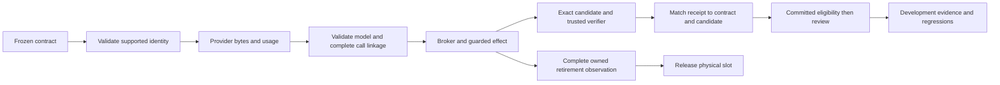

# Codebase audit and bounded refactor specification

Prepared 2026-10-10 before implementation. AI architecture and review; human mastery unchanged. This decision applies to the current reference, supported repair profile and NVIDIA NV-S0 foundation. The aim is to make existing evidence trustworthy before extending it to generated GPU programs. The current architecture is retained. This specification is an ordered repair slice, not a claim of complete production readiness.

**VI:** Trước khi hỏi agent tối ưu kernel tốt đến đâu, hệ thống phải chứng minh đúng code, đúng grader, đúng model và đúng lần chạy. Các lỗi ở đây có thể làm evidence nói nhiều hơn điều đã thực sự xảy ra.

**Delivery:** the ten defect groups and the independent model-pricing correction are implemented. [Integrated verification](codebase-review-verification-2026-10-10.json): 904 tests and 156 subtests passed with local Docker enabled; 10 PostgreSQL/Temporal opt-in tests skipped. Repository lint and [independent review](codebase-review-independent-2026-10-10.md) passed. The reviewed source and tested source hashes agree. This completes this repair slice, not the later feature or production gates.

## Audit scope and sources

Three independent Astra reviews inspect the active authority/runtime, execution/provider/repair, and research/compute/workload paths and their tests. The coordinator reviews integration, packaging, local checking and documentation. Findings, inspected inventory and reproduction details belong to the [authority review](codebase-audit-2026-10-10-authority.md), [execution review](codebase-audit-2026-10-10-execution.md) and [research review](codebase-audit-2026-10-10-research.md). The before-state file identities are recorded in [the baseline — local-only](../docs/github-snapshot.md#omitted-local-evidence). Historical lab, third-party references and archived runs are preserved as evidence; they are not active production modules to refactor.

Primary sources checked October 10:

- [NVIDIA CUDA asynchronous execution](https://docs.nvidia.com/cuda/cuda-programming-guide/02-basics/asynchronous-execution.html): a launch can return before work completes; synchronization establishes completion. Engineering implication: neither host return nor a candidate-authored timestamp can establish trustworthy GPU timing or retirement.
- [Anthropic agent evaluation guidance](https://www.anthropic.com/engineering/demystifying-evals-for-ai-agents): observed environment outcomes and transcripts serve different purposes; regression checks protect established behavior. Engineering implication: validate receipt identity and chronology before computing accepted outcomes.
- [HTTPX client API](https://www.python-httpx.org/api/): request-level redirect handling can override client configuration. Engineering implication: enforce endpoint policy at the credential-bearing request, including injected clients.

These sources motivate boundary checks; the local reproductions establish the defects. They do not establish how NVIDIA internally implements its coding agents.

**VI:** Paper và documentation giải thích cơ chế, còn reproducer kiểm tra code hiện tại. Không dùng tên công ty để thay cho bằng chứng, cũng không suy ra kiến trúc nội bộ từ một bài viết công khai.

## First principles and state ownership

The immutable task contract owns intended work and constraints. The controller owns admission. The verifier owns observations about the exact candidate under a specific grader/environment. RuntimeStore owns committed eligibility, resource exposure and review. The provider supplies bytes; validated linkage and broker policy decide whether those bytes may cause an effect. The analyzer consumes trusted outcome records; it cannot manufacture proof of execution.

Tiny counterexample: a task freezes grader G1; the runner executes G2; the DB records G1 because the caller copied it from the task. Matching two copied strings proves nothing about G2. Repair both boundaries: reject unsupported G1 before work, then compare the actual returned G2 identity before recording. Likewise, process exit 0 after SIGTERM does not imply an inventory command completed. Require normal completion and confirmed process-group retirement before using that observation.

**VI:** Equality chỉ có ý nghĩa khi hai giá trị đến từ hai nguồn phù hợp. Nếu receipt chỉ chép identity từ request, check đó là vòng tròn. Vì thế phải đối chiếu contract với nguồn verifier thực sự đã dùng.

## Frozen repair contracts

| ID and priority | Owner and purpose | Required invariant and distinguishing experiment |
|---|---|---|
| A1 P1 Fixture binding | `service/engine.py`; controller connects registry, contract and verifier | Before graph/dispatch/resource effects, require exact selected requirements and grader as well as base/environment/model. After verification require exact tree/grader/environment and boolean verdict before `record_verification`. Wrong requirements or grader leaves no graph/attempt; forged returned identity leaves no verification or eligibility. Preserve legitimate completed-task read/replay behavior. |
| A2 P2 Timestamp rejection | `service/contracts.py`; ingress finite UTC values | Oversized integers and unrepresentable timestamps become `ValueError` and structured client rejection, never an uncaught arithmetic 500 or committed task. Valid finite timestamp behavior remains. |
| A3 P3 Terminal recovery guidance | `service/recovery.py`; advisory next step | Failed/terminal task cannot recommend reacquiring execution. Quarantine, Unknown effects and retained physical environments still take precedence; fresh claims remain governed by RuntimeStore. |
| X1 P1 Docker observation completion | `service/execution.py`; supervisor owns physical lifecycle | Factor one private acknowledged-result predicate: exit code 0, reason `exited`, process group confirmed retired. Use at observation/binding/recovery/start/copy boundaries. Uncertain inventory cannot clear provisioning state or free a slot. A failed remove followed by complete authoritative absent inventory may establish retirement; incomplete remove cannot be labeled acknowledged. Test timeout-with-exit-zero, output truncation and unretired client group, plus valid absence. |
| X2 P1 Provider redirect boundary | `service/providers.py`; credential-bearing transport | Anthropic requests explicitly disable redirect following per request. Injected redirect-enabled client plus cross-host 307 causes exactly one original request and no forwarded credential. Existing Nebius policy remains. |
| X3 P1 Provider response identity | `providers.py`, `harness.py`; parser and durable gateway | Live Anthropic completion must report the exact frozen model before tools or terminal completion are accepted. Add optional expected-model validation for the shared parser; enforce it in adapter convenience and live harness, including replay. Preserve complete raw bytes; missing/wrong model identity keeps monetary liability unresolved for both live providers. Correct-model malformed tool content may still settle independently trustworthy usage. Missing model is unsupported on the live path. Update mock successful responses to include their intended identity; no alias substitution is introduced. |
| X4 P1 Whole batch linkage | `service/harness.py`; broker admission | Validate proposed assistant batch against complete previous protocol history before executing any call for either supported protocol, including scripted fixtures. Use temporary structurally complete tool-result placeholders solely for linkage validation. A batch containing a fresh edit and reused prior call ID must reject before the fresh edit, even on final turn or `finish`. No model retry, replay clearing or invented results are persisted. |
| R1 P2 Outcome identity | `evals/analysis.py`; offline acceptance predicate | Candidate/verified identities and eligibility/review references must be nonblank strings, with exact equality where required. Empty strings, containers and other invalid identities cannot score accepted. Synthetic named identities remain supported; digest shape alone cannot authenticate receipts. Rows and spend remain visible. |
| R2 P2 Observation chronology | `evals/analysis.py`; recorded outcome facts | A result cannot record a submission/verification/eligibility/review/withdrawal event in its future. Reject malformed factual chronology before scoring/cutoff selection. Preserve valid late results, append-only revisions, all-assigned denominator and cumulative consumption. |
| R3 P2 Static candidate kinds | `workloads/registry.py`; static admission only | Reject nonregular entries such as FIFO/socket, without opening or blocking on them. Preserve symlink/directory/byte/entry guards. Static success remains pending independent verification and is not hostile concurrent-writer containment. |

Implementation may add private validation helpers where multiple call sites need exactly the same predicate. No RuntimeStore schema migration, public route change, new engine, provider base class, generic repository framework or wholesale formatting is required. Keep modules and public seams stable except the parser's backward-compatible optional expected-model argument. Freeze any necessary additional scope before editing it.

**Independent review correction to X3, frozen before its follow-up patch:** valid token counters do not bind the requested model's prices when the live response model is missing or different. `ProviderEnvelope.charge` has only requested-model rates. Therefore both Anthropic and Nebius must validate exact response model identity before converting usage into settled monetary units. Retain the complete raw response/counters; record known received effect with unknown charge and retain its reservation. Replay must issue no new request, perform no tool and leave charge unresolved. This supersedes X3's initial settlement wording only for missing/wrong model identity. Correct-model responses with malformed tool content may still settle independently trustworthy usage. This is a demonstrated unsupported price attribution in mock records, not a measured real provider undercharge. Existing already-settled historical records are not silently rewritten; operator reconciliation remains separate.

**Preimplementation scope clarification:** A1 also owns `FixtureVerifier.verify` in `service/verification.py`: its existing CPU pass and unsupported-candidate branches must supply actual grader and environment identities, as the Linux verifier already does. X1's acknowledged-result predicate additionally requires `truncated is False`; absence of that observation is not proof of complete output. These are source-producer changes required by the frozen contracts, not a new verification protocol.

**Adjacent preflight clarification:** apply X1's predicate to the LinuxVerifier image-inspection preflight, which otherwise accepts exit-zero timeout results. The repair verifier already checks these four facts and needs no semantic change. R2's existing late-review and withdrawal controls must move `recorded_at` to at least their observed event time while retaining their original cutoff assertions; malformed chronology gets separate rejecting controls.

**VI:** Refactor có mục tiêu là giảm khả năng một caller bỏ quên cùng một invariant. Không tách file chỉ vì dài. Mỗi thay đổi phải có case xấu bị chặn và case đúng vẫn chạy được.

## Dependency order and acceptance

1. Preserve before-state identities and record reproduced failures. Save this specification and its canonical-plan link before implementation.
2. Execute disjoint bounded Sol lanes: authority/ingress/recovery; execution/provider/harness; evaluation/static intake. Each lane adds adversarial tests and performs focused checks. Existing source fixtures are changed only to represent a newly enforced valid protocol; original workload oracles/population remain intact.
3. Astra independently reviews integrated changes and fault cases. Resolve disagreements against the frozen invariant and source evidence.
4. Run the full default regression suite and repository lint once on the final integrated source. Run affected local backend integration when available and relevant; record explicit unavailable or opt-in skips. No paid inference, GPU rental or cloud deployment. Bind results to exact source hashes and retain prior runs.
5. Reconcile coverage, current state, decision log and reading entry points. Keep H0–H15 mastery unearned. Produce a final delivery record that separates reproduced defects, fixed behavior and unmeasured claims.

Prediction before implementation: the new bad-identity/uncertain-observation/bad-linkage controls should fail against the before-state and pass after the bounded fixes. Existing valid fixture and repair paths should preserve pending human review, conservative Unknown accounting and slot ownership. Any change to accepted-task counts on valid existing fixtures, or lost liability after rejection, falsifies preservation and blocks delivery until explained.

**VI:** Test xanh mới chỉ có giá trị khi test đó thực sự phân biệt bản cũ và bản sửa. Full suite sau integration kiểm việc sửa một boundary có vô tình phá accounting, recovery hoặc repair hay không.

## NVIDIA extensions after this repair slice

Keep [NV-S0 through NV-S4](../capstone/07-reference-implementation-spec.md#ordered-implementation-slices) and hackathon priority. Next shared addition remains the bounded, read-only development `FailureEvidence`/`RegressionCase` adapter around existing snapshot/events/artifacts and evaluator assignments. Its concrete design belongs to the research review and must freeze completeness, lineage, accounting and review before implementation. A CPU RMSNorm pass is a numerical observation, never accepted runtime work. No new accepted outcome may be manufactured to fill a missing commit timestamp or receipt.

GPU build/loading, independent measurement, permitted resources, retirement and health need the NV-S1 contract before actual device execution. Profiler/knowledge experiments follow working execution. Reviewed data promotion follows trace evidence and controls. Self-hosted inference/training remains conditional. Coarse authority locking, automatic reconciliation, arbitrary repository repair and operated SLOs remain explicit separate work; none is completed by this audit.

**VI:** Thứ tự đúng là sửa độ tin cậy của evidence hiện có, rồi xây adapter học từ failure, rồi mở rộng GPU theo boundary rõ ràng. Không cần thêm platform mới để làm đẹp sơ đồ; cũng không lấy demo CPU làm kết quả production.
