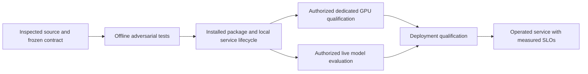

# Public harness evidence and local engineering decisions

Checked **2026-10-11**. AI-authored source review for the system readiness audit. These are public reports and design rationale, not access to private frontier-lab implementations or measurements of this project. Paid execution remains disabled.

| Primary source and publication date | Supported observation | Local decision and falsifying check |
|---|---|---|
| [Anthropic: effective long-running harnesses](https://www.anthropic.com/engineering/effective-harnesses-for-long-running-agents), 2025-11-26 | Session continuity needs explicit progress artifacts and incremental, verified work; compaction alone did not solve their task failures. | Preserve exact checkpoint/protocol evidence across owners. A valid restart must retain a load committed after the preceding request; a stale checkpoint must not erase later effects. |
| [Anthropic: application harness design](https://www.anthropic.com/engineering/harness-design-long-running-apps), 2026-03-24 | The report separates planner, generator and evaluator, with agreed sprint criteria. It also shows that context strategy depends on model behavior. | Freeze each bounded contract before implementation and use a separate reviewer. Do not copy one reported reset/compaction policy as a universal requirement or infer our model quality from it. |
| [Anthropic: agent evaluation](https://www.anthropic.com/engineering/demystifying-evals-for-ai-agents), 2026-01-09 | A transcript differs from the environment's actual final outcome. Code, model and human graders have different limits. | Keep external verification and full assigned-task denominators. Test actual outgoing mock request bytes and durable receipts, not only the controller's narrative. Local mocks measure harness behavior, not live task-solving capability. |
| [Cursor: scaling long-running coding](https://cursor.com/blog/scaling-agents), 2026-01-14 | Their experiments distinguish planning and bounded workers; additional coordination machinery sometimes became a bottleneck. | Parallelize disjoint audited slices under one integration owner. Retain the existing runtime and evaluator; add mechanisms only for identified failures. Static DAG support is a declared baseline, not dynamic replanning. |
| [Cursor/NVIDIA: GPU kernel optimization](https://cursor.com/blog/multi-agent-kernels), 2026-04-14 | The public experiment uses a planner/worker system and an external benchmark with correctness and anti-cheating checks on real GPU workloads. | Keep candidate output separate from trusted correctness/timing observation. Prepare one RMSNorm workload and device lifecycle first; reported speedups are not transferable measurements or our acceptance thresholds. |
| [Anthropic: context engineering](https://www.anthropic.com/engineering/effective-context-engineering-for-ai-agents), 2025-09-29 | Progressive retrieval, bounded context and persistent notes address different context problems. | Preserve our immutable catalog → receipt → accepted-request disclosure separation. A skill's instructions are data, and a summary cannot replace accounting or capability evidence. |

**VI:** Bài viết công khai cho ta giả thuyết thiết kế; code và thí nghiệm riêng mới cho evidence của hệ thống này. Không lấy con số benchmark của Cursor làm speedup của capstone, cũng không coi nhiều agent đồng ý là oracle độc lập. Bản spec phải chỉ ra một implementation sai cụ thể mà test sẽ bắt được.

## Readiness means different evidence at different boundaries

The arrow means a dependency, not automatic promotion. GPU correctness/timing requires actual supported hardware; coding quality requires a live model and frozen tasks; production serving additionally requires identity, containment, backup/reconciliation, load, rollback and operational evidence. CPU and mock checks can prepare those experiments and detect protocol defects. They cannot complete the hardware or operational gates.

**VI:** “Code đã sẵn để kiểm tra trên GPU” khác “GPU đã chạy đúng”, và cả hai khác “dịch vụ production đạt SLO”. Một báo cáo honest giữ các ô chưa đo là chưa đo, trong khi vẫn xây hết phần code đủ điều kiện ngay bây giờ.
