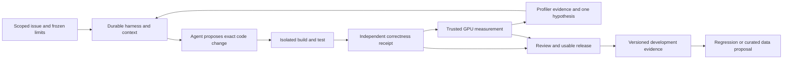

# NVIDIA coding tools role and project alignment

**Decision date: 10 October 2026.** Select **Senior Research Engineer — AI Coding Tools, JR2017020, advertised Level 6** as this project's NVIDIA target. It combines coding-agent research with the highest published base-pay ceiling among the closely related roles verified below. Keep the existing Anthropic Multi-Agent Scaling research contract and common production foundations. Add a bounded NVIDIA specialization to the same project, not a second curriculum.

The project strongly overlaps the technical subject matter. Neither its current implementation nor a completed capstone establishes near-100% job readiness: live adoption, research outcomes, long-term ownership and the advertised experience remain substantial evidence gaps. A percentage would obscure those differences. The canonical [role contract](../capstone/06-target-role-and-research-contract.md), [extension specification](../capstone/07-reference-implementation-spec.md#nvidia-coding-tools-specialization) and [coverage register](../capstone/08-implementation-coverage.md) own decisions, implementation requirements and status respectively.

**VI:** Chọn role này vì công việc thật sát coding agents và research, không phải vì đổi title sẽ làm portfolio mạnh hơn. Ta có thể xây evidence kỹ thuật tốt; không thể biến một project thành nhiều năm vận hành, ảnh hưởng tổ chức, hoặc bảo đảm tuyển dụng.

## Role selection and current availability

| Verified official listing | Annual US base pay in USD | Decision |
|---|---|---|
| [Senior Research Engineer — AI Coding Tools, JR2017020](https://jobs.nvidia.com/careers?query=JR2017020&pid=893394980530) | L5: 224,000–356,500; L6: 272,000–431,250 | Selected NVIDIA target: coding agents, code evaluation, developer tooling and applied research |
| [Lead Principal Engineer, Enterprise Agentic AI Platform, JR2013809](https://jobs.nvidia.com/careers/job?pid=893393699154) | 272,000–431,250 | Highest explicit title in the close shortlist; broader enterprise platform, Kubernetes and GPU inference obligations |
| [Principal Software Engineer — Agentic AI Applications and Foundations, JR2015726](https://jobs.nvidia.com/careers/job/893394426552) | 272,000–431,250 | Strong reliability overlap; additional full-stack/client lifecycle and enterprise deployment scope |

These are advertised base ranges, with equity and benefits additional; total compensation and offer level are unknown. This is a bounded comparison, not a ranking of every NVIDIA job or a labor-market demand estimate. All three list Santa Clara and full-time work. The selected team describes in-person collaboration; Vietnam/global-remote eligibility is not established. Preserve the actual Senior Research Engineer title rather than relabeling Level 6 as Principal.

**VI:** Ba role có cùng trần base salary đã thấy, nên chọn bằng nội dung công việc. Chuyển sang enterprise platform chỉ để có chữ Principal sẽ kéo thêm scope không phục vụ mục tiêu coding research hiện tại.

The live NVIDIA portal showed each vacancy, its full description and **Apply Now** on October 10. Exact search for JR2017020 returned one matching listing. Its application button redirected through Workday to corporate Careers: **listing confirmed; functioning application form unconfirmed**. Old Workday URLs also redirect. The postings' minimum acceptance dates—May 4, March 2 and June 12 respectively—are not proved closing dates. No publication date was exposed by the new portal; do not describe these as newly posted in October or guaranteed open later in 2026.

For JR2017020, the required background includes 12+ years of applied AI/ML with recent AI-for-code work, Python, LLM fine-tuning **or evaluation**, practical agent systems, rigorous evals and shipping to users. A degree **or equivalent experience** is accepted; advanced degrees are a plus. CUDA/profilers, synthetic data and public impact appear as differentiators. Actual duties include code-model specialization and data work, so the evaluation alternative does not erase the training responsibility. [Official role](https://jobs.nvidia.com/careers?query=JR2017020&pid=893394980530).

**VI:** “Or equivalent experience” cho phép nhiều con đường học, không có nghĩa bỏ yêu cầu kinh nghiệm. Đánh giá LLM có thể đáp ứng nhánh requirement được viết bằng “or”, nhưng chưa chứng minh em biết fine-tune model hay xây data pipeline chất lượng.

## The common system and the NVIDIA extension

The new causal connection is **agent proposal → compiled candidate → independently checked behavior → measured GPU execution → informed next proposal**. Profiling and retrieved documentation are evidence for the agent; neither can grant execution authority or issue acceptance. The same budget ledger, artifacts, isolation, verifier and evaluator remain responsible. Public benchmark calibration stays distinct from our existing 42 correlated synthetic definitions and later held-out confirmation.

**VI:** Model chỉ đề xuất patch. Compiler tạo binary; GPU chạy binary; verifier kiểm semantics; phép đo cho biết chi phí thực thi. Nếu mất identity ở bất kỳ mũi tên nào, ta có thể vô tình dùng kết quả của binary cũ để chứng minh patch mới.

## First principles and the exact skill evidence

The following decomposition is our engineering interpretation of the target, not NVIDIA's private interview rubric. Each skill starts with a constraint, then names the smallest demonstration that distinguishes understanding from terminology. Existing C1–C6 capabilities remain sufficient to organize it.

### Reliable agent execution

A language-model response describes a possible action. The host must decide whether the complete action has authority, fits remaining resources and has already happened. The essential objects are task identity, ownership epoch, logical action, dispatch attempt, external effect and durable receipt. Retries must distinguish the same action from a new attempt. Unknown effect and unknown billing are independent states.

Trace a 100-unit task: allocate 40 to an attempt; reserve 12 for a dispatch; lose the response; cancel authority; observe physical retirement; settle a trusted late bill of 9 exactly once. Cancellation must not erase the unresolved 12 before settlement. This connects distributed systems to real agent behavior. Existing [storage transitions](../service/storage.py#L648), H1–H4/H7/H11, C1/C2 and M1–M3 already cover the design. Automatic replacement/reconciliation and operated failure evidence still need completion. No new orchestration framework addresses that gap by itself.

**VI:** Crash làm knowledge khác với reality: file có thể đã đổi nhưng receipt chưa ghi. Kỹ năng cốt lõi là bảo toàn sự khác biệt này, thay vì coi retry là giải pháp cho mọi lỗi.

### Context and knowledge freshness

The next request is a finite projection of a larger history: `request = project(history, constraints, evidence, provider rules)`. Relevance, freshness, authority and token occupancy are different properties. A short summary can be stale or wrong; a cached prefix can be exact but irrelevant. A versioned CUDA API document can be correct for toolkit A and invalid for toolkit B.

Trace source revision → bounded chunk → retrieval result → activated skill → prompt digest → provider request → code/test outcome. Evaluate a missing API fact with and without one matched knowledge package; distinguish tool correctness from task improvement. H5/H6/H9 and the course-derived context/skills/LSP contracts already specify most boundaries. The current [projection](../service/context.py#L9) only bounds full history. The new piece is a small, version-bound developer-knowledge corpus and a same-budget intervention using those existing mechanisms. An embedding database is unnecessary until lexical retrieval fails on a defined case.

**VI:** RAG không phải “có vector DB”. Cốt lõi là đưa đúng fact của đúng version vào đúng quyết định và kiểm xem fact đó có giúp sửa code đúng không. Tài liệu được retrieve không tự trở thành lệnh có quyền cao hơn task.

### Tool interfaces and profiling evidence

A tool interface translates model intent into a bounded operation and an attributable observation. Schema validity is only the first condition: selected device, candidate digest, environment, deadline and output bounds must also match. MCP is a transport/interface choice; skills package instructions; the broker retains authority.

Use one narrow profiler interface backed by the existing supervisor. Nsight Systems helps localize timeline gaps; Nsight Compute investigates a selected kernel. Return a bounded structured summary plus an immutable raw artifact, bound to the exact binary and GPU. A report from another candidate or device is stale. Profiler failure returns unavailable, never zero time or a clean bill of health. H2/H3/H7/H9 own protocol, process lifetime and policy; H12/H13 own interpretation. No separate agent runtime is needed.

**VI:** Agent nhìn thấy “memory bound” chưa đủ. Nó phải biết report đo kernel nào, binary nào và GPU nào. Nếu profiler cần permission chưa có, phải ghi unavailable; không chạy privileged rồi coi quyền mới là chuyện kỹ thuật nhỏ.

### CUDA and numerical systems reasoning

First freeze function semantics: shapes, valid indices, dtype, accumulation precision, strides, aliasing, device and numerical tolerance. Then trace host dispatch → grid → thread block → warp/lane → global/shared/register data → result. For contiguous row-major `X[B,T,H]`, element `(b,t,h)` begins at byte offset `((b*T+t)*H+h)*element_size`; strided views require their actual strides. A kernel correct only for divisible dimensions has not implemented the full declared function.

For an explanatory planning bound, let `F` be operation count, `M` transferred bytes, `P` attainable operations/s and `W` attainable bytes/s. Under ideal overlap, `t >= max(F/P, M/W)` before launch and synchronization overhead. This is a lower-bound model, not a prediction from marketing peak throughput. Arithmetic intensity `F/M` has units operations/byte. Reducing bytes can help a memory-limited kernel; increasing occupancy alone need not help.

Existing [attention semantics](../compute/attention.py#L64), CPU tests and H12 already establish a strong reference. The [CUDA benchmark](../compute/cuda_benchmark.py#L70) compares eager and SDPA paths; it does not yet optimize an agent-produced CUDA implementation or identify actual warp behavior. Add one CUDA C++ target and one documented downstream consumer, selected after baseline profiling. Do not add a general compiler or a second inference engine.

**VI:** Tensor shape cho biết phép toán; stride cho biết địa chỉ thật; warp mapping cho biết phần cứng đọc các địa chỉ đó thế nào. C++/CUDA ở đây phục vụ một operator có consumer cụ thể, không mở một khóa systems language riêng chỉ để phủ keyword tuyển dụng.

### Evaluation and causal performance claims

Correctness is a prerequisite for useful speed. Define `V` as a trusted exact-candidate correctness result, `S=t_baseline/t_candidate` for the frozen timing boundary, and task acceptance under the existing deadline/review rule. Report V and S separately; S is not meaningful for a failed or invalid measurement. Across assignments retain failures, timeouts, unavailable hardware and unknown outcomes in their declared categories.

Use paired hardware runs with frozen shapes, resource policy and order control; separate profiler runs from unbiased timing because instrumentation can perturb execution. Block by GPU session and workload family. Repeated kernel timings estimate measurement variation, not independent task generalization. Include a deliberately fast-but-wrong kernel, stale binary, forged timing and missing trace as negative controls. H8/H13/H15 already specify controls, denominators, clustering and one-variable interventions; extend their result schema rather than inventing another evaluator.

**VI:** Ví dụ agent sửa kernel để luôn trả zero sẽ cực nhanh và có thể pass input zero. Oracle cần input phân biệt được; speedup chỉ được báo sau khi semantics đã pass. Nhiều timing của cùng một kernel không biến thành nhiều bài coding độc lập.

### Serving performance and end-to-end value

Total task time includes admission, model calls, tools, integration and verification, with overlap determined by the critical path. If an optimized component accounts for fraction `f` of original serial runtime and gains speedup `s`, unchanged surrounding work gives `S_total = 1/((1-f)+f/s)`. For synthetic `f=0.20`, `s=2`, total speedup is only `1/0.9 ≈ 1.11`. A twofold kernel speedup is not a twofold faster coding service.

H11/H13 and M6/M7 already cover arrival replay, queueing, cache residency, physical slots, deadlines, release and restore. The GPU addition measures the code being produced; self-hosted inference optimizes the model producing it. Those are separate questions. Keep API inference initially; adopt one self-hosted engine only for a measured serving hypothesis. More GPUs, Kubernetes or a vendor toolkit do not substitute for completing recovery and operating a bounded canary.

**VI:** Có hai performance loop: agent tạo code GPU tốt hơn, và service chạy agent nhanh hơn. Cần ghi rõ metric thuộc loop nào. Nếu phần lớn thời gian chờ test hoặc provider, tối ưu một kernel có thể không tác động nhiều đến thời gian giao patch.

### Data quality and model improvement

A successful trace is an observation under particular conditions, not automatically a training example. Before reuse, bind source permissions, task lineage, generator/model revision, input context, candidate, validation environment and split. Differentiate executable correctness, human acceptance and suitability for a learning objective. Deduplicate sibling tasks before splitting; never mine held-out confirmation failures and continue calling that set unseen.

H14 currently validates exact token/action masks and [offline objective arithmetic](../compute/trajectory.py#L27). The course audit adds failure-to-regression records. The missing bounded link is a reviewed data-promotion adapter: propose, quarantine, validate and freeze records from the same development runs. Include failures and rejection reasons; retain held-out assets outside exported training context. APIs without exact tokens/log probabilities cannot produce a valid on-policy RL record merely by re-tokenizing text. They may support a separately declared SFT format, with that transformation recorded.

A small fine-tuning study can follow only when data quality, rights, a model-improvement hypothesis, compute and a fresh evaluation set justify it. Compare against the untuned model with identical harness and knowledge access. Record a null result honestly. Until then **model specialization remains a role-responsibility gap**; do not claim that RAG or dataset curation completes it.

**VI:** Data pipeline tốt phải biết vì sao một sample được nhận hoặc loại. “Test pass” chưa đủ: code có thể dựa vào leaked test, sample có thể trùng họ với validation, hoặc trace không giữ action thật model đã sample. Training trước khi rõ các điều này chỉ khuếch đại lỗi.

### Shipping and senior technical ownership

A tool becomes a product when another person uses it under declared constraints and its owner resolves failures. Reuse M7's canary, restore/rollback runbook and independent reproduction. Add actual feedback-to-fix evidence: a user problem, alternatives considered, a chosen contract, an observed failure, a revision and a measured outcome. Huy must explain and defend the causal decision; AI authorship remains attributed.

The senior role requires demonstrated shipping; principal alternatives additionally call for sustained cross-team architecture and platform adoption. One reviewer or one demo is a beginning, not equivalent organizational scope. Preserve the real evidence as it accumulates. No lecture module can manufacture tenure, mentoring history or customer impact.

**VI:** Senior judgment nằm ở việc biết nên sửa gì, không nên xây gì, và chịu trách nhiệm khi quyết định sai. Portfolio cần cho người khác thấy tradeoff và hậu quả, không chỉ screenshot thành công.

## What is covered and what should change

| Area | Existing plan/source | Assessment and action |
|---|---|---|
| Durable authority, isolated tools, independent verification, bounded coordination | H1–H4/H7/H10/H11; service and integration evidence | Core design covered; source/operating gaps remain. Complete existing contracts |
| Context, skills, semantic code evidence, trace regressions | H5/H6/H8/H9; course extension contracts | Detailed design already present; extensions unimplemented. Reuse without duplication |
| GPU/inference concepts | H12/H13; CPU attention, KV/cache references, CUDA preflight | Fundamentals present; hardware and real consumer evidence absent |
| Agent-generated CUDA optimization | No end-to-end candidate-to-profiler-to-revision path | Add NV1 inside H12/H13/H15 and M2/M6; one bounded operator/workload |
| Current developer knowledge and profiler tools | Generic retrieval/skill/MCP scope, no pinned NVIDIA knowledge/profiler profile | Add NV2 to existing H6/H9 contracts; one knowledge package and one tool profile |
| Synthetic data validation and promotion | Workload controls, regression design, offline H14 trajectories | Add NV3 lineage/curation contract; training remains a later explicit decision |
| Held-out research and operated service | Already required by EV/OP/M6/M7 | Evidence gap, not a missing curriculum topic |
| Real-user adoption and independent reproduction | H15/M7 already require it | Perform and record honestly; no artificial principal-readiness score |

**VI:** “Covered” ở đây là contract hoặc cơ chế cụ thể đã có, không phải skill đã master. Chỉ NV1–NV3 cần refinement mới. Các khoảng trống khác chủ yếu là implementation hoặc evidence mà plan đã yêu cầu từ trước.

Current status must follow [coverage](../capstone/08-implementation-coverage.md) and dated verification records. October 9 local PostgreSQL/Docker/Temporal evidence and October 10 Nebius mock evidence are valuable but do not prove live quality or GPU speed. New [repository intake](../service/repositories.py#L290), [repair engine](../service/repair.py) and [Python verifier](../service/repair_verification.py#L268) source was present during inspection; its evolving validation belongs to the separate hackathon records. Do not overwrite that work or infer arbitrary CUDA support from the Python recipe. Human H0–H15 mastery remains unassessed.

## Minimal implementation and evidence sequence

1. Preserve the hackathon's required repair/access delivery and the existing production gaps. Correct stale planning language and keep one role contract.
2. Reuse the course-derived regression/evidence and immutable skill interfaces. Freeze NV2's corpus/tool identities and NV3's development-data lineage; prepare CPU/schema tests without claiming GPU results.
3. Freeze one NV1 workload, independent reference/negative controls, compatible GPU/toolchain, supervisor enforcement, costs and profiler permissions. Reuse the existing attention benchmark as a measurement reference, not as proof the new workload is supported.
4. Measure the baseline; let the coding agent attempt one profiler-supported change. Independently verify the exact candidate and repeat matched timing. Preserve unsupported/negative results.
5. Package the same result with a development regression, reviewed data proposal and independent-use feedback. A knowledge ablation changes only knowledge access; multiagent scaling changes only the declared coordination treatment. Do not combine all changes into one causal claim.
6. Consider a model-specialization or self-hosted-serving experiment only after an explicit hypothesis and evidence review. Remaining role gaps stay visible if these are deferred.

The existing 208–336-hour planning range is historical and does not price these additions. Estimate the selected implementation slice after workload/toolchain discovery; do not invent a deadline for mastery or hide GPU access costs in the old estimate. The initial portfolio claim is narrow: one coding harness, one performance task family, inspectable causal evidence. Broad CUDA expertise, production-scale platform ownership and general hiring readiness require further demonstrated work.

**VI:** “Ít scope” không có nghĩa làm nông. Một operator đi hết từ semantics, thread/memory mapping, tool permission, profiler, oracle tới user feedback đủ sâu hơn nhiều demo không có causal evidence.

## Primary engineering evidence behind the decisions

These sources were inspected on October 10. They support design choices, not local performance or reproduction claims.

| Primary source | Supported lesson and project decision |
|---|---|
| [NVIDIA ComputeEval at commit 00fbad91b63957a002b501f33a06510cd25beaae](https://github.com/NVIDIA/compute-eval/blob/00fbad91b63957a002b501f33a06510cd25beaae/README.md) | Separate correctness and performance workloads; compare against a baseline only after correctness. Its optimization mode exposes tests/full context, unlike generation mode. Preserve that distinction and keep our final oracle separate. Use as an inspected comparator or explicit public calibration, not a replacement evaluator or unseen benchmark claim |
| [NVIDIA NeMo Relay harness study, September 30, 2026](https://developer.nvidia.com/blog/tracing-agent-harness-behavior-with-nvidia-nemo-relay/) | Controlled repeated harness comparisons assess verified outcomes before interpreting calls, latency and cost. Reuse our evidence/receipt model; an exporter can be added only for a consumer need |
| [NVIDIA NeMo Agent Toolkit evaluation](https://docs.nvidia.com/nemo/agent-toolkit/latest/workflows/evaluate.html) | Effective configuration, per-sample outputs and traces make evaluations inspectable. We already own those concerns; no forced toolkit migration |
| [NVIDIA and Cursor kernel optimization report, April 14, 2026](https://prod.cursor.com/blog/multi-agent-kernels) | Profiler/benchmark feedback can guide iterative coding. Reported kernel gains and application gains differ; measure both. Their industrial results are not forecasts or proof of our coordination benefit |
| [NVIDIA Dynamo architecture](https://docs.dynamo.nvidia.com/dynamo/dev/knowledge-base/overview) | Distributed model inference and KV-state management are serving concerns. Keep this optional until the model-serving workload justifies it; it is separate from validating the GPU code our agent produces |

**VI:** Nguồn frontier giúp chọn mechanism cần kiểm chứng, không cho phép copy số performance vào project. Ta pin source khi có thể, ghi ngày kiểm tra cho docs động, và giữ rõ phần nào là proposal của mình.

The [verification record](nvidia-role-verification-2026-10-10.json) records source/status review and document checks. This change updates plans only. Separate ongoing hackathon code changes were preserved and are not validation results from this audit.
