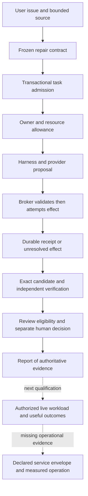

# H0 from foundational constraints to an operated service

Prepared **2026-10-11**. AI-authored companion to the [H0 runtime packet](H0-reference-runtime.md),
not a new module or completed human exercise. Purpose: explain why each agent-system boundary
exists and what evidence connects it to useful real-world service. The reusable
[systems foundation reference — local-only](../../docs/github-snapshot.md#omitted-local-evidence)
contains the primary research, assumptions and mathematical limits.

The central question is: **what must be true for a user's requested change to become a correct,
authorized, durable result within the declared resource and operational limits?** Work backward
to the constraints, then forward through code and observations. The current
[rc4 qualification](../../ops/runbooks/provider-qualification.md) is offline preparation;
live/paid/public/GPU execution remains disabled.

**VI:** Ta không bắt đầu bằng “chọn framework nào”. Bắt đầu bằng điều kiện để lời hứa với user
đúng. Mỗi component phải giữ một phần của lời hứa, và mỗi mũi tên cần object, owner và evidence cụ thể.

## One actual request path

The supported Python-function repair path is a CLI path. Its source allows a configured provider,
but the delivered examples and qualification evidence use mocks. The configured HTTP service is
a separate authored-fixture path sharing foundations; it does not invoke RepairEngine.

Dashed edges describe missing qualification or operational work, not currently implemented
connections or authorization. A failed or unresolved stage cannot borrow a later stage's status.

**VI:** Diagram đi tới production để thấy phần nào còn thiếu, không để giả vờ mọi ô đã nối thành
service thật. Report đẹp chưa chứng minh live repair, và mock qualification không cấp quyền chạy.

| Transition | Inspected code | Fundamental question and user consequence |
|---|---|---|
| Issue/source → contract | [RepairEngine.submit](../../service/repair.py#L68) | Which exact inputs, writable paths, limits and verifier define the requested task? Prevents silently changing the problem. |
| Contract → durable admission | [RuntimeStore.submit](../../service/storage.py#L424) | Which transaction decides identity, eligibility and optional pending limits? Prevents duplicate submission or admission races. |
| Task → current owner | [RuntimeStore.claim](../../service/storage.py#L551) | Who may act now, and which physical/budget capacity is occupied? A checkpoint alone cannot answer this. |
| Owner → model interaction | [Harness.run](../../service/harness.py#L186) | Which native request and durable dispatch produced this proposal? Preserves provenance and uncertainty across loss. |
| Proposal → external effect | [ToolBroker.execute](../../service/harness.py#L63), [Workspace.replace](../../service/execution.py#L79) | Is the call valid and authorized against the expected file state? A model message cannot bypass this boundary. |
| Candidate → independent check | [RepairEngine.run_task](../../service/repair.py#L198) | Did this exact tree pass this grader/environment? A previous passing tree cannot verify a changed tree. |
| Authority → readable result | [_build_report](../../service/repair_reporting.py#L112) | What is verified, pending review, spent, reserved or unknown? Reporting does not create acceptance. |
| Actual HTTP fixture execution | [_worker](../../service/offline_server.py#L321) | One serial dispatcher executes ReferenceEngine, not the repair CLI. Useful for the declared offline profile. |
| Local readiness | [OfflineService.readiness](../../service/offline_server.py#L226) | Which local dependencies are ready? Production measurement and live inference remain separately marked. |
| Offline provider preparation | [run_qualification](../../service/qualification.py#L486) | Two native mock requests check the existing protocol/ledger; handoff remains advisory. |

**VI:** Luôn tách “đúng cú pháp”, “được phép”, “đã xảy ra”, “đúng kết quả” và “đã được chấp nhận”.
Đây là các câu hỏi khác nhau. Hash nối evidence với bytes; hash không chứng minh bytes giải đúng bài toán.

## Derive the crash rule rather than memorizing it

Consider the same local observation: a durable dispatch exists, then the client times out without
a trusted receipt. History A: the remote system never applied the action. History B: it applied
the action but the reply was lost. Both histories fit that observation. Therefore the observation
alone cannot establish whether repeating the action is harmless. We need an additional mechanism:
a queryable effect identity, a correctly scoped remote idempotency contract, or reconciliation.
[AWS retry analysis](https://aws.amazon.com/builders-library/timeouts-retries-and-backoff-with-jitter/).

The local design preserves Unknown rather than inventing a known result. Cancellation changes
authority; confirmed retirement changes physical occupancy; a trusted billing receipt changes
financial knowledge. Automatic eventual progress needs additional recovery mechanisms and
assumptions. Safety and progress should be argued separately.

**VI:** Ví dụ chuyển khoản bị mất reply: chưa thấy biên lai không có nghĩa tiền chưa chuyển.
Analogy giải thích thiếu thông tin; khi quay lại code phải chỉ đúng dispatch ID, effect identity,
transaction và receipt. Không dùng cảm giác tự tin của model để lấp chỗ evidence đang thiếu.

## Derive queueing from a complete tiny trace

This is a **constructed scheduling example**, not a measurement of the reference or a model.
One worker, FIFO, no preemption, fixed service time 2 seconds, no failures or overhead. Three
jobs arrive at times 0, 1 and 1; ties put B before C.

| Job | Arrival s | Start s | Finish s | Queue wait s | Total time s |
|---|---:|---:|---:|---:|---:|
| A | 0 | 0 | 2 | 0 | 2 |
| B | 1 | 2 | 4 | 1 | 3 |
| C | 1 | 4 | 6 | 3 | 5 |

The system population includes waiting and executing jobs. Its complete timeline is:
`[0,1): 1`, `[1,2): 3`, `[2,4): 2`, `[4,6): 1`.
Area under population is `1*1 + 3*1 + 2*2 + 1*2 = 10 job-seconds`.
Thus average population is `10/6 = 5/3 jobs`, mean total time is `(2+3+5)/3 = 10/3 s`,
and observed arrivals per second are `3/6 = 1/2 jobs/s`.
Their product is `(1/2)*(10/3) = 5/3 jobs`.

This finite-window equality works because all three complete lifetimes are contained and the
system is empty before the first arrival and after the final departure. An arbitrary production
window can cut lifetimes and needs boundary treatment; the example is not a stationarity claim.
[Little's law and finite windows](https://www.columbia.edu/~ww2040/4615S15/LittlesLawNotes012715.pdf).

**VI:** C chỉ cần 2 giây xử lý nhưng user chờ 5 giây vì có 3 giây queue. Tăng giới hạn queue cho
thêm chỗ chờ, không giảm service time. Tăng worker cũng cần kiểm tra xem họ có tranh cùng GPU,
database hoặc rate limit không; concurrency không tự tạo ra tài nguyên.

For the actual service, pending-task caps count queued/running tasks and are configured for the
offline profile; generic RuntimeStore use does not automatically enable them. Queue occupancy,
physical slots and unresolved billing are different accounts. Canceling a task can remove it
from one population while its process or liability still occupies another. A load test must
measure the named population, rejected work, useful completions, tails and recovery.

## Connect model internals only where the workload requires them

For API inference, observe the request, provider response, tool loop, verification and overall
task time; do not pretend remote kernel/KV activity was inspected. For a selected self-hosted
model, extend the trace through tokenization, prefill/decode, batching, KV storage and kernels.
The [existing RMSNorm example](../../research/mentoring-operating-model-2026-10-11.md#exact-trace-b--from-one-tensor-row-to-a-performance-decision)
demonstrates numerical semantics; the foundation reference adds explicit byte and bandwidth models.

Measure time to first token and inter-token latency where streaming observation supports them,
and separately measure end-to-end task completion. Nonstreaming responses do not reveal token
arrival timing. The [versioned NVIDIA metrics catalog](https://docs.nvidia.com/dynamo/v1.5.0/reference/observability/metrics-catalog)
is a serving reference, not a new dependency in this project.

**VI:** Không ép mọi bài H0 thành bài tensor. Ownership và retry cần state trace; kernel cần
tensor/memory trace. Khi hai tầng gặp nhau, chỉ đúng interface và phần latency/resource mà user chịu.

## The next production proof

An operated-service claim requires evidence for its declared workload: useful verified outcomes,
cost/latency bounds, authentication and isolation, admission under overload, unresolved-effect
handling, restore/recovery, telemetry, rollout/rollback and accountable operation. A health check
alone does not establish these properties. Select targets from user needs and measure an explicit
population/window before deciding corrective actions.
[Google SRE objectives](https://sre.google/sre-book/service-level-objectives/).

Current declared gaps are maintained in [current state](../../context/current-state.md) and
[coverage](../../capstone/08-implementation-coverage.md), not reclassified as completed by this
packet. Offline qualification is delivered; a live conformance executor, actual model outcomes,
public repair serving and operational evidence remain separate work. H0 still needs Huy's own
prediction and transfer; no production or mastery gate is passed here.

**VI:** Bài tiếp theo của em là đổi một điều kiện rồi dự đoán: mất receipt sau edit, cancel khi
process còn sống, hoặc thêm job vào trace FIFO. Ghi reasoning trước khi xem lời giải. Các agent
vẫn có thể làm phần engineering được phép; hai loại evidence hỗ trợ nhau nhưng không thay nhau.
